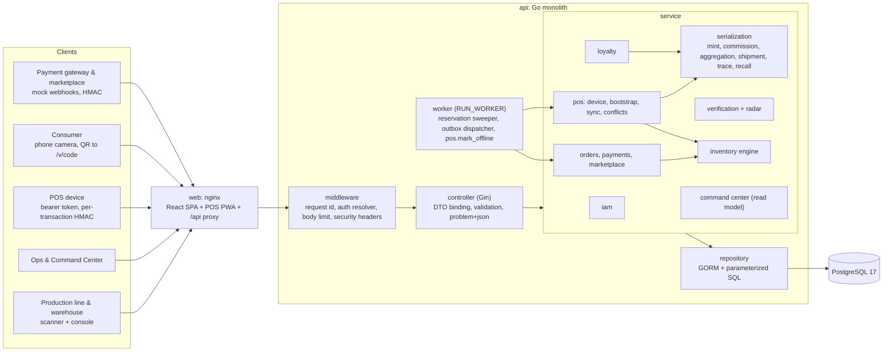
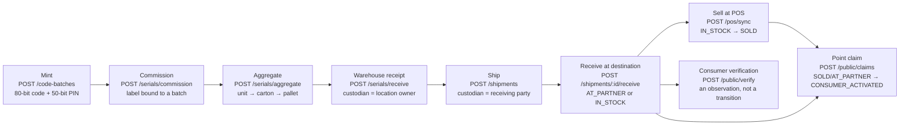
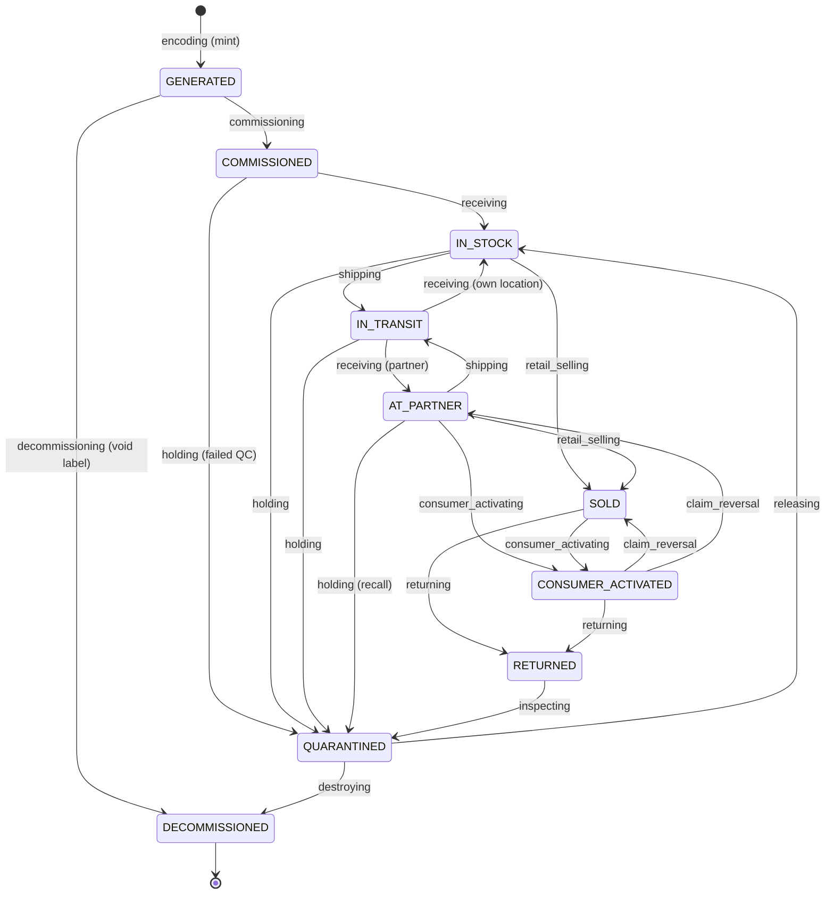
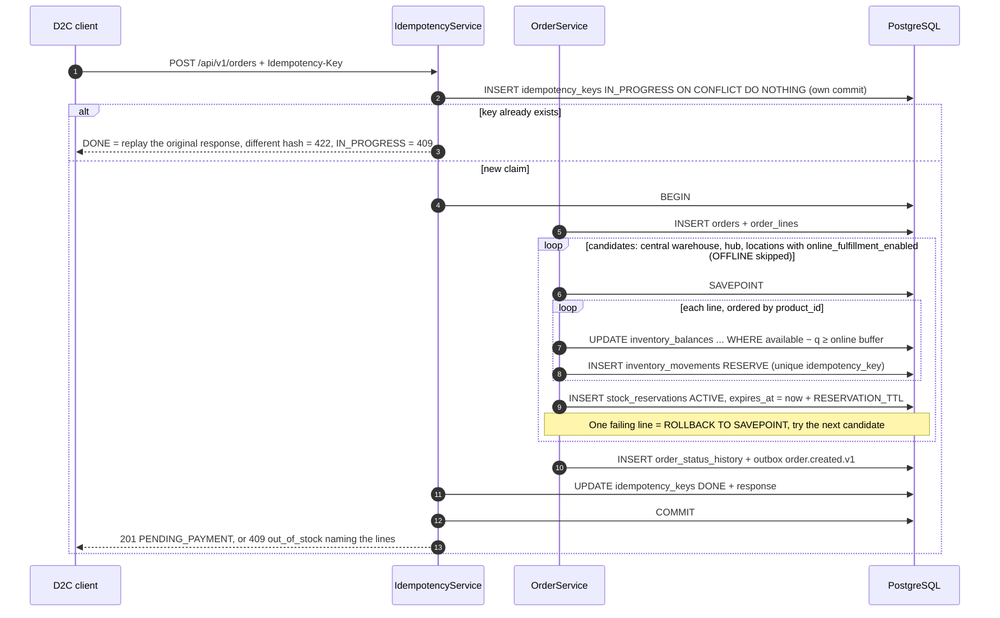
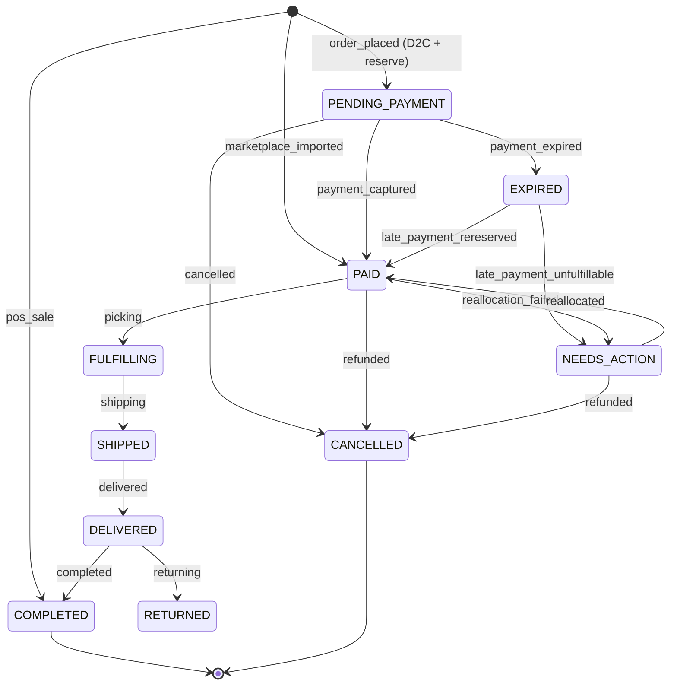
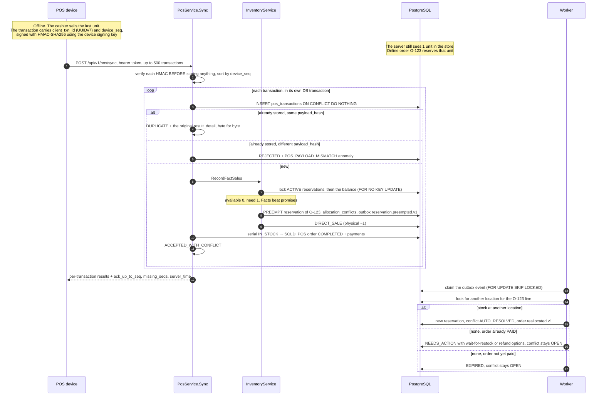
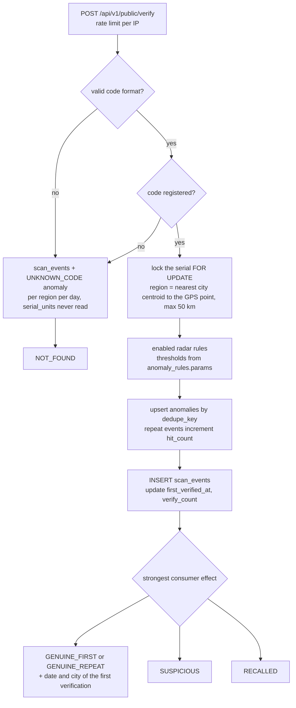
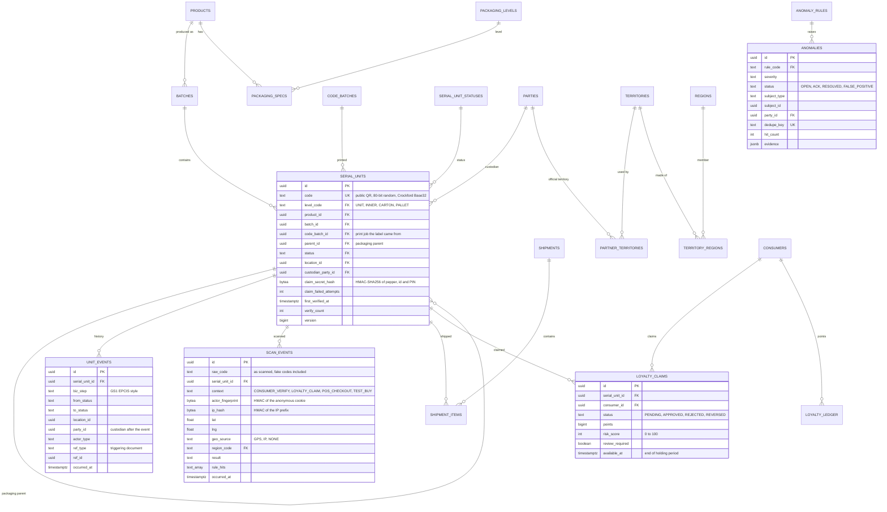
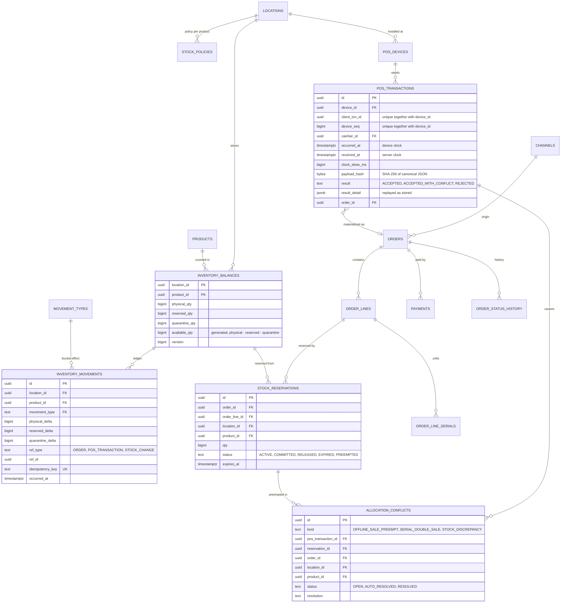

# Architecture

This document describes how the mGanik Omnichannel & Traceability prototype is built: its
components, data flows, database schema, concurrency strategy, technology choices, security, and
limits. Every mechanism described here points to code and tests in this repository. Anything not
yet built is listed under [§9 Prototype limitations](#9-prototype-limitations), not presented as a
feature.

The business reasoning behind the four operational cases lives in
[`PRODUCT_DEFENSE.md`](PRODUCT_DEFENSE.md).

## Contents

1. [Context](#1-context)
2. [Components](#2-components)
3. [Key data flows](#3-key-data-flows)
4. [Database schema](#4-database-schema)
5. [Concurrency and integrity strategy](#5-concurrency-and-integrity-strategy)
6. [Technology choices](#6-technology-choices)
7. [Security](#7-security)
8. [Cross-module data conventions](#8-cross-module-data-conventions)
9. [Prototype limitations](#9-prototype-limitations)
10. [Scaling path](#10-scaling-path)

---

## 1. Context

mGanik sells consumer goods through many channels at once: its own stores (POS), a D2C website,
marketplaces, regional distributors, and third-party modern retail. The system brings four
pillars together:

| Pillar | Question it answers | Main modules |
|---|---|---|
| A. Production to consumer, hologram | Is this unit genuine? Which batch, carton, pallet, and shipment did it come from? Who holds it now? | serialization, verification + radar, loyalty |
| B. Omnichannel orders and stock | How much stock can each channel promise without overselling? | inventory, orders, payments, marketplace |
| C. Offline-first POS | How do cashiers keep selling when the internet is down, and what happens when the data arrives? | pos |
| D. Supply Chain Command Center | Which stock will run out, which distributor is leaking, which conflicts are still open? | commandcenter |

**Actors**

| Actor | Access | Authentication |
|---|---|---|
| Production operators, warehouse staff, store managers, ops, analysts | Staff API (console) | Email + password, `__Host-session` cookie |
| POS devices in own stores | `/api/v1/pos/*` | Device bearer token + per-transaction HMAC |
| Consumers | `/api/v1/public/*` | Anonymous for verification; phone OTP for loyalty claims |
| Payment gateway, marketplaces | Webhooks | HMAC signature + timestamp |

**Prototype status.** The Go backend runs all three required flows (serial verification with
anti-fraud logic, stock allocation with concurrency protection, offline POS transaction sync)
plus the Command Center read model, all tested against a real PostgreSQL. The React frontend
covers the offline-first cashier PWA (`/pos`), the staff console (`/console`) and consumer
verification (`/v/:code`); remaining gaps are in [§9](#9-prototype-limitations).

**Design principles**

1. **The database is the last line of defense.** Logic lives in services, but critical
   invariants (stock never negative, one active claim per unit, each POS transaction processed
   once) are enforced with CHECK, UNIQUE, FK, and triggers. An application bug cannot silently
   corrupt data.
2. **Facts beat promises.** Physical events that already happened (an offline cashier sale, a
   consumer scan) are always recorded. An online order reservation is a promise that can be
   renegotiated.
3. **Append-only ledgers, balances as projections.** `inventory_movements`, `unit_events`,
   `scan_events`, `loyalty_ledger`, `order_status_history`, and `audit_logs` reject UPDATE,
   DELETE, and TRUNCATE. Balance and status tables are auditable projections.
4. **Idempotent at every retryable boundary:** data-creating POSTs, webhooks, POS sync, outbox
   handlers, worker jobs.
5. **Business rules as data.** Status transitions, stock movement effects, packaging levels, and
   anomaly rule thresholds live in lookup tables.
6. **Modular monolith.** One binary, clearly bounded modules, cross-module side effects through
   an outbox. Ready to split when scale demands it, without paying the operational cost of
   microservices today.

---

## 2. Components



### 2.1 Modules

| Module | Code | Owns tables | Responsibility |
|---|---|---|---|
| iam | `service/auth_*.go`, `consumer_service.go` | `users`, `sessions`, `roles`, `permissions`, `role_permissions`, `user_roles`, `user_role_locations`, `consumers`, `consumer_sessions`, `otp_challenges` | Staff login, sessions, RBAC with location scope, consumer OTP |
| catalog & locations | migration `00003` | `brands`, `products`, `packaging_levels`, `packaging_specs`, `price_lists`, `price_list_items`, `locations`, `location_types`, `parties`, `party_roles`, `regions`, `territories`, `territory_regions`, `partner_territories`, `channels` | Master data (filled by the seed; no CRUD endpoints yet) |
| serialization | `service/serial_*.go`, `shipment_service.go` | `code_batches`, `batches`, `serial_units`, `serial_unit_statuses`, `lifecycle_transitions`, `unit_events`, `shipments`, `shipment_items` | Code minting, commissioning, packing/unpacking, receiving, shipping, trace, recall |
| verification + radar | `service/verify_service.go`, `radar_service.go` | `scan_events`, `anomaly_rules`, `anomalies` | Public endpoint, scan recording, radar rules, anomaly deduplication |
| loyalty | `service/loyalty_service.go` | `loyalty_claims`, `loyalty_ledger` | PIN-based point claims, risk scoring, holding period, staff review |
| inventory | `service/inventory_service.go` | `inventory_balances`, `inventory_movements`, `movement_types`, `stock_policies` | Generic movement engine, fact sales, adjustments, quarantine |
| orders | `service/order_service.go`, `payment_service.go`, `marketplace_service.go` | `orders`, `order_lines`, `order_line_serials`, `order_status_history`, `order_statuses`, `payments`, `stock_reservations` | Omnichannel order lifecycle, payment webhook, marketplace import |
| pos | `service/pos_*.go` | `pos_devices`, `pos_transactions`, `allocation_conflicts` | Provisioning, offline bootstrap data, heartbeat, idempotent sync, conflict resolution |
| commandcenter | `service/commandcenter_service.go` | (read-only) | Summary, stock, runout/DOI, anomaly and conflict queues, leakage index |
| platform | `service/idempotency_service.go`, `worker/` | `outbox_events`, `idempotency_keys`, `audit_logs` | Cross-module infrastructure |

All code paths are relative to `apps/api/internal/`.

### 2.2 Layering

Dependencies point one way: `router → controller → service → repository → model`.

| Package | Responsibility | Rules |
|---|---|---|
| `router` | Gin engine, middleware, manual dependency wiring | One file per domain (`routes_*.go`) |
| `controller` | DTO binding, boundary validation, call the service, write the response | Never touches the database; GORM models are never bound from a request |
| `service` | Use cases, transaction boundaries, business rules, per-object authorization | One use case is one transaction. All services share one package, so `PosService` can call `InventoryService` without an import cycle |
| `repository` | GORM queries and parameterized raw SQL | Receives `*gorm.DB` (the transaction) from the service; knows nothing about HTTP |
| `domain` | Pure rules with no database: serial state machine, radar rules, haversine, online ATP, canonical POS JSON | Unit-tested without a database |
| `apperror` | Domain errors → `application/problem+json` (RFC 9457) | Stable error codes (`out_of_stock`, `invalid_transition`, ...) |

### 2.3 How modules talk to each other

- **When the result is needed in the same transaction**, a service calls another module's
  service with the caller's `*gorm.DB` transaction. Example: POS sync calls
  `InventoryService.RecordFactSales` and `SerialService.SellSerials` in one transaction, so the
  stock deduction and the serial status change commit or roll back together.
- **When a side effect can happen later**, the writer inserts into `outbox_events` in the same
  transaction as the data change. The worker claims events with `FOR UPDATE SKIP LOCKED` and runs
  the handler in the same transaction that sets `published_at`, so the handler's database effect
  happens exactly once. Failures back off exponentially; after `OUTBOX_MAX_ATTEMPTS` (default 10)
  the event is marked `dead_at`. The only handler today is `reservation.preempted.v1` (order
  reallocation after a POS sale). Events without a handler count as published; in production they
  would be forwarded to a broker. There is no dual write to a message broker.

### 2.4 Runtime

`docker compose up --build` starts, in order:

| Service | What it does |
|---|---|
| `db` | `postgres:17-alpine` with a healthcheck |
| `migrate` | `api migrate --seed`: embedded goose migrations, then the idempotent demo seed, then exits |
| `api` | `api serve`: HTTP plus the worker in the same process (`RUN_WORKER=true`) |
| `web` | nginx: SPA build + proxy for `/api` and `/healthz`; the only trusted proxy for `X-Forwarded-For` |

The worker ticks every `WORKER_INTERVAL` (default 2 seconds): the expired-order sweeper, the
registered jobs (`pos.mark_offline`), then the outbox dispatcher. Every work claim uses
`SKIP LOCKED`, so several worker instances can run safely.

---

## 3. Key data flows

### 3.1 Serial lifecycle: from the production line to the consumer



Every step that changes status writes one `unit_events` row per unit (GS1 EPCIS style:
`biz_step`, location, party, actor, triggering document). Shipping and receiving process the
whole packaging tree in **one statement**: a recursive CTE finds every descendant of the pallet,
`UPDATE ... FROM` changes status, location, and custodian, and `INSERT ... SELECT` writes one
event per unit (`repository/serial_repository.go`, `BulkTransition`). Thousands of units under a
pallet are never processed in a per-row loop.

The serial state machine is stored in `lifecycle_transitions` (migrations `00010` and `00012`)
and loaded into `domain.Lifecycle`:



Notes:

- **A verification scan is not a transition.** It is an observation stored in `scan_events`; the
  only `serial_units` columns it touches are `first_verified_at`, `first_verified_region_code`,
  and `verify_count`.
- **Recall works at batch level.** `POST /batches/:id/recall` marks the batch `RECALLED` and moves
  every unit still in the supply chain to `QUARANTINED` in bulk. Units already with consumers
  (`SOLD`, `CONSUMER_ACTIVATED`) keep their status; verification answers `RECALLED` based on the
  batch status.
- **`claim_reversal`** returns a unit to its pre-activation status when its point claim is
  rejected or reversed, so the unit is covered again by recalls, partner sales reports, and
  returns.

### 3.2 Stock reservation for an online order



- An order is allocated **all-or-nothing at a single location**. Online ATP for a store is
  `available − online_buffer_qty`, and 0 when `locations.sync_state = OFFLINE`
  (`domain.OnlineATP`).
- The payment webhook (`POST /webhooks/payments/mock`) locks the order, then moves it
  `PENDING_PAYMENT → PAID` conditionally. A late payment after `EXPIRED` tries to reserve stock
  again: success → `PAID`, failure → `NEEDS_ACTION` plus a refund request. An order is never
  `PAID` without stock.
- The sweeper releases reservations of `PENDING_PAYMENT` orders past their payment deadline, one
  order per transaction, claimed with `FOR NO KEY UPDATE SKIP LOCKED`.
- Marketplace import (`POST /channels/marketplace/orders`) records orders that are already paid.
  It deduplicates on `(channel_code, external_ref)`; if stock is short, the order is still created
  and moved to `NEEDS_ACTION`, because it already exists on the marketplace.

Order state machine (`lifecycle_transitions`, `entity_type = 'ORDER'`):



The transitions `SHIPPED → DELIVERED → COMPLETED/RETURNED` and `NEEDS_ACTION → PAID` exist as
data, but no endpoint triggers them yet.

### 3.3 Offline POS sync and conflicts with online orders (Case 4)



Details that matter:

- **The signature is checked before an idempotency slot is claimed.** A transaction with a bad
  signature is not stored and occupies neither `(device_id, client_txn_id)` nor
  `(device_id, device_seq)`. Someone who stole the device token but not the signing key cannot
  squat the next sequence number and get genuine sales rejected (`TestQA_SeqSquatting`).
- **Preemption order:** reservations of the newest `PENDING_PAYMENT` orders first, then the newest
  `PAID` orders. Within a group, the smallest reservation that covers the shortfall goes first, so
  as few customers as possible are affected (`invPickPreempt`).
- **When physical stock is short too** (an unrecorded receipt, a stock-count discrepancy), the
  server records `ADJUST_DISCREPANCY`, a `STOCK_DISCREPANCY` conflict, and an anomaly, and still
  records the `DIRECT_SALE`. A sale that already happened is never rejected because of stock or
  serials. The only rejections are a bad signature, a malformed payload, a cashier without
  permission at that location, or a product missing from the catalog.
- **Problem serials never cancel a sale.** An unregistered serial raises a
  `POS_UNREGISTERED_SERIAL` anomaly (a sign of counterfeit goods in the store). A registered serial
  in a contradictory state (already sold, wrong location) becomes a `SERIAL_DOUBLE_SALE` conflict.
- **The device clock is not trusted for decisions.** The device `occurred_at` is stored as sent;
  the ledger and the order use the batch's skew-corrected time. The flags `CLOCK_SKEW`,
  `FUTURE_TIMESTAMP`, `OFFLINE_TOO_LONG` (over 24 hours), `PRICE_STALE`, `PRICE_MISMATCH`,
  `HIGH_DISCOUNT`, `OFFLINE_VALUE_LIMIT`, and `CASHIER_INACTIVE` are stored in `result_detail` for
  review.
- **Heartbeat.** `POST /pos/heartbeat` marks the location `ONLINE`. The `pos.mark_offline` job
  marks a location `OFFLINE` after more than `POS_HEARTBEAT_TIMEOUT` (default 2 minutes) without a
  heartbeat, which drops that store's online ATP to 0 immediately.

### 3.4 Consumer verification and the anti-counterfeit radar



| Rule | Condition | Effect on the consumer |
|---|---|---|
| `UNKNOWN_CODE` | Code does not exist (or is malformed) | `NOT_FOUND`; aggregated per region per day as a counterfeit hotspot |
| `NON_SELLABLE_SCAN` | Unit is `GENERATED`/`COMMISSIONED`/`DECOMMISSIONED`, or `IN_STOCK` at the central warehouse and never shipped | `SUSPICIOUS` |
| `IMPOSSIBLE_TRAVEL` | Distance to the previous located scan ÷ time difference > 900 km/h, with a minimum distance of 100 km (GPS) or 500 km (either point from IP) | `SUSPICIOUS` only when the two scans come from different devices; same device → internal anomaly only |
| `SCAN_VELOCITY` | More than 5 distinct fingerprints **and** more than 5 distinct IP prefixes within 24 hours | `SUSPICIOUS` |
| `OUT_OF_TERRITORY` | Scan region outside the custodian's coverage (`coverage_mode = SELECTED`) | None: the consumer still sees `GENUINE_*`; the anomaly is for the internal team |
| `BATCH_RECALLED` | Batch is `RECALLED` | `RECALLED` (wins over `SUSPICIOUS`) |

Two anti-griefing trade-offs are documented in the code (`service/radar_service.go`). GPS and the
anonymous cookie are client-controlled, so a single person faking GPS or clearing cookies over and
over must not be able to make a genuine unit show `SUSPICIOUS`. The consequence: a clone scanned
from the same device as the previous scan, or from behind one NAT, does not trigger `SUSPICIOUS`;
its anomaly still lands in the review queue.

---

## 4. Database schema

There are 15 goose migrations in `apps/api/migrations/`, embedded in the binary. The schema is
hand-written SQL, not `AutoMigrate`, because it needs partial unique indexes, named CHECK
constraints, generated columns, and triggers.

| Migration | Contents |
|---|---|
| `00001_bootstrap` | `forbid_mutation()` function for append-only tables |
| `00002_platform` | `outbox_events`, `idempotency_keys`, `audit_logs` |
| `00003_catalog_locations` | Packaging, channel, location type, and party role lookups; catalog; regions; parties; locations; distributor territories; prices |
| `00004_iam` | Users, sessions, RBAC with location scope, consumers |
| `00005_serialization` | Print jobs, batches, serial statuses, `lifecycle_transitions`, `serial_units`, `unit_events`, shipments |
| `00006_inventory` | `movement_types`, `inventory_balances`, `inventory_movements`, `stock_policies` |
| `00007_orders` | Order statuses, orders, lines, sold serials, history, payments, reservations |
| `00008_pos` | Devices, POS transactions, allocation conflicts |
| `00009_authenticity_loyalty` | `scan_events`, `anomaly_rules`, `anomalies`, `loyalty_claims`, `loyalty_ledger` |
| `00010_lookup_data` | Reference data required in every environment: statuses, transitions, movement types, RBAC, radar rules |
| `00011` – `00015` | Consumer sessions + OTP, serialization additions, stock/outbox indexes, Command Center indexes, POS additions |

### 4.1 ERD: traceability, radar, loyalty



### 4.2 ERD: stock, orders, POS



### 4.3 Adaptive schema patterns: business rules as data

Statuses and rules that can grow live in lookup tables (`text` + FK), not PostgreSQL `ENUM`
types (`TestSchema_NoEnumTypes` asserts there are none). Technical statuses that only change
together with code (reservation, outbox, idempotency) use `text` + CHECK.

| Pattern | Implementation | Business change handled with data only |
|---|---|---|
| **Transitions as data** | `lifecycle_transitions (entity_type, from_code, to_code, biz_step, permission)`. Serials: `domain.Lifecycle` is built from this table and used as `WHERE status = ANY(allowed_from)`. Orders: `UPDATE ... WHERE EXISTS (SELECT 1 FROM lifecycle_transitions ...)`. The `lifecycle_transitions_codes_exist` trigger ensures the status codes exist | A new flow (for example free samples for KOLs: `IN_STOCK → SAMPLED`) = `INSERT` a status, a transition, and a permission |
| **Movement types define their effect** | `movement_types (physical_sign, reserved_sign, quarantine_sign, is_promise, allow_either_sign)`. Balances change through a single `UPDATE ... FROM movement_types`; the `check_movement_effect` trigger rejects ledger rows whose deltas do not match their type | "Consignment" or "bonus goods" = one row; the stock engine does not change |
| **Generic packaging hierarchy** | `serial_units.parent_id` + `packaging_levels.rank` + `packaging_specs (qty_per_parent, allow_mixed_batch)`. The `serial_parent_level_higher` trigger rejects a parent whose rank is ≤ the child's | The `INNER` level already exists; a "display box" = one level row + a spec |
| **EPCIS-style event log** | `unit_events (biz_step, from/to_status, location, party, actor, ref_type/ref_id, payload)` | A new supply chain step = a new `biz_step`, not a new table |
| **Anomaly rules as data** | `anomaly_rules (enabled, severity, consumer_effect, params jsonb)`. Radar thresholds and claim risk weights are read from `params` | Change the impossible-travel threshold or disable a rule without a deploy |
| **Party–role** | `parties` + `party_roles (valid_from, valid_to)` | A new partner type (reseller, agent) = a new role |
| **Typed, hierarchical locations** | `locations (type_code, parent_id, party_id, region_code)` | Dark stores, marketplace warehouses, consignment counters |
| **Polymorphic references** | `(ref_type, ref_id)` on ledgers and events | New documents (B2B returns, stock counts) without changing the ledger |
| **Explicit scope modes** | `user_roles.scope_mode` (`ALL`/`SELECTED`), `partner_territories.coverage_mode` (`NATIONAL`/`SELECTED`), with consistency CHECKs | "All locations" or "nationwide" is never inferred from an empty child table (`TestInvariant_ExplicitScopeModes`) |
| **JSONB for long-tail attributes** | `products.attributes`, `parties.attributes`, `serial_units.attributes`, `orders.metadata` | New attributes (BPOM registration, halal) right away; promoted to columns once they are filtered often |
| **Versioned event payloads** | CHECK `outbox_event_type_versioned`: `<aggregate>.<event>.v<N>` | Old consumers keep working when an event schema changes |

The honest limit: the status metadata columns (`serial_unit_statuses.is_sellable`, `is_terminal`,
`consumer_message_key`, `order_statuses.holds_stock`) are stored, but the code does not read them
yet. Gates that name specific statuses (point claims only for `SOLD`/`AT_PARTNER`, POS sales only
from `IN_STOCK`) are still constants in code, so adding a status that must behave like an existing
one at those gates still needs a code change. The serial state machine is cached on first load;
transition changes in the database take effect after a restart.

### 4.4 Schema conventions

- `uuid` primary keys (UUIDv7 generated by the application: time-ordered, and creatable on a
  device while offline). Times are `timestamptz`, stored and sent in UTC. Money is `bigint` whole
  rupiah, never float.
- Constraints are named (`no_oversell`, `one_active_claim_per_unit`, `pos_txn_once`, ...) and
  mapped to domain errors (`invMapStockError`, `mapSerialConstraint`).
  `TestSchema_NamedConstraints` guards this.
- Ledger and event tables are append-only through `BEFORE UPDATE OR DELETE` and
  `BEFORE TRUNCATE` triggers (`TestSchema_AppendOnlyTriggers`).
- No foreign key points into an event table (`TestSchema_NoForeignKeysIntoEventTables`), so
  `unit_events` and `scan_events` can be partitioned monthly. That is why
  `loyalty_claims.scan_event_id` deliberately has no FK.
- Master data uses `archived_at` with partial unique indexes `WHERE archived_at IS NULL`.
  Transactional data is never deleted.
- A `version bigint` column is incremented on every update of rows that are edited concurrently.

### 4.5 Critical tables

The stock balance has three physical buckets, a computed ATP, and overselling blocked in the
database (`migrations/00006_inventory.sql`):

```sql
CREATE TABLE inventory_balances (
  location_id    uuid   NOT NULL REFERENCES locations (id),
  product_id     uuid   NOT NULL REFERENCES products (id),
  physical_qty   bigint NOT NULL DEFAULT 0,
  reserved_qty   bigint NOT NULL DEFAULT 0,
  quarantine_qty bigint NOT NULL DEFAULT 0,
  available_qty  bigint GENERATED ALWAYS AS (physical_qty - reserved_qty - quarantine_qty) STORED,
  version        bigint NOT NULL DEFAULT 0,
  PRIMARY KEY (location_id, product_id),
  CONSTRAINT physical_nonneg   CHECK (physical_qty >= 0),
  CONSTRAINT reserved_nonneg   CHECK (reserved_qty >= 0),
  CONSTRAINT quarantine_nonneg CHECK (quarantine_qty >= 0),
  CONSTRAINT no_oversell       CHECK (physical_qty - reserved_qty - quarantine_qty >= 0)
);
```

Every movement changes the balance in one statement that reads its effect from `movement_types`
(`repository/inventory_repository.go`, `ApplyBalanceEffect`, simplified):

```sql
UPDATE inventory_balances b
   SET physical_qty   = b.physical_qty   + mt.physical_sign   * @qty,
       reserved_qty   = b.reserved_qty   + mt.reserved_sign   * @qty,
       quarantine_qty = b.quarantine_qty + mt.quarantine_sign * @qty,
       version        = b.version + 1
  FROM movement_types mt
 WHERE mt.code = @type
   AND b.location_id = @loc AND b.product_id = @prod
   -- promise types (RESERVE): available after the movement must not drop below the online buffer
   AND (NOT mt.is_promise
        OR (b.physical_qty - b.reserved_qty - b.quarantine_qty)
           + (mt.physical_sign - mt.reserved_sign - mt.quarantine_sign) * @qty >= @keep)
RETURNING ...;
```

In the real code every operand is `CAST` to `bigint`; without that, Postgres infers the
parameter type from the `smallint` sign columns and a quantity above 32,767 overflows
(`TestApplyMovement_LargeQtyNoSmallintOverflow`). The ledger row is written in the same
transaction with `ON CONFLICT ON CONSTRAINT movement_idempotent DO NOTHING`.

---

## 5. Concurrency and integrity strategy

Every transaction runs at READ COMMITTED. There is no SERIALIZABLE isolation and no Redis lock.

| Problem | Mechanism | Proof (test) |
|---|---|---|
| **Overselling during an order spike** | Conditional atomic update: `UPDATE ... WHERE available − q ≥ buffer`, then check `RowsAffected`. At READ COMMITTED, Postgres waits for the row lock and then re-evaluates `WHERE` against the latest row version, so there is no lost update and no retry | `TestReserve_ConcurrentLastUnits`: stock 10, 100 goroutines → exactly 10 succeed, 90 get `ErrInsufficientStock`, 10 ledger rows, zero retries |
| **An application bug slips through** | CHECK `no_oversell` + a CHECK per bucket; the `check_movement_effect` trigger rejects deltas that do not match the movement type | `TestInvariant_NoOversell`, `TestInvariant_MovementLedger` |
| **A movement recorded twice** | UNIQUE `inventory_movements.idempotency_key` + `ON CONFLICT DO NOTHING`; same key and same content → the original result, different content → `idempotency_key_reused` | `TestApplyMovement_Rules` |
| **Deadlocks on multi-line orders** | Order creation locks balances in product order. Cancel, expiry, fulfillment, and fact sales lock reservations first and balances second, in the same `(location, product)` order. `invRunTx` retries a transaction up to 3 times if a deadlock still happens | `TestReserve_MultiLineOppositeOrder`, `TestSweeper_ConcurrentWithMultiLineCreates` |
| **Overselling across channels** | D2C, marketplace, and POS all go through the same engine | `TestOrder_OversellAcrossChannels`, `TestPosSync_ConcurrentWithOnlineOrders` |
| **Duplicate orders from client retries** | Two-phase `Idempotency-Key`: claim with `INSERT ... ON CONFLICT DO NOTHING` (own commit), then the business effect + `DONE` status + stored response in one transaction. Same key, different body → 422 | `TestOrder_IdempotencyKey` |
| **POS sync processed twice** | Insert-first: `INSERT pos_transactions ON CONFLICT DO NOTHING` with `UNIQUE (device_id, client_txn_id)` and `UNIQUE (device_id, device_seq)`. A concurrent duplicate blocks on the unique index until the first commits, then reads the stored `result_detail` | `TestPosSync_DuplicateBatch`, `TestPosSync_ConcurrentDuplicate` |
| **Same ID, different content** | `payload_hash` (SHA-256 of canonical JSON) is compared; a mismatch → `REJECTED` + critical anomaly, and the sequence number is filled with a tombstone row so `ack_up_to_seq` keeps advancing | `TestPosSync_SameIdDifferentPayload`, `TestQA_AckStuckAfterKeyReuse` |
| **Fact sale vs. online reservation** | Lock (waiting) every ACTIVE reservation at `(location, product)`, then the balance with `FOR NO KEY UPDATE`. Preemption candidates are taken with `SKIP LOCKED`. If some reservations are still held by another transaction, the step rolls back to a savepoint and retries (up to 20 times, then a retryable `stock_contended`), so a phantom stock discrepancy is never recorded | `TestRecordFactSale_WaitsForLockedReservation`, `TestRecordFactSale_QARepro_NoPhantomStock`, `TestKasus4_OfflineSaleBeatsOnlineReservation` |
| **Racing serial status transitions** | Rows are locked `FOR UPDATE` in id order, then `UPDATE ... WHERE status = ANY(allowed_from)`; the loser gets 409 `invalid_transition`. `order_line_serials` has `UNIQUE (serial_unit_id)` | `TestSerial_ConcurrentSell`, `TestSerialTransitions_Table` |
| **Carton capacity exceeded** | Parent and children are locked `FOR UPDATE` in id order before capacity is counted; packaging level trigger | `TestAggregate_ConcurrentCapacity` |
| **Points claimed twice** | Partial unique `one_active_claim_per_unit WHERE status IN ('PENDING','APPROVED')`: a rejected claim does not lock out the real buyer. The serial is locked `FOR UPDATE`, so PIN attempts for the same unit are serialized | `TestClaim_ConcurrentDoubleClaim`, `TestClaim_ParallelBruteForceStopsAtFive`, `TestClaim_RejectedThenGenuineBuyerClaims` |
| **Repeated payment webhooks** | The order is locked, `UNIQUE (provider, provider_ref)`, and amount and currency must match the order total | `TestPaymentWebhook`, `TestPaymentWebhook_LatePayment` |
| **Repeated marketplace imports** | `UNIQUE (channel_code, external_ref)`; same ref, different content → 409 | `TestMarketplaceImport_SameRefDifferentPayload` |
| **Several workers at once** | Sweeper: `FOR NO KEY UPDATE SKIP LOCKED`, one order per transaction. Outbox: `FOR UPDATE SKIP LOCKED`. Offline marker: `SKIP LOCKED` + conditional update | `TestSweeper_ReleasesExpiredOnceWithTwoInstances`, `TestPosHeartbeat_TwoJobInstances`, `TestReleaseDueClaims_ConcurrentInstances` |
| **An outbox handler applied twice** | The handler runs in the same transaction that sets `published_at` | `TestDispatcher_RetryBackoffAndExactlyOnce` |
| **Racing ops decisions** | Anomalies and conflicts are locked, then updated conditionally; one wins, the rest get 409 | `TestAnomaly_ConcurrentUpdatesOneWins`, `TestClaim_ConcurrentReviewDecisions` |
| **A wrong POS device clock** | Both the device `occurred_at` and the server `received_at` are stored; ordering uses `device_seq`; `ack_up_to_seq` + `missing_seqs` tell the device which sequence numbers have not arrived | `TestPosSync_ClockSkewAndDiscrepancy`, `TestPosSync_SeqGapAndOrdering` |

**Why not SERIALIZABLE?** The conditional update already closes the relevant races without
aborts. SERIALIZABLE would abort conflicting transactions and force retries on every path, exactly
during an order spike.

**Why not keep stock in Redis?** Redis is fast, but stock in Redis needs a dual write to the
database, which drifts when one side fails. A ledger and a balance in the same transaction are
easier to audit, and a conditional update in Postgres is enough at prototype volume. The path for
hot rows is in [§10](#10-scaling-path).

**Why `FOR NO KEY UPDATE` and not `FOR UPDATE`?** Inserting ledger and reservation rows checks
the foreign key to `inventory_balances` with a `KEY SHARE` lock. `FOR UPDATE` would block that
check; `FOR NO KEY UPDATE` does not.

---

## 6. Technology choices

| Choice | Why | Alternatives not chosen |
|---|---|---|
| **Go 1.27** | Cheap concurrency for real race tests (100 goroutines), a single binary, steady performance for the public verification endpoint | Node/TS: a good ecosystem, but real concurrency tests are more natural in Go |
| **Gin** | Fast router, built-in binding + validator v10, a broad middleware ecosystem | chi/Echo: functionally equivalent |
| **GORM** (pgx v5 driver) | CRUD and ordinary queries. Hot paths (conditional updates, recursive CTEs, `SKIP LOCKED`) use parameterized `Raw/Exec`. `SkipDefaultTransaction` is on, and every conditional update checks `RowsAffected` | sqlc/plain pgx: more explicit, but outside the brief |
| **PostgreSQL 17** | `WHERE` re-evaluation after a row lock at READ COMMITTED, `SKIP LOCKED`, partial unique indexes, generated columns, CHECK + triggers, JSONB, BRIN, declarative partitioning | MySQL: more limited partial indexes and CHECK. Redis for stock: dual write |
| **goose v3**, embedded SQL migrations | Partial indexes, named CHECKs, triggers, and generated columns cannot be expressed cleanly with `AutoMigrate`. Migrations are versioned and reviewable; `TestMigrate_UpDownUp` | `AutoMigrate`: no down migrations, prone to drift |
| **testcontainers-go** (`postgres:17-alpine`) | Concurrency tests must run on real Postgres, not SQLite or mocks. `TEST_DATABASE_URL` as a fallback | — |
| `log/slog`, `google/uuid` (UUIDv7), `x/crypto/argon2` | Built-in structured logging; time-ordered IDs that can be generated offline; argon2id is the OWASP recommendation | zap/zerolog, bigint serials, bcrypt |
| **React 19 + Vite + Tailwind v4 + shadcn/ui** | Standard and fast; components are copied into the repo, so they can be adapted for POS needs (large touch targets, HID scanners) | — |
| **Dexie.js (IndexedDB) + a custom sync protocol** | A POS transaction is a fact that server business logic must process (preemption, conflicts, idempotency). Generic sync libraries copy row state with last-write-wins, which is exactly what produces split-brain stock balances | RxDB, PowerSync, ElectricSQL (extra infrastructure components), PouchDB (needs CouchDB) |
| **pnpm workspace + Makefile + docker compose** | One command runs the whole stack; one JS app and one contracts package do not need Turborepo/Nx | — |
| **OpenAPI** (`packages/contracts/openapi.yaml`) | Source of the frontend TypeScript types (`make gen`) | — |

---

## 7. Security

### 7.1 Authentication per actor

| Actor | Mechanism |
|---|---|
| Staff | argon2id passwords (OWASP parameters). Opaque 256-bit session token; the database stores only its SHA-256, so a database dump cannot be used to log in and sessions can be revoked. `__Host-session` cookie: HttpOnly, Secure, SameSite=Lax; 8 hours idle, 12 hours absolute. Lockout after 5 failures per email or 20 per IP within 15 minutes. CSRF: `Content-Type: application/json` is required, plus an `Origin` check |
| POS device | Provisioned by staff with `pos.device.manage` at that location (store manager, ops). The bearer token and the random 256-bit signing key are returned only once. The database stores the token's SHA-256 and the signing key encrypted with AES-GCM (an HKDF subkey of `PII_ENC_KEY`, AAD = device id). Every transaction is signed with HMAC-SHA256 over canonical JSON that matches the JS implementation (`TestCanonicalPosJSON_MatchesJSReference`). Devices can be revoked |
| Cashier at the POS | The argon2id hash of the cashier PIN ships with the bootstrap for local login. Trade-off: a stolen device lets an attacker brute-force that hash offline; the impact is limited because server authorization still uses the revocable device token |
| Consumer | Verification is anonymous + rate limited. Point claims need a phone OTP login (prototype: a mock OTP, refused in production unless the demo is explicitly allowed). Consumer sessions live in their own table with the same rules |
| Webhooks | `X-Mganik-Signature: v1=HMAC-SHA256(secret, timestamp + "." + body)` + a timestamp tolerance. Without `WEBHOOK_SECRET`, all webhooks are refused |

### 7.2 Authorization

- RBAC with granular permissions (`serial.commission`, `inventory.adjust`, `pos.sync`,
  `conflict.resolve`, ...); the role → permission map lives in the database (migration `00010`).
- Routes check the permission (`middleware.RequirePermission`); services check location scope per
  object (BOLA). `user_roles.scope_mode` (`ALL`/`SELECTED`) is read explicitly; an empty location
  list never means "everything".
- The POS module and conflict resolution use the combined per-permission check
  `Principal.CanAt(perm, loc)`. Serialization, stock/orders, and the Command Center still use
  `Can(perm) && CanAccessLocation(loc)` (see §9, I1).

### 7.3 Data and secret protection

| Data | How it is stored |
|---|---|
| Claim PIN | `serial_units.claim_secret_hash = HMAC-SHA256(CLAIM_PEPPER, id ‖ PIN)`. The PIN is 50 random bits, so HMAC is enough (no argon2 needed) and millions can be minted. The plaintext PIN only exists in the mint response (input for the vendor print file). **The weakest point is the print vendor's process**; mitigations are the contract, vendor audits, and per-print-job reconciliation (the `code_batches.void_qty`/`reconciled_at` columns exist, the workflow is not built) |
| Consumer phone number | AES-GCM (`phone_enc`) + an HMAC blind index (`phone_bidx`) for lookups. Never written to logs |
| IP and device | `scan_events.ip_hash` = HMAC of the /24 (IPv4) or /48 (IPv6) prefix; `actor_fingerprint` = HMAC of the anonymous cookie id. Subkeys are derived from `CLAIM_PEPPER` with domain separation |
| Session and device tokens | SHA-256 only |

Secrets come from the environment (`CLAIM_PEPPER`, `PII_ENC_KEY`, `WEBHOOK_SECRET`,
`SEED_DEMO_PASSWORD`). With `APP_ENV=production`, the config refuses demo secrets, the mock OTP,
and the demo seed unless `SEED_DEMO_ALLOW_PRODUCTION=true` (compose sets it because it is a demo
stack, and logs a WARN at startup).

### 7.4 API security

- Validation at the boundary: DTOs separate from GORM models, validator v10, serial code format
  checked before any query (a malformed code never reads `serial_units`), free text with control
  characters rejected.
- Limits: 1 MB body in general; `/pos/sync` 5 MB and at most 500 transactions per batch; server
  read/write timeouts.
- Public endpoint rate limits: verification 60/minute per IP, claims 20/minute per IP and 10/hour
  per consumer (in memory, per process).
- The client IP comes from `X-Forwarded-For` only when the request arrives from nginx (a static IP
  in compose); nginx overwrites that header with the peer IP.
- Security headers; `problem+json` errors without stack traces or SQL messages; details go to the
  log with the `request_id`.
- Audit: `audit_logs` (append-only) records staff and consumer login/logout, stock adjustments,
  quarantine, batch recalls, point claim reviews, anomaly status changes, conflict resolutions, and
  device provisioning and revocation.

---

## 8. Cross-module data conventions

The modules were built in parallel, and the Command Center reads data written by the others. The
conventions below are the contract between them; changing one means changing its readers too.

| Convention | Writers | Readers | Contract |
|---|---|---|---|
| `unit_events.party_id` = custodian **after** the event | Every `unit_events` writer in `repository/serial_repository.go` (minting writes NULL) | Leakage index (`commandcenter_repository.go`) | The custodian at scan time = the last event with a `party_id` whose `occurred_at` ≤ the scan time; falls back to `serial_units.custodian_party_id` |
| `anomalies.subject_type` | Radar: `SERIAL_UNIT`, `BATCH`, `REGION`. Stock/POS: `LOCATION` (`STOCK_DISCREPANCY`, `POS_UNREGISTERED_SERIAL`), `POS_DEVICE`, `POS_TRANSACTION`, `USER` | `GET /cc/anomalies` | A principal with `SELECTED` scope only sees anomalies with `subject_type = 'LOCATION'` at its locations; everything else needs `ALL` scope. An anomaly a store manager must see has to use a `LOCATION` subject |
| `anomalies.dedupe_key` | Every anomaly writer | Upsert (increments `hit_count`) | `<RULE>:<subject>[:<UTC date>]`, for example `STOCK_DISCREPANCY:<location>:<product>:2026-11-07`, `UNKNOWN_CODE:<region>:<date>` |
| `inventory_movements.ref_type` + `idempotency_key` | Inventory, orders, POS | Reconciliation, trace | `ref_type`: `ORDER`, `POS_TRANSACTION`, `STOCK_CHANGE`. Keys: `reservation:<id>:reserve/commit/release/preempt`, `pos:<device>:<client_txn_id>:<line>` (+ `:discrepancy`) |
| 28-day sales | Orders (`COMMIT_SALE`) and POS (`DIRECT_SALE`) | Runout/DOI | Only these two types count as sales; `physical_delta` is negative |
| `outbox_events.event_type` | Orders, inventory | Dispatcher | `<aggregate>.<event>.v<N>`: `order.created.v1`, `order.paid.v1`, `order.expired.v1`, `order.cancelled.v1`, `order.shipped.v1`, `order.needs_action.v1`, `order.reallocated.v1`, `order.refund_requested.v1`, `reservation.preempted.v1` |
| `scan_events.context` | Verification (`CONSUMER_VERIFY`), loyalty (`LOYALTY_CLAIM`) | Radar, leakage index | The leakage index counts `TEST_BUY` as the strongest evidence, but no endpoint writes it yet |
| `actor_type` | Every ledger and event | Audit | `USER`, `DEVICE`, `SYSTEM`, `CONSUMER` (CHECK on every table) |
| Time | All | All | `timestamptz`; Command Center responses are in UTC with a `Z` suffix (`TestResponses_TimestampsInUTC`) |

The Command Center tests (`test/commandcenter`) currently seed `unit_events`, `scan_events`, and
`anomalies` with manual inserts that follow these conventions, not through the real services.

---

## 9. Prototype limitations

This list is deliberately complete. Every item already has a hook point in the code, so the work
is small and local.

### 9.1 Unfinished integration between modules

| # | Limitation | Impact today | Hook point |
|---|---|---|---|
| I1 | Per-permission scope (`CanAt`) is only used by the POS module | Serialization, stock/orders, and the Command Center check `Can(perm) && CanAccessLocation(loc)` separately. A user holding two roles with different scopes could get the union of both. Not exploitable with the demo accounts, which have one role each | `service/serial_scope.go` `serialCanAt`, `service/inventory_tx.go` `invScopeAllows`, `service/commandcenter_service.go` `authorize` |
| I2 | Resolved: order fulfillment moves serials to `SOLD` | Fulfillment calls `SerialService.SellSerials` in the same transaction as `COMMIT_SALE`; a serial that is not `IN_STOCK` at the fulfillment location rolls back the whole fulfillment | `service/order_serial_hook.go`, wired in `router/routes_inventory.go`; `TestFulfill_MarksSerialsSold` |
| I3 | `ReleaseDueClaims` has no runtime caller | Claims on `AT_PARTNER` units stay `PENDING` after the holding period until approved by hand (`POST /loyalty/claims/:id/review`). Expired sessions and `otp_challenges` are never cleaned up | `worker/runner.go` `RegisterJob`; the function itself is tested (`TestReleaseDueClaims_ConcurrentInstances`) |
| I4 | Shipping, receiving, and recalls do not move `inventory_balances` | Serial status and stock balance are two separate records: shipping a pallet to a distributor does not reduce the central warehouse balance. The demo stock balance is opening stock without per-unit serials. Only POS sync changes both in one transaction | `service/shipment_service.go`, `serial_production_service.go` → `InventoryService.ApplyMovement` (`TRANSFER_OUT/IN`, `QUARANTINE_IN`) |
| I5 | No `LEDGER_DRIFT` reconciliation job | The `LEDGER_DRIFT` rule exists in `anomaly_rules`, but nothing writes it. The invariant `SUM(ledger delta) = balance` is only checked in tests today (`AssertLedgerInvariant`, `assertLedgerMatchesBalances`) | A new worker job |
| I6 | Cross-module conventions are only documented | See [§8](#8-cross-module-data-conventions). POS anomalies other than `POS_UNREGISTERED_SERIAL` do not use a `LOCATION` subject, so store managers do not see them in `/cc/anomalies`; only ops with `ALL` scope do | Command Center tests using data written by the real services |

### 9.2 Frontend

The cashier PWA (Dexie outbox, monotonic `device_seq` in one IndexedDB transaction, HMAC signing
with a non-extractable WebCrypto key, Web Locks single sync runner, local argon2id PIN check), the
staff console and the consumer verification page are built and covered by Vitest. Known gaps:

- No in-app recovery when a device was set up with a wrong signing key: sales come back
  `invalid_signature` (not stored) and the store cannot reach ONLINE until the device is wiped.
- Bootstrap does not return the highest stored `device_seq`, so re-provisioning the same token on
  a second browser can hit `device_seq_reused`.
- The API has no location, product or anomaly-rule list endpoints; console filters are applied from
  row links, and the store picker for new devices is derived from stock balances.
- The points-claim response does not say whether a PENDING claim is waiting for review.
- The cashier sync stops when every `/pos` tab is closed (no Background Sync).

### 9.3 Other

- **No IP geolocation.** The default `IPGeoResolver` (`UnknownIPGeo`) always answers "unknown", so
  a scan without GPS has no region and is skipped by the territory rules. The `X-Test-IP-Geo` demo
  header is only honored outside production.
- **Region resolution** uses the nearest city centroid (max 50 km) from the ~10 seeded cities.
  Production needs polygons (PostGIS).
- **The test-buy program** has no endpoint that writes `TEST_BUY` scans yet.
- **Rate limits and login lockout** are in memory per process; with several API instances, the
  effective limit multiplies by the instance count.
- **No master data CRUD endpoints** (products, locations, prices, regions, anomaly rules); all of
  it comes from the seed and migrations.
- **Case 3** (ad attribution) is design only; the campaign and conversion tables do not exist.
- **A revoked device** can no longer sync; unsynced offline sales from that device must be
  recovered by hand (export the outbox or receipts, then post an adjustment).
- **Single fulfillment location**: an order is allocated to one location; a split order only
  happens through reallocation after a preemption.
- **Not built:** admin TOTP, IndexedDB encryption, Turnstile, automatic key rotation, separate
  database roles for the application and migrations, partitioned event tables.

---

## 10. Scaling path

None of this is built yet; the schema and code are prepared so that these steps do not need a
redesign.

| Pressure | Step | Already prepared |
|---|---|---|
| Worker competes with the API for CPU | Run the worker as a separate process | `RUN_WORKER=false` on the API, `true` on the worker process; every work claim uses `SKIP LOCKED` |
| Hot row during flash sales (11.11, 12.12) | Per-channel stock quotas, or split one SKU's balance into N sub-rows chosen at random | Generic stock engine; a per-`(location, product)` online buffer already exists |
| `unit_events` volume (10 million units/year × ~7 events = 70 million rows/year) and `scan_events` | Monthly partitions on `occurred_at` + BRIN; keep detailed scans for 13 months, then aggregate per region per day (Indonesian PDP law) | No foreign key into event tables; a BRIN index on `scan_events (occurred_at)` already exists |
| Command Center queries load the primary | A read replica; a worker computes the leakage index into a daily table or materialized view | The leakage endpoint is capped at a 90-day window |
| Bots flood the public verification endpoint | CDN/WAF in front, rate limits in Redis or at the edge, a Turnstile challenge past a threshold | 80-bit random serial codes (not enumerable), uniform responses |
| Event consumers outside the database | Forward the outbox to a broker (Kafka/NATS) | Versioned events, a dispatcher with dead-lettering |
| Precise region resolution | PostGIS polygons for districts and sub-districts | Hierarchical Ministry of Home Affairs region codes are already used (`35.78.01` → `35.78` → `35`) |

Indexes are measured before they are added. Example: the partial index
`inventory_movements_sales_window` (`migrations/00014_commandcenter.sql`) turns the 28-day sales
aggregation into an index-only scan; on 180 thousand ledger rows, buffers dropped from 2,189 to 317
and time from 19.5 ms to 12.6 ms.
