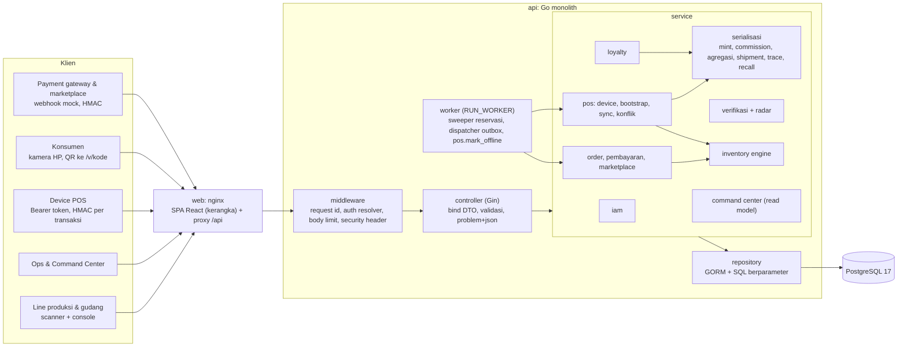
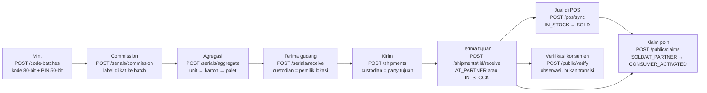
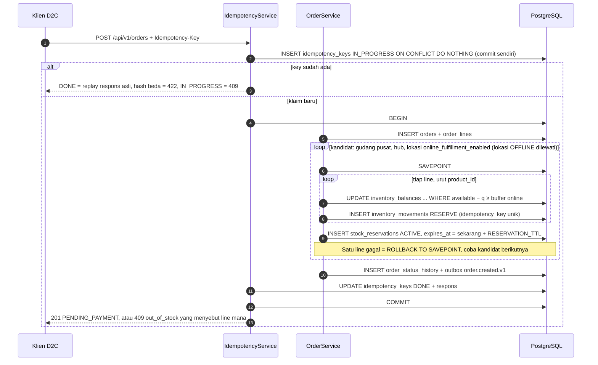
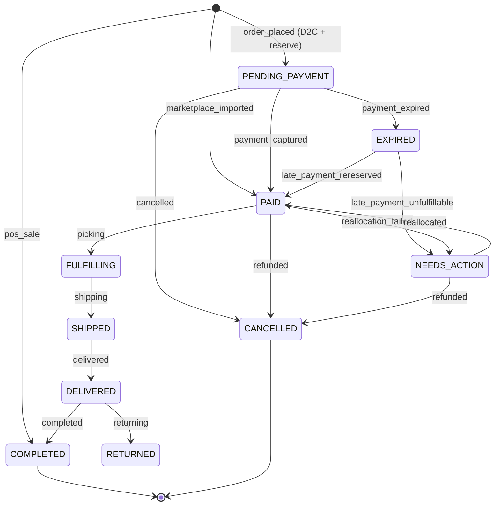
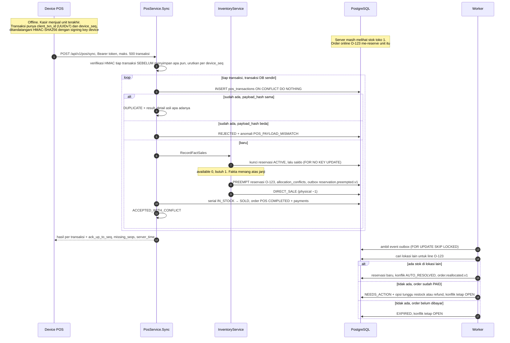
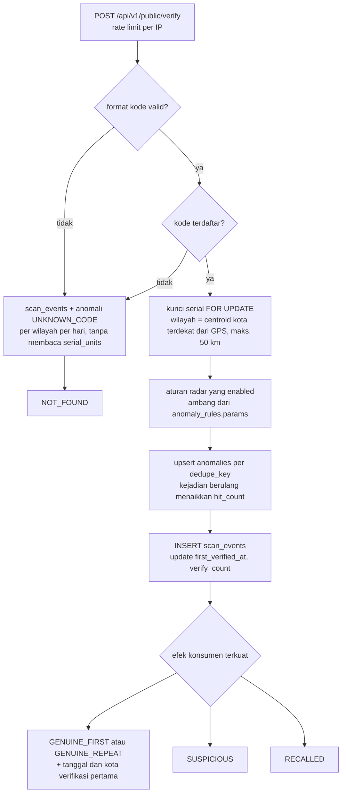
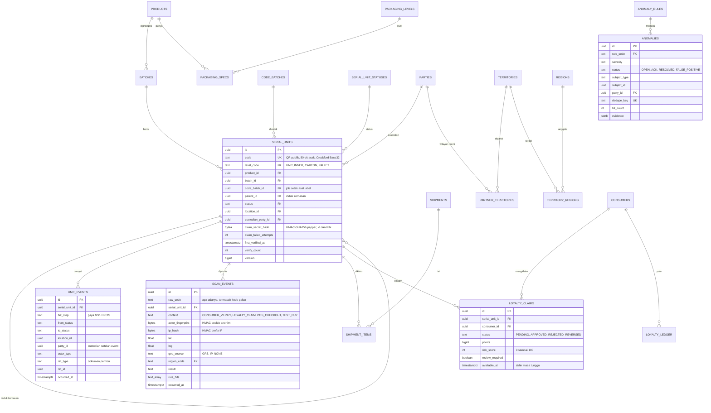
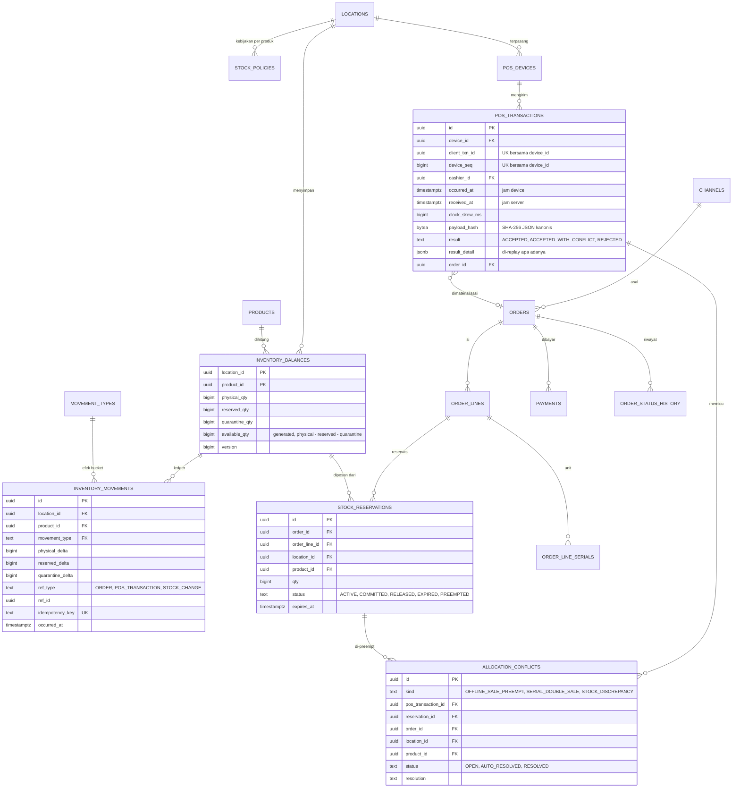

# Arsitektur

Dokumen ini menjelaskan cara prototype mGanik Omnichannel & Traceability dibangun: komponen,
alur data, skema database, strategi konkurensi, alasan pilihan teknologi, keamanan, dan
batasannya. Setiap mekanisme yang disebut di sini merujuk ke kode dan test di repo. Yang belum
dibangun ditulis di [§9 Batasan](#9-batasan-prototype), bukan di bagian fitur.

Solusi bisnis untuk empat kasus operasional ada di [`PRODUCT_DEFENSE.md`](PRODUCT_DEFENSE.md).

## Daftar isi

1. [Konteks](#1-konteks)
2. [Komponen](#2-komponen)
3. [Alur data kunci](#3-alur-data-kunci)
4. [Skema database](#4-skema-database)
5. [Strategi konkurensi & integritas](#5-strategi-konkurensi--integritas)
6. [Pilihan teknologi](#6-pilihan-teknologi)
7. [Keamanan](#7-keamanan)
8. [Konvensi data lintas modul](#8-konvensi-data-lintas-modul)
9. [Batasan prototype](#9-batasan-prototype)
10. [Jalur skala](#10-jalur-skala)

---

## 1. Konteks

mGanik menjual produk konsumen lewat banyak jalur sekaligus: toko sendiri (POS), website D2C,
marketplace, distributor daerah, dan retail modern pihak ketiga. Sistem ini menyatukan empat
pilar:

| Pilar | Pertanyaan yang dijawab | Modul utama |
|---|---|---|
| A. Produksi → konsumen & hologram | Unit ini asli? Dari batch, karton, palet, dan shipment mana? Siapa yang memegangnya? | serialisasi, verifikasi + radar, loyalty |
| B. Omnichannel order & stok | Berapa stok yang boleh dijanjikan ke tiap channel tanpa oversell? | inventory, order, pembayaran, marketplace |
| C. POS offline-first | Bagaimana kasir tetap berjualan saat internet mati, dan apa yang terjadi saat datanya masuk? | pos |
| D. Supply Chain Command Center | Stok mana yang akan habis, distributor mana yang bocor, konflik apa yang belum selesai? | commandcenter |

**Aktor**

| Aktor | Akses | Autentikasi |
|---|---|---|
| Operator produksi, staf gudang, kepala toko, ops, analis | API staff (console) | Email + password, cookie sesi `__Host-session` |
| Device POS di toko sendiri | `/api/v1/pos/*` | Bearer token device + HMAC per transaksi |
| Konsumen | `/api/v1/public/*` | Anonim untuk verifikasi; OTP nomor HP untuk klaim poin |
| Payment gateway, marketplace | Webhook | Signature HMAC + timestamp |

**Status prototype.** Backend Go sudah menjalankan ketiga alur wajib (verifikasi serial +
anti-fraud, alokasi stok dengan proteksi konkurensi, sync transaksi POS offline) dan read model
Command Center, semuanya teruji terhadap PostgreSQL sungguhan. Frontend React baru kerangka:
halaman `/pos`, `/console`, dan `/v/:code` masih placeholder, jadi demo dijalankan lewat API
dan test (lihat [§9](#9-batasan-prototype)).

**Prinsip desain**

1. **Database adalah garis pertahanan terakhir.** Logika ada di service, tetapi invariant kritis
   (stok tidak negatif, satu unit satu klaim aktif, satu transaksi POS diproses sekali) dikunci
   dengan CHECK, UNIQUE, FK, dan trigger. Bug aplikasi tidak bisa merusak data diam-diam.
2. **Fakta menang atas janji.** Kejadian fisik yang sudah terjadi (penjualan kasir offline, scan
   konsumen) selalu dicatat. Reservasi order online adalah janji yang boleh dinegosiasi ulang.
3. **Ledger append-only, saldo sebagai proyeksi.** `inventory_movements`, `unit_events`,
   `scan_events`, `loyalty_ledger`, `order_status_history`, dan `audit_logs` tidak bisa di-UPDATE,
   DELETE, atau TRUNCATE. Tabel saldo dan status adalah proyeksi yang bisa diaudit.
4. **Idempotent di setiap batas yang bisa di-retry:** POST pembuat data, webhook, sync POS,
   handler outbox, job worker.
5. **Aturan bisnis sebagai data.** Transisi status, efek tipe mutasi stok, level kemasan, dan
   ambang aturan anomali disimpan di tabel lookup.
6. **Modular monolith.** Satu binary, modul berbatas jelas, efek samping lintas modul lewat
   outbox. Siap dipecah saat skala menuntut, tanpa biaya operasional microservice sekarang.

---

## 2. Komponen



### 2.1 Modul

| Modul | Kode | Pemilik tabel | Tanggung jawab |
|---|---|---|---|
| iam | `service/auth_*.go`, `consumer_service.go` | `users`, `sessions`, `roles`, `permissions`, `role_permissions`, `user_roles`, `user_role_locations`, `consumers`, `consumer_sessions`, `otp_challenges` | Login staff, sesi, RBAC + scope lokasi, OTP konsumen |
| katalog & lokasi | migrasi `00003` | `brands`, `products`, `packaging_levels`, `packaging_specs`, `price_lists`, `price_list_items`, `locations`, `location_types`, `parties`, `party_roles`, `regions`, `territories`, `territory_regions`, `partner_territories`, `channels` | Master data (diisi seed; belum ada endpoint CRUD) |
| serialisasi | `service/serial_*.go`, `shipment_service.go` | `code_batches`, `batches`, `serial_units`, `serial_unit_statuses`, `lifecycle_transitions`, `unit_events`, `shipments`, `shipment_items` | Mint kode, commission, agregasi/bongkar, terima, kirim, trace, recall |
| verifikasi + radar | `service/verify_service.go`, `radar_service.go` | `scan_events`, `anomaly_rules`, `anomalies` | Endpoint publik, rekam scan, aturan radar, dedupe anomali |
| loyalty | `service/loyalty_service.go` | `loyalty_claims`, `loyalty_ledger` | Klaim poin dengan PIN, skor risiko, masa tunggu, review staff |
| inventory | `service/inventory_service.go` | `inventory_balances`, `inventory_movements`, `movement_types`, `stock_policies` | Engine mutasi generik, penjualan fakta, adjustment, karantina |
| order | `service/order_service.go`, `payment_service.go`, `marketplace_service.go` | `orders`, `order_lines`, `order_line_serials`, `order_status_history`, `order_statuses`, `payments`, `stock_reservations` | Siklus hidup order omnichannel, webhook bayar, impor marketplace |
| pos | `service/pos_*.go` | `pos_devices`, `pos_transactions`, `allocation_conflicts` | Provisioning, bootstrap data offline, heartbeat, sync idempotent, resolusi konflik |
| commandcenter | `service/commandcenter_service.go` | (hanya membaca) | Ringkasan, stok, runout/DOI, antrean anomali dan konflik, indeks kebocoran |
| platform | `service/idempotency_service.go`, `worker/` | `outbox_events`, `idempotency_keys`, `audit_logs` | Infrastruktur lintas modul |

Semua path kode relatif terhadap `apps/api/internal/`.

### 2.2 Pola layered

Arah dependency satu arah: `router → controller → service → repository → model`.

| Package | Tanggung jawab | Aturan |
|---|---|---|
| `router` | Engine Gin, middleware, wiring dependency manual | Satu file per domain (`routes_*.go`) |
| `controller` | Bind DTO, validasi boundary, panggil service, tulis respons | Tidak menyentuh DB; model GORM tidak pernah di-bind dari request |
| `service` | Use case, batas transaksi, aturan bisnis, otorisasi per objek | Satu use case = satu transaksi; semua service satu package sehingga `PosService` bisa memanggil `InventoryService` tanpa import cycle |
| `repository` | Query GORM dan SQL mentah berparameter | Menerima `*gorm.DB` (transaksi) dari service; tidak tahu HTTP |
| `domain` | Aturan murni tanpa DB: state machine serial, aturan radar, haversine, ATP online, JSON kanonis POS | Diuji unit tanpa database |
| `apperror` | Error domain → `application/problem+json` (RFC 9457) | Kode error stabil (`out_of_stock`, `invalid_transition`, ...) |

### 2.3 Komunikasi antar modul

- **Butuh hasil dalam transaksi yang sama** → panggil service modul lain dengan `*gorm.DB`
  transaksi pemanggil. Contoh: sync POS memanggil `InventoryService.RecordFactSales` dan
  `SerialService.SellSerials` di transaksi yang sama, jadi deduksi stok dan status serial commit
  atau rollback bersama.
- **Efek samping yang boleh menyusul** → tulis `outbox_events` di transaksi yang sama dengan
  perubahan datanya. Worker mengambil event dengan `FOR UPDATE SKIP LOCKED` dan menjalankan
  handler di transaksi yang sama dengan penanda `published_at`, sehingga efek handler di DB
  terjadi tepat sekali. Gagal → backoff eksponensial; setelah `OUTBOX_MAX_ATTEMPTS` (default 10)
  event ditandai `dead_at`. Satu-satunya handler saat ini adalah `reservation.preempted.v1`
  (realokasi order setelah penjualan POS). Event tanpa handler dianggap terbit; di produksi
  event itu diteruskan ke broker. Tidak ada dual-write ke message broker.

### 2.4 Runtime

`docker compose up --build` menjalankan berurutan:

| Service | Isi |
|---|---|
| `db` | `postgres:17-alpine` dengan healthcheck |
| `migrate` | `api migrate --seed`: migrasi goose ter-embed lalu seed demo (idempotent), lalu keluar |
| `api` | `api serve`: HTTP + worker di proses yang sama (`RUN_WORKER=true`) |
| `web` | nginx: build SPA + proxy `/api` dan `/healthz` ke `api`; satu-satunya proxy tepercaya untuk `X-Forwarded-For` |

Worker berputar setiap `WORKER_INTERVAL` (default 2 detik): sweeper order kedaluwarsa, job
terdaftar (`pos.mark_offline`), lalu dispatcher outbox. Semua klaim pekerjaan memakai
`SKIP LOCKED`, jadi worker aman dijalankan di beberapa instance.

---

## 3. Alur data kunci

### 3.1 Siklus hidup serial: dari line produksi ke konsumen



Setiap langkah yang mengubah status menulis satu baris `unit_events` per unit (gaya GS1 EPCIS:
`biz_step`, lokasi, party, aktor, dokumen pemicu). Kirim dan terima memproses seluruh pohon
kemasan dalam **satu statement**: recursive CTE mencari semua turunan palet, `UPDATE ... FROM`
mengubah status, lokasi, dan custodian, lalu `INSERT ... SELECT` menulis event per unit
(`repository/serial_repository.go`, `BulkTransition`). Ribuan unit di bawah satu palet tidak
diproses dengan loop per baris.

State machine serial disimpan di `lifecycle_transitions` (migrasi `00010` dan `00012`) dan
dimuat oleh `domain.Lifecycle`:


Catatan:

- **Scan verifikasi bukan transisi.** Scan adalah observasi di `scan_events`; yang berubah di
  `serial_units` hanya `first_verified_at`, `first_verified_region_code`, dan `verify_count`.
- **Recall bekerja di level batch.** `POST /batches/:id/recall` menandai batch `RECALLED` dan
  memindahkan massal unit yang masih di rantai pasok ke `QUARANTINED`. Unit di tangan konsumen
  (`SOLD`, `CONSUMER_ACTIVATED`) statusnya tetap; verifikasi menjawab `RECALLED` dari status batch.
- **`claim_reversal`** mengembalikan unit ke status sebelum aktivasi saat klaim poinnya ditolak
  atau dibalik, supaya unit itu kembali ikut recall, laporan jual mitra, dan retur.

### 3.2 Reservasi stok order online



- Order dialokasikan **all-or-nothing di satu lokasi**. ATP online toko = `available −
  online_buffer_qty`, dan 0 kalau `locations.sync_state = OFFLINE` (`domain.OnlineATP`).
- Webhook bayar (`POST /webhooks/payments/mock`) mengunci order lalu memindahkan
  `PENDING_PAYMENT → PAID` secara bersyarat. Bayar telat setelah `EXPIRED` mencoba pesan ulang
  stok: berhasil → `PAID`, gagal → `NEEDS_ACTION` + permintaan refund. Order tidak pernah `PAID`
  tanpa stok.
- Sweeper melepas reservasi order `PENDING_PAYMENT` yang lewat batas bayar, satu order per
  transaksi, dikunci dengan `FOR NO KEY UPDATE SKIP LOCKED`.
- Impor marketplace (`POST /channels/marketplace/orders`) mencatat order yang sudah dibayar.
  Dedupe per `(channel_code, external_ref)`; stok tidak cukup → order tetap dibuat lalu
  `NEEDS_ACTION`, karena order itu sudah ada di marketplace.

State machine order (`lifecycle_transitions`, `entity_type = 'ORDER'`):



Transisi `SHIPPED → DELIVERED → COMPLETED/RETURNED` dan `NEEDS_ACTION → PAID` sudah ada sebagai
data, tetapi belum ada endpoint yang memicunya.

### 3.3 Sync POS offline dan konflik dengan order online (Kasus 4)



Detail yang penting:

- **Signature dicek sebelum slot idempotensi diklaim.** Transaksi bersignature salah tidak
  disimpan dan tidak menempati `(device_id, client_txn_id)` maupun `(device_id, device_seq)`.
  Pencuri token device tanpa signing key tidak bisa "menduduki" seq berikutnya sehingga penjualan
  asli ditolak (`TestQA_SeqSquatting`).
- **Urutan preempt:** reservasi milik order `PENDING_PAYMENT` terbaru dulu, lalu `PAID` terbaru.
  Di dalam satu kelompok, reservasi terkecil yang cukup menutup kekurangan didahulukan, supaya
  sesedikit mungkin pelanggan terdampak (`invPickPreempt`).
- **Kalau stok fisik pun kurang** (penerimaan tidak tercatat, selisih opname), server mencatat
  `ADJUST_DISCREPANCY`, konflik `STOCK_DISCREPANCY`, dan anomali, lalu tetap mencatat
  `DIRECT_SALE`. Penjualan yang sudah terjadi tidak pernah ditolak karena stok atau serial; yang
  ditolak hanya signature salah, payload rusak, kasir tanpa izin di lokasi itu, atau produk yang
  tidak ada di katalog.
- **Serial bermasalah tidak membatalkan penjualan.** Serial tak terdaftar → anomali
  `POS_UNREGISTERED_SERIAL` (indikasi barang palsu di toko). Serial terdaftar tapi bertentangan
  (sudah terjual, salah lokasi) → konflik `SERIAL_DOUBLE_SALE`.
- **Jam device tidak dipercaya untuk keputusan.** `occurred_at` device disimpan apa adanya;
  ledger dan order memakai waktu terkoreksi skew batch. Flag `CLOCK_SKEW`, `FUTURE_TIMESTAMP`,
  `OFFLINE_TOO_LONG` (> 24 jam), `PRICE_STALE`, `PRICE_MISMATCH`, `HIGH_DISCOUNT`,
  `OFFLINE_VALUE_LIMIT`, `CASHIER_INACTIVE` disimpan di `result_detail` untuk ditinjau.
- **Heartbeat** `POST /pos/heartbeat` menandai lokasi `ONLINE`. Job `pos.mark_offline` menandai
  lokasi tanpa heartbeat lebih dari `POS_HEARTBEAT_TIMEOUT` (default 2 menit) menjadi `OFFLINE`,
  sehingga ATP online toko itu langsung 0.

### 3.4 Verifikasi konsumen dan radar anti-counterfeit



| Aturan | Kondisi | Efek ke konsumen |
|---|---|---|
| `UNKNOWN_CODE` | Kode tidak ada (atau formatnya salah) | `NOT_FOUND`; diagregasi per wilayah per hari sebagai hotspot |
| `NON_SELLABLE_SCAN` | Unit `GENERATED`/`COMMISSIONED`/`DECOMMISSIONED`, atau `IN_STOCK` di gudang pusat yang belum pernah dikirim | `SUSPICIOUS` |
| `IMPOSSIBLE_TRAVEL` | Jarak ke scan berlokasi sebelumnya ÷ selisih waktu > 900 km/jam, jarak minimum 100 km (GPS) atau 500 km (salah satu dari IP) | `SUSPICIOUS` hanya kalau dua perangkat berbeda; perangkat sama → anomali internal saja |
| `SCAN_VELOCITY` | > 5 fingerprint **dan** > 5 prefix IP berbeda dalam 24 jam | `SUSPICIOUS` |
| `OUT_OF_TERRITORY` | Wilayah scan di luar cakupan custodian (`coverage_mode = SELECTED`) | Tidak ada: konsumen tetap melihat `GENUINE_*`, anomali untuk tim internal |
| `BATCH_RECALLED` | Batch berstatus `RECALLED` | `RECALLED` (menang atas `SUSPICIOUS`) |

Dua trade-off anti-grief ditulis di kode (`service/radar_service.go`): GPS dan cookie anonim
dikendalikan klien, jadi satu orang yang memalsukan GPS atau menghapus cookie berulang kali tidak
boleh bisa membuat unit asli tampil `SUSPICIOUS`. Akibatnya, kloning yang dipindai dari perangkat
yang sama dengan scan terakhir, atau dari satu jaringan NAT, tidak memicu `SUSPICIOUS`; anomalinya
tetap masuk antrean review.

---

## 4. Skema database

15 migrasi goose di `apps/api/migrations/`, ter-embed di binary. Skema ditulis dengan SQL tangan,
bukan `AutoMigrate`, karena butuh partial unique index, CHECK bernama, generated column, dan
trigger.

| Migrasi | Isi |
|---|---|
| `00001_bootstrap` | Fungsi `forbid_mutation()` untuk tabel append-only |
| `00002_platform` | `outbox_events`, `idempotency_keys`, `audit_logs` |
| `00003_catalog_locations` | Lookup kemasan, channel, tipe lokasi, role party; katalog; wilayah; party; lokasi; wilayah distributor; harga |
| `00004_iam` | User, sesi, RBAC + scope lokasi, konsumen |
| `00005_serialization` | Job cetak, batch, status serial, `lifecycle_transitions`, `serial_units`, `unit_events`, shipment |
| `00006_inventory` | `movement_types`, `inventory_balances`, `inventory_movements`, `stock_policies` |
| `00007_orders` | Status order, order, line, serial terjual, riwayat, pembayaran, reservasi |
| `00008_pos` | Device, transaksi POS, konflik alokasi |
| `00009_authenticity_loyalty` | `scan_events`, `anomaly_rules`, `anomalies`, `loyalty_claims`, `loyalty_ledger` |
| `00010_lookup_data` | Data referensi di setiap lingkungan: status, transisi, tipe mutasi, RBAC, aturan radar |
| `00011` – `00015` | Sesi konsumen + OTP, tambahan serialisasi, index stok/outbox, index Command Center, tambahan POS |

### 4.1 ERD: traceability, radar, loyalty



### 4.2 ERD: stok, order, POS



### 4.3 Pola skema adaptif: aturan bisnis sebagai data

Status dan aturan yang bisa bertambah disimpan di tabel lookup (`text` + FK), bukan PostgreSQL
`ENUM` (`TestSchema_NoEnumTypes` memastikan tidak ada tipe enum). Status teknis yang hanya
berubah bersama kode (status reservasi, outbox, idempotency) cukup `text` + CHECK.

| Pola | Penerapan | Perubahan bisnis yang cukup diselesaikan dengan data |
|---|---|---|
| **Transisi sebagai data** | `lifecycle_transitions (entity_type, from_code, to_code, biz_step, permission)`. Serial: `domain.Lifecycle` dibangun dari tabel ini dan dipakai sebagai `WHERE status = ANY(allowed_from)`. Order: `UPDATE ... WHERE EXISTS (SELECT 1 FROM lifecycle_transitions ...)`. Trigger `lifecycle_transitions_codes_exist` memastikan kode status ada | Flow baru (misal sampel gratis untuk KOL: `IN_STOCK → SAMPLED`) = `INSERT` status + transisi + permission |
| **Tipe mutasi mendefinisikan efek** | `movement_types (physical_sign, reserved_sign, quarantine_sign, is_promise, allow_either_sign)`. Saldo di-update oleh satu `UPDATE ... FROM movement_types`; trigger `check_movement_effect` menolak baris ledger yang deltanya tidak cocok dengan tipenya | "Titip jual" atau "bonus barang" = satu baris; engine stok tidak berubah |
| **Hierarki kemasan generik** | `serial_units.parent_id` + `packaging_levels.rank` + `packaging_specs (qty_per_parent, allow_mixed_batch)`. Trigger `serial_parent_level_higher` menolak induk dengan rank ≤ anak | Level `INNER` sudah ada; "display box" = satu baris level + spec |
| **Event log gaya EPCIS** | `unit_events (biz_step, from/to_status, location, party, actor, ref_type/ref_id, payload)` | Langkah supply chain baru = `biz_step` baru, bukan tabel baru |
| **Aturan anomali sebagai data** | `anomaly_rules (enabled, severity, consumer_effect, params jsonb)`. Ambang radar dan bobot risiko klaim dibaca dari `params` | Ubah ambang impossible travel atau matikan aturan tanpa deploy |
| **Party–role** | `parties` + `party_roles (valid_from, valid_to)` | Tipe mitra baru (reseller, agen) = role baru |
| **Lokasi hierarkis bertipe** | `locations (type_code, parent_id, party_id, region_code)` | Dark store, gudang marketplace, counter titip jual |
| **Referensi polimorfik** | `(ref_type, ref_id)` di ledger dan event | Dokumen baru (retur B2B, stock opname) tanpa ubah ledger |
| **Mode scope eksplisit** | `user_roles.scope_mode` (`ALL`/`SELECTED`), `partner_territories.coverage_mode` (`NATIONAL`/`SELECTED`) dengan CHECK konsistensi | "Semua lokasi" atau "nasional" tidak pernah disimpulkan dari tabel anak yang kosong (`TestInvariant_ExplicitScopeModes`) |
| **JSONB untuk atribut ekor panjang** | `products.attributes`, `parties.attributes`, `serial_units.attributes`, `orders.metadata` | Atribut baru (BPOM, halal) langsung; dipromosikan ke kolom kalau sering difilter |
| **Payload event berversi** | CHECK `outbox_event_type_versioned`: `<agregat>.<kejadian>.v<N>` | Konsumer lama tetap jalan saat skema event berubah |

Batas yang jujur: kolom metadata status (`serial_unit_statuses.is_sellable`, `is_terminal`,
`consumer_message_key`, `order_statuses.holds_stock`) sudah tersimpan, tetapi kode belum
membacanya. Gerbang yang menyebut status tertentu (klaim poin hanya untuk `SOLD`/`AT_PARTNER`,
penjualan POS hanya dari `IN_STOCK`) masih konstanta di kode. Menambah status yang perlu
diperlakukan seperti status lama di gerbang itu masih butuh perubahan kode. State machine serial
di-cache saat pertama dimuat; perubahan transisi di DB berlaku setelah restart.

### 4.4 Konvensi skema

- PK `uuid` (UUIDv7 dari aplikasi, urut waktu dan bisa dibuat di device saat offline). Waktu
  `timestamptz`, disimpan dan dikirim dalam UTC. Uang `bigint` rupiah utuh, tidak pernah float.
- Constraint diberi nama (`no_oversell`, `one_active_claim_per_unit`, `pos_txn_once`, ...) dan
  dipetakan ke error domain (`invMapStockError`, `mapSerialConstraint`). `TestSchema_NamedConstraints`
  menjaganya.
- Tabel ledger/event append-only lewat trigger `BEFORE UPDATE OR DELETE` dan `BEFORE TRUNCATE`
  (`TestSchema_AppendOnlyTriggers`).
- Tidak ada FK yang masuk ke tabel event (`TestSchema_NoForeignKeysIntoEventTables`), supaya
  `unit_events` dan `scan_events` bisa dipartisi bulanan. Karena itu
  `loyalty_claims.scan_event_id` sengaja tanpa FK.
- Master data memakai `archived_at` dengan partial unique index `WHERE archived_at IS NULL`. Data
  transaksi tidak pernah dihapus.
- Kolom `version bigint` dinaikkan di setiap update baris yang diedit bersamaan.

### 4.5 Tabel kritis

Saldo stok punya tiga bucket fisik, ATP dihitung, dan oversell dikunci di DB
(`migrations/00006_inventory.sql`):

```sql
CREATE TABLE inventory_balances (
  location_id    uuid   NOT NULL REFERENCES locations (id),
  product_id     uuid   NOT NULL REFERENCES products (id),
  physical_qty   bigint NOT NULL DEFAULT 0,
  reserved_qty   bigint NOT NULL DEFAULT 0,
  quarantine_qty bigint NOT NULL DEFAULT 0,
  available_qty  bigint GENERATED ALWAYS AS (physical_qty - reserved_qty - quarantine_qty) STORED,
  version        bigint NOT NULL DEFAULT 0,
  PRIMARY KEY (location_id, product_id),
  CONSTRAINT physical_nonneg   CHECK (physical_qty >= 0),
  CONSTRAINT reserved_nonneg   CHECK (reserved_qty >= 0),
  CONSTRAINT quarantine_nonneg CHECK (quarantine_qty >= 0),
  CONSTRAINT no_oversell       CHECK (physical_qty - reserved_qty - quarantine_qty >= 0)
);
```

Setiap mutasi mengubah saldo dalam satu statement yang membaca efeknya dari `movement_types`
(`repository/inventory_repository.go`, `ApplyBalanceEffect`, disederhanakan):

```sql
UPDATE inventory_balances b
   SET physical_qty   = b.physical_qty   + mt.physical_sign   * @qty,
       reserved_qty   = b.reserved_qty   + mt.reserved_sign   * @qty,
       quarantine_qty = b.quarantine_qty + mt.quarantine_sign * @qty,
       version        = b.version + 1
  FROM movement_types mt
 WHERE mt.code = @type
   AND b.location_id = @loc AND b.product_id = @prod
   -- tipe janji (RESERVE): available setelah mutasi tidak boleh di bawah buffer online
   AND (NOT mt.is_promise
        OR (b.physical_qty - b.reserved_qty - b.quarantine_qty)
           + (mt.physical_sign - mt.reserved_sign - mt.quarantine_sign) * @qty >= @keep)
RETURNING ...;
```

Di kode, semua operand di-`CAST` ke `bigint` (tanpa itu Postgres menyimpulkan tipe parameter dari
kolom `smallint` dan qty > 32.767 overflow; `TestApplyMovement_LargeQtyNoSmallintOverflow`).
Baris ledger ditulis di transaksi yang sama dengan `ON CONFLICT ON CONSTRAINT movement_idempotent
DO NOTHING`.

---

## 5. Strategi konkurensi & integritas

Semua transaksi berjalan di READ COMMITTED. Tidak ada SERIALIZABLE dan tidak ada lock di Redis.

| Masalah | Mekanisme | Bukti (test) |
|---|---|---|
| **Overselling saat lonjakan order** | Conditional atomic update: `UPDATE ... WHERE available − q ≥ buffer`, lalu cek `RowsAffected`. Di READ COMMITTED, Postgres menunggu row lock lalu mengevaluasi ulang `WHERE` pada versi baris terbaru, jadi tidak ada lost update dan tidak perlu retry | `TestReserve_ConcurrentLastUnits`: stok 10, 100 goroutine → tepat 10 sukses, 90 `ErrInsufficientStock`, 10 baris ledger, nol retry |
| **Bug aplikasi yang lolos** | CHECK `no_oversell` + CHECK per bucket; trigger `check_movement_effect` menolak delta yang tidak cocok dengan tipe mutasi | `TestInvariant_NoOversell`, `TestInvariant_MovementLedger` |
| **Mutasi tercatat dua kali** | `inventory_movements.idempotency_key` UNIQUE + `ON CONFLICT DO NOTHING`; key sama isi sama → hasil lama, isi beda → `idempotency_key_reused` | `TestApplyMovement_Rules` |
| **Deadlock order multi-line** | Pembuatan order mengunci saldo urut produk. Jalur batal, kedaluwarsa, fulfill, dan penjualan fakta mengunci reservasi dulu lalu saldo, dengan urutan `(lokasi, produk)` yang sama. `invRunTx` mengulang transaksi maks. 3 kali kalau tetap terjadi deadlock | `TestReserve_MultiLineOppositeOrder`, `TestSweeper_ConcurrentWithMultiLineCreates` |
| **Oversell lintas channel** | D2C, marketplace, dan POS semuanya lewat engine yang sama | `TestOrder_OversellAcrossChannels`, `TestPosSync_ConcurrentWithOnlineOrders` |
| **Order ganda karena retry klien** | `Idempotency-Key` dua fase: klaim `INSERT ... ON CONFLICT DO NOTHING` (commit sendiri), lalu efek bisnis + status `DONE` + respons dalam satu transaksi. Key sama isi beda → 422 | `TestOrder_IdempotencyKey` |
| **Sync POS diproses dua kali** | Insert-first: `INSERT pos_transactions ON CONFLICT DO NOTHING` dengan `UNIQUE (device_id, client_txn_id)` dan `UNIQUE (device_id, device_seq)`. Pengiriman bersamaan tertahan di unique index sampai yang pertama commit; yang kedua membaca `result_detail` tersimpan | `TestPosSync_DuplicateBatch`, `TestPosSync_ConcurrentDuplicate` |
| **ID sama, isi beda** | `payload_hash` (SHA-256 JSON kanonis) dibandingkan; beda → `REJECTED` + anomali critical, seq diisi baris tombstone supaya `ack_up_to_seq` tetap maju | `TestPosSync_SameIdDifferentPayload`, `TestQA_AckStuckAfterKeyReuse` |
| **Penjualan fakta vs reservasi online** | Kunci (menunggu) semua reservasi ACTIVE di `(lokasi, produk)`, lalu saldo `FOR NO KEY UPDATE`. Kandidat preempt diambil `SKIP LOCKED`. Kalau sebagian reservasi masih dipegang transaksi lain, langkah dibatalkan ke savepoint dan dicoba ulang (maks. 20 kali, lalu `stock_contended` yang bisa di-retry), sehingga tidak pernah tercatat selisih stok palsu | `TestRecordFactSale_WaitsForLockedReservation`, `TestRecordFactSale_QARepro_NoPhantomStock`, `TestKasus4_OfflineSaleBeatsOnlineReservation` |
| **Transisi status serial balapan** | Baris dikunci `FOR UPDATE` urut id, lalu `UPDATE ... WHERE status = ANY(allowed_from)`; yang kalah mendapat 409 `invalid_transition`. `order_line_serials` punya `UNIQUE (serial_unit_id)` | `TestSerial_ConcurrentSell`, `TestSerialTransitions_Table` |
| **Kapasitas karton terlampaui** | Induk dan anak dikunci `FOR UPDATE` urut id sebelum kapasitas dihitung; trigger level kemasan | `TestAggregate_ConcurrentCapacity` |
| **Poin diklaim dua kali** | Partial unique `one_active_claim_per_unit WHERE status IN ('PENDING','APPROVED')`: klaim yang ditolak tidak mengunci pembeli asli. Serial dikunci `FOR UPDATE`, jadi percobaan PIN untuk unit yang sama diserialkan | `TestClaim_ConcurrentDoubleClaim`, `TestClaim_ParallelBruteForceStopsAtFive`, `TestClaim_RejectedThenGenuineBuyerClaims` |
| **Webhook bayar berulang** | Order dikunci, `UNIQUE (provider, provider_ref)`, nominal dan mata uang wajib sama dengan total order | `TestPaymentWebhook`, `TestPaymentWebhook_LatePayment` |
| **Impor marketplace berulang** | `UNIQUE (channel_code, external_ref)`; ref sama isi beda → 409 | `TestMarketplaceImport_SameRefDifferentPayload` |
| **Worker ganda** | Sweeper: `FOR NO KEY UPDATE SKIP LOCKED`, satu order per transaksi. Outbox: `FOR UPDATE SKIP LOCKED`. Penanda offline: `SKIP LOCKED` + update bersyarat | `TestSweeper_ReleasesExpiredOnceWithTwoInstances`, `TestPosHeartbeat_TwoJobInstances`, `TestReleaseDueClaims_ConcurrentInstances` |
| **Efek handler outbox ganda** | Handler berjalan di transaksi yang sama dengan penanda `published_at` | `TestDispatcher_RetryBackoffAndExactlyOnce` |
| **Keputusan ops balapan** | Anomali dan konflik dikunci lalu di-update bersyarat; satu menang, sisanya 409 | `TestAnomaly_ConcurrentUpdatesOneWins`, `TestClaim_ConcurrentReviewDecisions` |
| **Jam device POS salah** | `occurred_at` device dan `received_at` server disimpan; urutan per `device_seq`; `ack_up_to_seq` + `missing_seqs` memberi tahu device seq yang belum sampai | `TestPosSync_ClockSkewAndDiscrepancy`, `TestPosSync_SeqGapAndOrdering` |

**Kenapa tidak SERIALIZABLE?** Conditional update sudah menutup race yang relevan tanpa abort.
SERIALIZABLE akan membatalkan transaksi yang bertabrakan dan memaksa retry di setiap jalur, justru
saat lonjakan order.

**Kenapa tidak Redis untuk stok?** Stok di Redis cepat, tetapi butuh dual-write ke database yang
rawan tidak konsisten saat salah satu gagal. Ledger dan saldo di transaksi yang sama lebih mudah
diaudit, dan conditional update di Postgres sudah cukup untuk volume prototype. Jalur untuk hot
row ada di [§10](#10-jalur-skala).

**Kenapa `FOR NO KEY UPDATE`, bukan `FOR UPDATE`?** Insert ledger dan reservasi memeriksa FK ke
`inventory_balances` dengan `KEY SHARE`. `FOR UPDATE` akan memblokir pengecekan itu;
`FOR NO KEY UPDATE` tidak.

---

## 6. Pilihan teknologi

| Pilihan | Alasan | Alternatif yang tidak dipilih |
|---|---|---|
| **Go 1.27** | Konkurensi murah untuk test race nyata (100 goroutine), binary tunggal, performa stabil untuk endpoint verifikasi publik | Node/TS: ekosistem bagus, tetapi test konkurensi nyata lebih natural di Go |
| **Gin** | Router cepat, binding + validator v10 bawaan, ekosistem middleware luas | chi/Echo: setara secara fungsi |
| **GORM** (driver pgx v5) | CRUD dan query biasa. Jalur panas (conditional update, recursive CTE, `SKIP LOCKED`) memakai `Raw/Exec` berparameter. `SkipDefaultTransaction`, cek `RowsAffected` di setiap update bersyarat | sqlc/pgx murni: lebih eksplisit, tetapi di luar permintaan |
| **PostgreSQL 17** | Re-evaluasi `WHERE` setelah row lock di READ COMMITTED, `SKIP LOCKED`, partial unique index, generated column, CHECK + trigger, JSONB, BRIN, partisi deklaratif | MySQL: partial index dan CHECK lebih terbatas. Redis untuk stok: dual-write |
| **goose v3**, migrasi SQL ter-embed | Partial index, CHECK bernama, trigger, dan generated column tidak bisa dibuat rapi oleh `AutoMigrate`. Migrasi versioned dan bisa di-review; `TestMigrate_UpDownUp` | `AutoMigrate`: tanpa down migration, rawan drift |
| **testcontainers-go** (`postgres:17-alpine`) | Test konkurensi harus di Postgres sungguhan, bukan SQLite atau mock. Fallback `TEST_DATABASE_URL` | — |
| `log/slog`, `google/uuid` (UUIDv7), `x/crypto/argon2` | Log terstruktur bawaan; ID urut waktu yang bisa dibuat offline; argon2id rekomendasi OWASP | zap/zerolog, bigint serial, bcrypt |
| **React 19 + Vite + Tailwind v4 + shadcn/ui** | Standar, cepat; komponen di-copy ke repo sehingga bisa dimodifikasi untuk kebutuhan POS (target sentuh besar, scanner HID) | — |
| **Dexie.js (IndexedDB) + protokol sync sendiri** (direncanakan, lihat §9) | Transaksi POS adalah fakta yang harus diproses logika bisnis server (preempt, konflik, idempotensi). Library sync generik menyalin state baris dengan last-write-wins, dan model itu justru menghasilkan split-brain di saldo stok | RxDB, PowerSync, ElectricSQL (butuh komponen infra tambahan), PouchDB (butuh CouchDB) |
| **pnpm workspace + Makefile + docker compose** | Satu perintah menjalankan seluruh stack; satu app JS dan satu paket kontrak tidak butuh Turborepo/Nx | — |
| **OpenAPI** (`packages/contracts/openapi.yaml`) | Sumber tipe TypeScript frontend (`make gen`) | — |

---

## 7. Keamanan

### 7.1 Autentikasi per aktor

| Aktor | Mekanisme |
|---|---|
| Staff | Password argon2id (parameter OWASP). Token sesi opaque 256-bit; DB hanya menyimpan SHA-256-nya sehingga dump DB tidak bisa dipakai login dan sesi bisa dicabut. Cookie `__Host-session` HttpOnly, Secure, SameSite=Lax; idle 8 jam, absolut 12 jam. Lockout 5 gagal per email dan 20 per IP dalam 15 menit. CSRF: `Content-Type: application/json` wajib + cek `Origin` |
| Device POS | Provisioning oleh staff dengan `pos.device.manage` di lokasi itu (kepala toko, ops). Token Bearer dan signing key acak 256-bit hanya dikembalikan sekali. DB menyimpan SHA-256 token dan signing key terenkripsi AES-GCM (subkey HKDF dari `PII_ENC_KEY`, AAD = id device). Setiap transaksi ditandatangani HMAC-SHA256 atas JSON kanonis yang hasilnya sama dengan implementasi JS (`TestCanonicalPosJSON_MatchesJSReference`). Device bisa dicabut |
| Kasir di POS | Hash argon2id PIN kasir ikut bootstrap untuk login lokal. Trade-off: hash di device bisa di-brute force offline kalau device dicuri; dampaknya terbatas karena otorisasi ke server tetap memakai token device yang bisa dicabut |
| Konsumen | Verifikasi anonim + rate limit. Klaim poin butuh login OTP nomor HP (prototype: OTP mock, ditolak di production kecuali izin demo eksplisit). Sesi konsumen di tabel terpisah dengan aturan yang sama |
| Webhook | `X-Mganik-Signature: v1=HMAC-SHA256(secret, timestamp + "." + body)` + toleransi timestamp. Tanpa `WEBHOOK_SECRET`, webhook ditolak seluruhnya |

### 7.2 Otorisasi

- RBAC dengan permission granular (`serial.commission`, `inventory.adjust`, `pos.sync`,
  `conflict.resolve`, ...), peta role → permission disimpan di DB (migrasi `00010`).
- Route memeriksa permission (`middleware.RequirePermission`); service memeriksa scope lokasi per
  objek (BOLA). `user_roles.scope_mode` (`ALL`/`SELECTED`) dibaca eksplisit; daftar lokasi kosong
  tidak pernah berarti "semua".
- Modul POS dan resolusi konflik memakai cek gabungan per permission `Principal.CanAt(perm, loc)`.
  Modul serialisasi, stok/order, dan Command Center masih memakai `Can(perm) && CanAccessLocation(loc)`
  (lihat §9, I1).

### 7.3 Perlindungan data dan rahasia

| Data | Penyimpanan |
|---|---|
| PIN klaim | `serial_units.claim_secret_hash = HMAC-SHA256(CLAIM_PEPPER, id ‖ PIN)`. PIN 50-bit acak, jadi HMAC cukup (bukan argon2) dan bisa di-mint jutaan kali. PIN plaintext hanya ada di respons mint (bahan file cetak vendor). **Titik terlemah adalah proses vendor cetak**; mitigasinya kontrak, audit vendor, dan rekonsiliasi per job cetak (kolom `code_batches.void_qty`/`reconciled_at` sudah ada, alurnya belum dibangun) |
| Nomor HP konsumen | AES-GCM (`phone_enc`) + blind index HMAC (`phone_bidx`) untuk pencarian. Tidak pernah ditulis ke log |
| IP dan perangkat | `scan_events.ip_hash` = HMAC prefix /24 (IPv4) atau /48 (IPv6); `actor_fingerprint` = HMAC id cookie anonim. Subkey diturunkan dari `CLAIM_PEPPER` dengan pemisah domain |
| Token sesi, token device | SHA-256 saja |

Secret lewat env (`CLAIM_PEPPER`, `PII_ENC_KEY`, `WEBHOOK_SECRET`, `SEED_DEMO_PASSWORD`). Dengan
`APP_ENV=production`, config menolak secret demo, OTP mock, dan seed demo kecuali
`SEED_DEMO_ALLOW_PRODUCTION=true` (dipakai compose sebagai stack demo, dengan WARN saat start).

### 7.4 Keamanan API

- Validasi di boundary: DTO terpisah dari model GORM, validator v10, format kode serial dicek
  sebelum query (kode berformat salah tidak pernah membaca `serial_units`), teks bebas dengan
  karakter kontrol ditolak.
- Batas: body 1 MB umum; `/pos/sync` 5 MB dan maks. 500 transaksi per batch; timeout read/write
  server.
- Rate limit endpoint publik: verifikasi 60/menit per IP, klaim 20/menit per IP dan 10/jam per
  konsumen (in-memory per proses).
- IP klien dari `X-Forwarded-For` hanya kalau request datang dari nginx (IP statis di compose);
  nginx menimpa header itu dengan IP peer.
- Header keamanan, error `problem+json` tanpa stack trace atau pesan SQL; detail ada di log
  dengan `request_id`.
- Audit: `audit_logs` (append-only) untuk login/logout staff dan konsumen, adjustment stok,
  karantina, recall batch, review klaim poin, perubahan status anomali, resolusi konflik, serta
  provisioning dan pencabutan device.

---

## 8. Konvensi data lintas modul

Modul ditulis paralel, lalu Command Center membaca data yang ditulis modul lain. Konvensi berikut
adalah kontrak di antara mereka. Mengubah salah satunya berarti mengubah pembacanya juga.

| Konvensi | Penulis | Pembaca | Isi kontrak |
|---|---|---|---|
| `unit_events.party_id` = custodian **setelah** event | Semua penulis `unit_events` di `repository/serial_repository.go` (mint menulis NULL) | Indeks kebocoran (`commandcenter_repository.go`) | Custodian saat scan = event ber-`party_id` terakhir dengan `occurred_at` ≤ waktu scan; fallback ke `serial_units.custodian_party_id` |
| `anomalies.subject_type` | Radar: `SERIAL_UNIT`, `BATCH`, `REGION`. Stok/POS: `LOCATION` (`STOCK_DISCREPANCY`, `POS_UNREGISTERED_SERIAL`), `POS_DEVICE`, `POS_TRANSACTION`, `USER` | `GET /cc/anomalies` | Principal ber-scope `SELECTED` hanya melihat anomali dengan `subject_type = 'LOCATION'` di lokasinya; selain itu hanya scope `ALL`. Anomali yang harus terlihat kepala toko wajib bersubjek `LOCATION` |
| `anomalies.dedupe_key` | Semua penulis anomali | Upsert (`hit_count` naik) | `<RULE>:<subjek>[:<tanggal UTC>]`, misal `STOCK_DISCREPANCY:<lokasi>:<produk>:2026-11-07`, `UNKNOWN_CODE:<wilayah>:<tanggal>` |
| `inventory_movements.ref_type` + `idempotency_key` | Inventory, order, POS | Rekonsiliasi, trace | `ref_type`: `ORDER`, `POS_TRANSACTION`, `STOCK_CHANGE`. Key: `reservation:<id>:reserve/commit/release/preempt`, `pos:<device>:<client_txn_id>:<line>` (+ `:discrepancy`) |
| Penjualan 28 hari | Order (`COMMIT_SALE`) dan POS (`DIRECT_SALE`) | Runout/DOI | Hanya dua tipe itu yang dihitung sebagai penjualan; `physical_delta` negatif |
| `outbox_events.event_type` | Order, inventory | Dispatcher | `<agregat>.<kejadian>.v<N>`: `order.created.v1`, `order.paid.v1`, `order.expired.v1`, `order.cancelled.v1`, `order.shipped.v1`, `order.needs_action.v1`, `order.reallocated.v1`, `order.refund_requested.v1`, `reservation.preempted.v1` |
| `scan_events.context` | Verifikasi (`CONSUMER_VERIFY`), loyalty (`LOYALTY_CLAIM`) | Radar, indeks kebocoran | `TEST_BUY` dihitung indeks kebocoran sebagai bukti terkuat, tetapi belum ada endpoint yang menulisnya |
| `actor_type` | Semua ledger/event | Audit | `USER`, `DEVICE`, `SYSTEM`, `CONSUMER` (CHECK di setiap tabel) |
| Waktu | Semua | Semua | `timestamptz`; respons Command Center dalam UTC berakhiran `Z` (`TestResponses_TimestampsInUTC`) |

Test Command Center (`test/commandcenter`) saat ini mengisi `unit_events`, `scan_events`, dan
`anomalies` dengan insert manual yang mengikuti konvensi di atas, belum lewat service asli.

---

## 9. Batasan prototype

Daftar ini sengaja ditulis lengkap. Setiap butir punya titik kait di kode, jadi pekerjaannya kecil
dan terlokalisasi.

### 9.1 Integrasi antar modul yang belum selesai

| # | Batasan | Dampak sekarang | Titik kait |
|---|---|---|---|
| I1 | Scope per permission (`CanAt`) baru dipakai modul POS | Serialisasi, stok/order, dan Command Center memeriksa `Can(perm) && CanAccessLocation(loc)` secara terpisah. User dengan dua role berbeda scope bisa mendapat gabungan hak. Tidak bisa dieksploitasi dengan akun demo karena masing-masing satu role | `service/serial_scope.go` `serialCanAt`, `service/inventory_tx.go` `invScopeAllows`, `service/commandcenter_service.go` `authorize` |
| I2 | Fulfill order tidak mengubah serial menjadi `SOLD` | Fulfill mencatat `COMMIT_SALE` dan `order_line_serials` (UNIQUE mencegah satu unit terjual dua kali), tetapi status serial tetap `IN_STOCK` di gudang. Unit D2C yang belum pernah dikirim lewat shipment akan dijawab `SUSPICIOUS` saat diverifikasi konsumen (`NON_SELLABLE_SCAN`, stok gudang pusat yang belum dikirim) dan klaim poinnya ditolak | `service/order_service.go` `SerialSaleHook` (belum dipasang), `SerialService.SellSerials` sudah siap |
| I3 | `ReleaseDueClaims` tidak punya pemanggil runtime | Klaim unit `AT_PARTNER` tetap `PENDING` setelah masa tunggu sampai di-approve manual (`POST /loyalty/claims/:id/review`). Sesi dan `otp_challenges` kedaluwarsa tidak dibersihkan | `worker/runner.go` `RegisterJob`; fungsinya sudah teruji (`TestReleaseDueClaims_ConcurrentInstances`) |
| I4 | Shipment, terima, dan recall tidak menggerakkan `inventory_balances` | Status serial dan saldo stok adalah dua catatan terpisah: kirim palet ke distributor tidak mengurangi saldo gudang pusat. Saldo stok demo adalah stok pembuka tanpa serial per unit. Hanya sync POS yang mengubah keduanya dalam satu transaksi | `service/shipment_service.go`, `serial_production_service.go` → `InventoryService.ApplyMovement` (`TRANSFER_OUT/IN`, `QUARANTINE_IN`) |
| I5 | Job rekonsiliasi `LEDGER_DRIFT` belum ada | Aturan `LEDGER_DRIFT` sudah ada di `anomaly_rules`, tetapi tidak ada yang menulisnya. Invariant `SUM(delta) ledger = saldo` saat ini hanya diperiksa di test (`AssertLedgerInvariant`, `assertLedgerMatchesBalances`) | Job worker baru |
| I6 | Konvensi lintas modul baru didokumentasikan | Lihat [§8](#8-konvensi-data-lintas-modul). Anomali POS selain `POS_UNREGISTERED_SERIAL` tidak bersubjek `LOCATION`, jadi tidak terlihat kepala toko di `/cc/anomalies`, hanya ops ber-scope `ALL` | Test Command Center dengan data dari service asli |

### 9.2 Frontend

`/pos`, `/console`, dan `/v/:code` masih placeholder (judul + empty state). Dexie dan
`vite-plugin-pwa` sudah ada di dependency, tetapi sync engine offline, layar kasir, halaman
verifikasi, dan console belum dibangun. Semua alur dibuktikan lewat API dan test Go; desain
offline POS (outbox IndexedDB, `device_seq` monoton, Web Locks untuk satu sync runner) ada di
`PRODUCT_DEFENSE.md`.

### 9.3 Lainnya

- **Geolokasi IP belum ada.** `IPGeoResolver` default (`UnknownIPGeo`) selalu menjawab "tidak
  diketahui", jadi scan tanpa GPS tidak punya wilayah dan tidak ikut aturan wilayah. Header
  `X-Test-IP-Geo` untuk demo hanya dibaca di luar production.
- **Resolusi wilayah** memakai centroid kota terdekat (maks. 50 km) dari seed ±10 kota. Produksi
  butuh polygon (PostGIS).
- **Program test-buy** belum punya endpoint penulis scan `TEST_BUY`.
- **Rate limit dan lockout login** in-memory per proses; dengan beberapa instance API, batasnya
  dikali jumlah instance.
- **Belum ada endpoint CRUD master data** (produk, lokasi, harga, wilayah, aturan anomali); semua
  dari seed dan migrasi.
- **Kasus 3** (atribusi iklan) hanya desain; tabel kampanye dan konversi belum dibuat.
- **Device yang dicabut** tidak bisa lagi sync; penjualan offline yang belum tersinkron dari
  device itu harus dipulihkan manual (ekspor outbox atau struk, lalu adjustment).
- **Lokasi fulfillment tunggal**: order dialokasikan ke satu lokasi; split order hanya terjadi
  saat realokasi setelah preempt.
- **Belum dibangun:** TOTP admin, enkripsi IndexedDB, Turnstile, rotasi key otomatis, role DB
  terpisah untuk aplikasi dan migrasi, partisi tabel event.

---

## 10. Jalur skala

Tidak dibangun sekarang; skema dan kode sudah disiapkan supaya langkah ini tidak butuh desain
ulang.

| Tekanan | Langkah | Yang sudah disiapkan |
|---|---|---|
| Worker bersaing CPU dengan API | Jalankan worker sebagai proses terpisah | `RUN_WORKER=false` di API, `true` di proses worker; semua klaim pekerjaan `SKIP LOCKED` |
| Hot row saat flash sale (11.11, 12.12) | Kuota stok per channel, atau saldo satu SKU dipecah ke N sub-baris yang dipilih acak | Engine stok generik; buffer online per `(lokasi, produk)` sudah ada |
| Volume `unit_events` (10 juta unit/tahun × ±7 event = 70 juta baris/tahun) dan `scan_events` | Partisi bulanan per `occurred_at` + BRIN; retensi detail scan 13 bulan lalu agregasi per wilayah/hari (UU PDP) | Tidak ada FK masuk ke tabel event; BRIN `scan_events (occurred_at)` sudah ada |
| Query Command Center membebani primary | Read replica; indeks kebocoran dihitung worker ke tabel/materialized view harian | Endpoint kebocoran dibatasi jendela 90 hari |
| Bot membanjiri endpoint verifikasi publik | CDN/WAF di depan, rate limit di Redis/edge, challenge Turnstile setelah ambang | Kode serial 80-bit acak (tidak bisa dienumerasi), respons seragam |
| Konsumer event di luar database | Teruskan outbox ke broker (Kafka/NATS) | Event berversi, dispatcher dengan dead-letter |
| Resolusi wilayah presisi | PostGIS polygon kelurahan/kecamatan | Kode wilayah Kemendagri hierarkis sudah dipakai (`35.78.01` → `35.78` → `35`) |

Index diukur sebelum ditambahkan. Contoh: index parsial `inventory_movements_sales_window`
(`migrations/00014_commandcenter.sql`) membuat agregasi penjualan 28 hari menjadi index-only scan;
pada 180 ribu baris ledger, buffer turun dari 2.189 ke 317 dan waktu dari 19,5 ms ke 12,6 ms.
