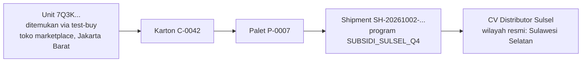
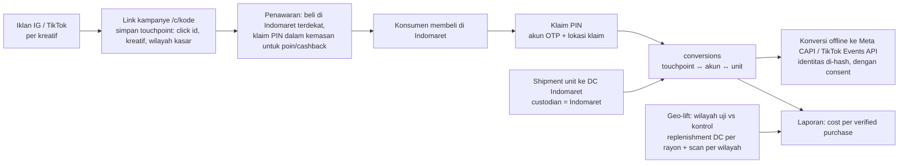

# Product Defense

Dokumen ini mempertahankan keputusan produk untuk empat kasus operasional mGanik dan Pilar D
(Supply Chain Command Center). Setiap kasus disusun dengan urutan yang sama: **masalah inti →
solusi berlapis → edge case & false positive → trade-off → metrik bisnis → rollout bertahap →
apa yang sudah ada di prototype**.

Cara membaca status:

- **Dibangun**: ada di kode dan teruji terhadap PostgreSQL sungguhan (nama test disebut).
- **Desain**: belum dibangun; alasan dan rencananya ditulis di sini.

Detail teknis (skema, konkurensi, keamanan, batasan) ada di [`ARCHITECTURE.md`](ARCHITECTURE.md).

## Daftar isi

1. [Ringkasan](#1-ringkasan)
2. [Asumsi](#2-asumsi)
3. [Fondasi bersama: satu aset data untuk empat kasus](#3-fondasi-bersama-satu-aset-data-untuk-empat-kasus)
4. [Kasus 1: Gray market distributor](#4-kasus-1-gray-market-distributor)
5. [Kasus 2: Fraud poin loyalty](#5-kasus-2-fraud-poin-loyalty)
6. [Kasus 3: Atribusi iklan ke penjualan Indomaret](#6-kasus-3-atribusi-iklan-ke-penjualan-indomaret)
7. [Kasus 4: Split-brain stok POS offline vs online](#7-kasus-4-split-brain-stok-pos-offline-vs-online)
8. [Pilar D: Supply Chain Command Center](#8-pilar-d-supply-chain-command-center)
9. [Metrik utama](#9-metrik-utama)
10. [Roadmap](#10-roadmap)
11. [Pertanyaan yang hampir pasti muncul](#11-pertanyaan-yang-hampir-pasti-muncul)

---

## 1. Ringkasan

| Kasus | Inti solusi | Status prototype | Metrik utama |
|---|---|---|---|
| 1. Gray market distributor | Setiap unit ditelusuri ke shipment dan distributor penerimanya. Scan di luar wilayah resmi menjadi bukti internal; indeks kebocoran per distributor, bukan satu scan, yang memicu tindakan | Dibangun: agregasi, shipment + propagasi custodian, trace, aturan `OUT_OF_TERRITORY`, indeks kebocoran. Desain: endpoint test-buy, geolokasi IP | Subsidi yang diselamatkan (Rp) |
| 2. Fraud poin loyalty | QR luar hanya untuk cek keaslian; poin hanya lewat PIN di dalam kemasan. Gerbang siklus hidup, masa tunggu, skor risiko, review + clawback | Dibangun hampir seluruhnya. Belum: job pelepasan poin otomatis | Tingkat klaim yang dibalik, biaya poin per pembelian ulang inkremental |
| 3. Atribusi iklan → Indomaret | Alat ukur dipindah ke tangan konsumen: klaim PIN setelah membeli menyambungkan klik ke pembelian; data serial membuktikan unit lewat DC Indomaret; geo-lift untuk yang tidak scan | Desain. Bagian yang dipakai ulang (klaim PIN, scan berwilayah, custodian per shipment) sudah dibangun | Cost per verified purchase, iROAS dari geo-test |
| 4. Split-brain stok POS | Fakta menang atas janji. Jendela konflik dikecilkan (buffer, heartbeat); saat konflik tetap terjadi, penjualan kasir selalu diterima dan order online dialihkan atau diselesaikan dengan adil | Dibangun di backend (sync, preempt, realokasi, konflik). Desain: aplikasi POS offline di browser | Konflik per 1.000 order online dari stok toko, % realokasi otomatis |
| D. Command Center | Tiga pertanyaan setiap pagi: stok mana yang akan habis, distributor mana yang bocor, konflik apa yang belum selesai | Dibangun sebagai API read model. Belum: layar console | Hari stockout yang dihindari, rasio false positive anomali |

**Benang merah**

1. **Satu aset data, banyak kegunaan.** Serialisasi + agregasi + PIN dalam kemasan menjawab gray
   market, fraud poin, atribusi iklan, dan anti-counterfeit sekaligus.
2. **Integritas di database, keputusan di service.** Invariant kritis dikunci constraint; aturan
   bisnis bisa berubah tanpa merusak data.
3. **Jangan menghukum dari satu sinyal.** Radar mengumpulkan bukti, manusia memutuskan. Konsumen
   tidak pernah disalahkan atas kesalahan distributor.
4. **Rollout bertahap sadar biaya.** Mulai dari yang tidak mengubah kemasan atau proses pabrik,
   ukur, lalu naik.
5. **Jujur soal batas.** Yang belum dibangun ditulis sebagai batasan, lengkap dengan titik terlemah
   desainnya.

---

## 2. Asumsi

Saya tidak punya data operasional mGanik. Asumsi di bawah dipakai sebagai default; semua ambang
angka bisa diubah tanpa deploy (`anomaly_rules.params`, env config) dan wajib dikalibrasi dengan
data minggu-minggu pertama.

| Area | Asumsi |
|---|---|
| Organisasi | Satu grup usaha, bisa multi-brand. Mata uang IDR. Waktu disimpan UTC, ditampilkan per zona lokasi (WIB/WITA/WIT) |
| Label | Label hologram dicetak vendor dengan kode yang kita generate: QR publik di luar kemasan dan PIN di dalam/balik label. Label ditempel di line produksi lalu di-scan untuk di-*commission* ke batch |
| Retail modern | Indomaret dan retail pihak ketiga tidak memindai serial kita; POS mereka black box. Data yang mungkin didapat hanya replenishment ke DC, dengan jeda mingguan |
| Distributor | Distributor belum memakai sistem kita (tidak ada scan keluar di gudang distributor). Portal distributor adalah fase lanjutan |
| Channel online | Marketplace dan payment gateway terintegrasi lewat webhook (di prototype: mock bersignature HMAC) |
| Toko sendiri | Tablet/PC dengan Chrome atau Edge dan barcode scanner HID. Internet toko bisa putus berjam-jam |
| Konsumen | Memakai kamera HP untuk memindai QR; tidak perlu install aplikasi. Nomor HP Indonesia untuk OTP |
| Angka awal | Baseline mobilitas konsumen lintas wilayah 5%, sampel minimum 20 scan per distributor, masa tunggu poin 7 hari, ambang review klaim skor 50, buffer stok online toko 2 unit, timeout heartbeat 2 menit |

---

## 3. Fondasi bersama: satu aset data untuk empat kasus

Setiap unit punya dua rahasia dengan fungsi berbeda:

| Kode | Letak | Fungsi | Tidak bisa dipakai untuk |
|---|---|---|---|
| QR publik (80-bit acak, 16 karakter) | Luar kemasan, terlihat di rak | Verifikasi keaslian oleh siapa pun, tanpa login | Mengklaim poin |
| PIN klaim (50-bit acak) | Dalam kemasan / balik segel, baru terjangkau setelah dibeli dan dibuka | Klaim poin oleh akun terverifikasi | Apa pun sebelum produk dibeli |

Kode acak (bukan berurutan) membuat enumerasi tidak mungkin. PIN hanya disimpan sebagai
`HMAC-SHA256(pepper, id ‖ PIN)`.

Unit diagregasi ke karton dan palet di line produksi. Shipment memindahkan custodian seluruh
pohon kemasan sekaligus. Hasilnya, untuk setiap unit kita tahu: batch dan tanggal produksi, job
cetak labelnya, karton dan paletnya, setiap shipment yang membawanya, siapa pemegangnya saat
ini, dan di mana saja ia pernah dipindai. Empat kasus di bawah membaca aset data yang sama ini.

---

## 4. Kasus 1: Gray market distributor

### 4.1 Masalah inti

Distributor daerah (misal Sulawesi Selatan) mendapat harga subsidi untuk menumbuhkan pasar di
wilayahnya, lalu menjual ulang barang itu ke marketplace di kota besar. Akibatnya:

- brand membayar subsidi untuk penjualan yang tidak menumbuhkan pasar baru;
- harga pasar di kota besar rusak, karena barang subsidi dijual di bawah harga normal;
- distributor resmi kota besar kehilangan penjualan dan kepercayaan pada brand.

**Kenapa sulit:** kita tidak punya akses ke gudang distributor dan tidak bisa inspeksi fisik.
Barang yang bocor adalah **barang asli**, jadi pemeriksaan keaslian biasa tidak menemukannya.

### 4.2 Solusi berlapis

**Lapis 1: data serial yang mengikat unit ke surat jalan.**

1. Line produksi mengagregasi unit → karton → palet (`POST /serials/aggregate`). Kapasitas,
   produk, level kemasan, dan aturan campuran batch divalidasi; agregasi paralel ke karton yang
   sama tidak bisa melampaui kapasitas.
2. Shipment ke Distributor Sulsel dicatat dengan `program_code` (misal `SUBSIDI_SULSEL_Q4`).
   Satu statement memindahkan status dan custodian seluruh turunan palet ke distributor itu,
   plus satu event per unit.
3. `GET /serials/:code/trace` memberikan genealogi lengkap: leluhur kemasan, shipment (termasuk
   shipment milik karton/palet induknya, walau unit sudah dibongkar), custodian, dan scan terakhir.

**Lapis 2: sumber sinyal lokasi.** Distributor tidak memindai, jadi sinyal datang dari luar:

| Sumber | Kepercayaan | Status |
|---|---|---|
| Scan verifikasi konsumen (GPS dengan izin) | Sedang: konsumen bisa sedang bepergian | Dibangun |
| Klaim poin (lokasi klaim) | Sedang | Dibangun |
| **Program test-buy**: tim ops membeli dari listing marketplace yang mencurigakan (harga di bawah harga normal), lalu memindai dengan konteks `TEST_BUY` | Tertinggi: pembelian terkontrol dengan bukti transaksi | Indeks kebocoran sudah menghitungnya; endpoint pencatat scan test-buy masih desain |
| Retur | Sedang | Desain |

**Lapis 3: aturan dan indeks, bukan tuduhan per scan.**

- Aturan `OUT_OF_TERRITORY`: wilayah scan dibandingkan dengan wilayah resmi custodian
  (`partner_territories`, mode `NATIONAL`/`SELECTED` disimpan eksplisit). Hasilnya **anomali
  internal**; konsumen tetap melihat "asli", karena produknya memang asli. Yang bermasalah adalah
  distributornya, bukan konsumen.
- **Indeks kebocoran per distributor** (`GET /cc/distribution-leakage`) = scan luar wilayah ÷ scan
  yang bisa dinilai, dalam jendela waktu (maks. 90 hari). Alert kalau:
  - sampel ≥ 20 scan **dan** rasio > baseline mobilitas 5%, **atau**
  - ada **satu** hit test-buy di luar wilayah (bukti terkuat, langsung alert).
- Custodian dan wilayah resmi dihitung **pada saat scan**, bukan saat laporan dibuat. Distributor
  yang wilayahnya berubah atau kontraknya berakhir di tengah jendela tidak salah dituduh.

**Lapis 4: bukti tanpa inspeksi fisik.** Contoh rantai bukti yang bisa dibaca dari data:

**Lapis 5: tindakan bisnis setelah bukti.** Sesuai kontrak distribusi: clawback subsidi untuk unit
yang terbukti bocor, pengurangan alokasi program berikutnya, atau penghentian program subsidi
untuk distributor itu. Sistem menyediakan bukti; keputusan sanksi tetap di tangan manusia.

### 4.3 Edge case & false positive

| Situasi | Kenapa bisa salah | Penanganan |
|---|---|---|
| Konsumen bepergian (mudik, dinas) | Satu scan luar wilayah terlihat seperti kebocoran | Tidak ada tindakan dari satu scan. Indeks per distributor dengan sampel minimum dan baseline mobilitas |
| GPS dipalsukan | Lokasi dikirim klien | Satu sinyal tidak memicu sanksi; test-buy adalah bukti yang dikontrol tim sendiri |
| Wilayah scan terlalu kasar (hanya provinsi) padahal wilayah resmi level kota | Tidak bisa diputuskan di dalam atau di luar | Scan itu tidak dinilai (tidak masuk pembilang maupun penyebut) |
| Transfer antar distributor yang sah | Unit berpindah wilayah secara resmi | Wajib dicatat sebagai shipment, sehingga custodian berpindah |
| Distributor dengan cakupan nasional | Semua wilayah sah | `coverage_mode = NATIONAL` tidak pernah menghasilkan `OUT_OF_TERRITORY` |
| Party tanpa data wilayah resmi | Tidak diketahui | Dilewati, tidak diasumsikan nasional atau kosong |
| Scan tanpa izin lokasi | Tidak ada wilayah | Tidak dinilai; hanya scan berlokasi yang masuk indeks |

**Counter-tactic distributor**

| Taktik | Jawaban |
|---|---|
| Merobek label hologram | Label tamper-evident (pola VOID); edukasi konsumen "tanpa hologram = jangan beli"; takedown listing tanpa hologram lewat program brand protection marketplace |
| Membongkar karton dan menyebar ke sub-distributor | Presisi turun ke level distributor, masih cukup untuk sanksi. Fase lanjut: portal distributor dengan scan keluar |
| Menjual lewat akun pribadi atau reseller | Test-buy tetap menelusuri unit ke shipment, siapa pun penjualnya |

### 4.4 Trade-off

- Scan agregasi menambah satu langkah di line produksi: butuh scanner, disiplin operator, dan
  target per shift. Sistem menolak karton yang melebihi kapasitas, jadi kesalahan cepat terlihat.
- Propagasi custodian saat shipment (bukan saat baca) menambah biaya tulis per shipment, karena
  scan konsumen jauh lebih sering dan lebih sensitif latensi daripada shipment.
- Resolusi wilayah memakai centroid kota terdekat: murah, tetapi kurang presisi di perbatasan.
  Produksi butuh polygon wilayah.
- Indeks kebocoran bergantung pada scan rate konsumen. Wilayah dengan scan rate rendah butuh
  test-buy untuk menutup celah.

### 4.5 Metrik bisnis

| Metrik | Definisi | Kenapa penting |
|---|---|---|
| **Subsidi yang diselamatkan (Rp)** | (harga normal − harga subsidi) × estimasi unit bocor yang dicegah atau di-clawback | Angka yang membuat manajemen bertindak |
| Indeks kebocoran per distributor | Scan luar wilayah ÷ scan yang dinilai, per bulan | Tren per distributor, bukan kejadian tunggal |
| Waktu scan → alert | Dari scan pertama yang memicu sampai alert | Kecepatan respons sebelum stok bocor menyebar |
| Test-buy yang terlacak ke shipment | % pembelian test-buy yang punya rantai unit → shipment | Kualitas data agregasi |
| Rasio false positive | Anomali `FALSE_POSITIVE` ÷ anomali yang ditutup | Kualitas aturan; menaikkan ambang kalau terlalu tinggi |

Ilustrasi (bukan data mGanik): selisih harga Rp5.000 per unit × 10.000 unit bocor per bulan =
Rp50 juta per bulan untuk satu distributor.

### 4.6 Rollout bertahap

1. **Fase 1, satu program subsidi:** agregasi di line untuk SKU program itu, shipment wajib
   dengan `program_code`, scan konsumen berjalan, indeks kebocoran dibaca mingguan oleh ops.
2. **Fase 2, test-buy rutin:** 10–20 pembelian per bulan dari listing di bawah harga normal.
   Mulai menerapkan klausul clawback di kontrak program berikutnya.
3. **Fase 3:** portal distributor dengan scan keluar untuk distributor besar; polygon wilayah;
   alert otomatis ke account manager distributor.

### 4.7 Di prototype

| Komponen | Status | Bukti |
|---|---|---|
| Agregasi unit → karton → palet dengan validasi kapasitas dan level | Dibangun | `TestAggregate_CapacityAndIdempotent`, `TestAggregate_ConcurrentCapacity`, `TestAggregate_MixedBatchRule`, `TestAggregate_Rejections` |
| Shipment + propagasi custodian ke seluruh palet | Dibangun | `TestShipment_PropagatesToWholePallet`, `TestShipmentToPartyAndUnlocatedScope` |
| Trace genealogi | Dibangun | `TestTrace_Genealogy`, `TestTrace_ShipmentSurvivesUnpack` |
| `OUT_OF_TERRITORY` internal saja | Dibangun | `TestVerify_OutOfTerritoryIsInternalOnly`, `TestVerify_NationalCoverageNeverOutOfTerritory` |
| Indeks kebocoran per distributor | Dibangun | `TestLeakage_IndexPerDistributor`, `TestLeakage_CustodianAtScanTime`, `TestLeakage_TerritoryValidAtScanTime`, `TestLeakage_RoleEndedMidWindow`, `TestLeakage_CoarseRegionAndRounding` |
| Endpoint pencatat scan test-buy | Desain | — |
| Lokasi dari IP untuk scan tanpa GPS | Desain | Resolver default menjawab "tidak diketahui" |
| Saldo stok ikut berpindah saat shipment | Belum (ARCHITECTURE §9, I4) | — |

---

## 5. Kasus 2: Fraud poin loyalty

### 5.1 Masalah inti

QR di kemasan terlihat di rak, jadi siapa pun (kasir, SPG, perantara) bisa memindainya sebelum
produk terjual dan memanen poinnya. Poin harus jatuh ke **pembeli asli, sekali saja**.

**Kenapa sulit:** di retail pihak ketiga kita tidak tahu kapan unit terjual. Kalau kita terlalu
ketat, pembeli asli kecewa; kalau terlalu longgar, program loyalty membiayai pencuri poin.

### 5.2 Solusi berlapis

Prinsipnya: ubah **ekonomi serangan**, bukan hanya menambah deteksi. Untuk mendapat PIN,
pelaku harus merusak segel, dan produk yang segelnya rusak tidak bisa dijual.

| # | Lapis | Cara kerja | Status |
|---|---|---|---|
| 1 | **Dua kode per unit** | QR luar hanya verifikasi; poin hanya dengan PIN dalam kemasan | Dibangun |
| 2 | **Gerbang siklus hidup** | Unit `SOLD` (terjual di toko sendiri/D2C) → poin langsung. Unit `AT_PARTNER` (di retail pihak ketiga, waktu jual tidak diketahui) → klaim diterima, poin `PENDING` selama masa tunggu 7 hari untuk review dan clawback. Unit yang belum beredar (`IN_STOCK`, `GENERATED`, `QUARANTINED`, ...) → ditolak + anomali | Dibangun |
| 3 | **Satu unit satu klaim aktif** | Partial unique index hanya atas klaim `PENDING`/`APPROVED`. Klaim, transisi serial ke `CONSUMER_ACTIVATED`, dan ledger poin ditulis dalam satu transaksi | Dibangun |
| 4 | **Akun terverifikasi** | Login OTP nomor HP (nomor disimpan terenkripsi); rate limit klaim 10 per jam per akun | Dibangun (OTP mock) |
| 5 | **Anti brute force PIN** | Unit dikunci setelah 5 PIN salah, plus anomali. Percobaan paralel diserialkan oleh lock baris, jadi tidak bisa melewati batas | Dibangun |
| 6 | **Skor risiko** | Bobot dari `anomaly_rules.params`, dijumlah lalu dibatasi 0–100; skor ≥ 50 → review manual | Dibangun |
| 7 | **Review & clawback** | Staff `loyalty.review`: approve, reject, atau reverse (clawback, alasan wajib). Poin dibalik lewat ledger, status serial dikembalikan, semua tercatat di audit log | Dibangun |
| 8 | **Selaraskan insentif** | Kasir toko sendiri mendapat insentif resmi per transaksi yang di-scan di POS, sehingga motivasi memanen poin konsumen hilang | Proses, di luar kode |

Aturan skor risiko (default):

| Aturan | Kondisi | Bobot |
|---|---|---|
| `CLAIM_NEAR_STORE` | Klaim dalam radius 100 m dari toko/gerai saat jam buka (konsumen biasanya klaim di rumah) | 30 |
| `CLAIM_ACCOUNT_VELOCITY` | Lebih dari 5 klaim per akun dalam 24 jam | 40 |
| `CLAIM_CARTON_SPREAD` | Unit dari karton yang sama diklaim lebih dari 3 akun dalam 24 jam | 30 |
| `CLAIM_SHARED_DEVICE` | Satu perangkat dipakai lebih dari 3 akun | 40 |

Dengan ambang 50, **tidak ada satu aturan pun yang sendirian memicu review**. Butuh minimal dua
sinyal (misal klaim beruntun + dekat toko = 70). Ini sengaja: satu sinyal terlalu mudah salah.

### 5.3 Edge case & false positive

| Situasi | Penanganan |
|---|---|
| Pembeli asli datang setelah klaim fraud | Klaim fraud ditolak/dibalik di review. Karena unique index hanya atas klaim aktif, pembeli asli tetap bisa klaim. Akun yang klaimnya ditolak tidak bisa mengklaim unit itu lagi, dan klaim berikutnya atas unit yang pernah ditolak wajib review manual |
| Klaim yang ditolak padahal unit sudah diaktifkan | Status serial dikembalikan ke status sebelum aktivasi (`SOLD`/`AT_PARTNER`), supaya unit kembali ikut recall dan retur |
| Konsumen klaim di toko tempat ia membeli | Hanya bobot 30, tidak cukup sendirian untuk review |
| Hadiah (pembeli ≠ pengklaim) | Sah. Poin jatuh ke pemegang PIN, yaitu orang yang membuka kemasan |
| Kemasan rusak, PIN tidak terbaca | Jalur CS dengan foto kemasan + struk; poin diberikan lewat entri `ADJUST` di ledger. Endpoint CS belum dibangun |
| Pembeli di retail pihak ketiga menunggu 7 hari | Respons klaim menyebut kapan poin tersedia; saldo dipisah "tersedia" dan "tertahan" |
| Dua klaim bersamaan untuk unit yang sama | Satu menang, satu ditolak `already_claimed` |
| Recall batch setelah klaim | Unit di tangan konsumen tetap `CONSUMER_ACTIVATED`; verifikasi menampilkan instruksi recall |

### 5.4 Trade-off

- **Biaya kemasan.** PIN di dalam kemasan butuh cetak variable data di balik label atau tutup;
  lapisan gosok/segel menambah biaya per unit. Karena itu lapisan fisik yang mahal hanya untuk
  SKU atau wilayah yang fraud-nya terukur tinggi (lihat rollout).
- **Gratifikasi tertunda.** Pembeli di retail pihak ketiga menunggu 7 hari. Ini harga untuk bisa
  membalik poin hasil panen sebelum terlanjur ditukar.
- **Biaya review manual.** Ambang 50 bisa dinaikkan kalau antrean review terlalu panjang dan
  rasio false positive tinggi.
- **Biaya OTP SMS** per login konsumen.

### 5.5 Metrik bisnis

| Metrik | Definisi |
|---|---|
| **Tingkat klaim yang dibalik** | Klaim `REJECTED` + `REVERSED` ÷ semua klaim. Target turun setelah lapis PIN aktif |
| Scan rate | Klaim ÷ unit terjual. Terlalu rendah = program tidak menarik; lonjakan mendadak = panen |
| % klaim yang direview + SLA review | Beban tim dan pengalaman konsumen |
| Rasio false positive review | Klaim yang direview lalu di-approve ÷ klaim yang direview |
| **Biaya poin per pembelian ulang inkremental** | Total biaya poin ÷ pembelian ulang tambahan dibanding kelompok kontrol tanpa poin |
| Repeat purchase rate pemegang poin | Dibanding non-pemegang |
| Unit terkunci karena brute force PIN | Indikasi serangan terorganisir |

### 5.6 Rollout bertahap

1. **Fase 1, pilot satu SKU:** PIN dicetak di balik label (variable data, bentuk kemasan tidak
   berubah). Gerbang siklus hidup, masa tunggu, dan skor risiko aktif; semua klaim skor ≥ 50
   direview. Ukur scan rate, tingkat pembalikan, dan rasio false positive.
2. **Fase 2, semua SKU:** ambang review dikalibrasi dari data fase 1; pelepasan poin otomatis
   setelah masa tunggu dijalankan worker; insentif kasir toko sendiri berjalan.
3. **Fase 3, lapisan fisik:** lapisan gosok/segel tamper-evident hanya untuk SKU bernilai tinggi
   atau wilayah dengan fraud tinggi, kalau kerugian fraud terukur lebih besar dari biaya label.

### 5.7 Di prototype

| Komponen | Status | Bukti |
|---|---|---|
| Mint kode + PIN, PIN hanya sebagai HMAC | Dibangun | `TestMint_UnitCodesAndPINs`, `TestMint_ContainerHasNoPINAndValidation` |
| Gerbang siklus hidup | Dibangun | `TestClaim_SoldUnitApprovedImmediately`, `TestClaim_AtPartnerWaitingPeriod`, `TestClaim_UnsoldUnitRejectedWithAnomaly` |
| Satu klaim aktif, klaim bersamaan | Dibangun | `TestClaim_ConcurrentDoubleClaim`, `TestInvariant_OneActiveClaimPerUnit` |
| Lockout PIN, termasuk percobaan paralel | Dibangun | `TestClaim_WrongPINLockout`, `TestClaim_ParallelBruteForceStopsAtFive` |
| Skor risiko + review | Dibangun | `TestClaim_RiskScoreClampedAndReview`, `TestHTTP_ClaimAndReviewFlow` |
| Penolakan, pembeli asli, clawback | Dibangun | `TestClaim_RejectedThenGenuineBuyerClaims`, `TestClaim_QARepro_ReclaimAfterRejectBlocked`, `TestClaim_ReverseApprovedClaim`, `TestClaim_RejectRestoresStatusSoRecallCatchesIt`, `TestClaim_ConcurrentReviewDecisions` |
| Pelepasan poin otomatis setelah masa tunggu | Fungsi dibangun dan teruji (`TestReleaseDueClaims_ConcurrentInstances`), belum dijadwalkan worker (ARCHITECTURE §9, I3) | — |
| Unit yang terjual lewat order D2C bisa diklaim | Belum: fulfill belum mengubah serial ke `SOLD` (ARCHITECTURE §9, I2). Unit yang terjual lewat POS sudah | — |
| Pengirim SMS OTP, endpoint CS | Desain | — |

---

## 6. Kasus 3: Atribusi iklan ke penjualan Indomaret

Seluruh kasus ini **desain**. Bagian yang dipakai ulang (klaim PIN, scan berwilayah, custodian per
shipment) sudah dibangun untuk kasus 1 dan 2.

### 6.1 Masalah inti

Marketing membelanjakan iklan Instagram/TikTok dan perlu bukti bahwa iklan itu menggerakkan
penjualan fisik di Indomaret. POS Indomaret black box: tidak ada data transaksi real-time, hanya
replenishment ke DC dengan jeda mingguan. Tanpa bukti, anggaran iklan dibagi berdasarkan klik dan
view, bukan pembelian.

### 6.2 Solusi hibrida: deterministik untuk sebagian, eksperimen untuk sisanya

1. **Link kampanye berkode.** Setiap kreatif punya `campaign_links` (`/c/<kode>` + UTM). Landing
   page menyimpan touchpoint (click id `fbclid`/`ttclid`, kreatif, wilayah kasar) dengan cookie
   first-party anonim.
2. **Klaim PIN pasca-beli sebagai alat ukur.** Konsumen membeli di Indomaret, membuka kemasan,
   mengklaim PIN (mekanisme kasus 2). Cookie anonim tersambung ke akun lewat `identity_links`,
   lalu tercatat di `conversions`.
3. **Serialisasi membuktikan channel.** Custodian unit adalah DC Indomaret wilayah X (dari
   shipment), jadi pembelian itu memang lewat Indomaret, tanpa integrasi dengan POS mereka.
4. **Promo geofence.** Promo hanya berlaku kalau lokasi klaim berada di wilayah target kampanye;
   iklan ditargetkan pada radius sekitar gerai.
5. **Umpan balik ke platform iklan.** Konversi offline dikirim ke Meta Conversions API dan TikTok
   Events API (identitas di-hash, hanya untuk konsumen yang memberi consent marketing), supaya
   algoritma iklan belajar dari pembelian nyata, bukan klik.
6. **Geo-lift untuk yang tidak scan.** Wilayah uji (iklan menyala) dibandingkan wilayah kontrol
   dengan difference-in-differences atas replenishment ke DC Indomaret per rayon
   (`region_sellin_daily`) dan scan per wilayah. Scan rate wilayah menjadi faktor kalibrasi.
7. **Opsional untuk hadiah besar:** unggah struk (OCR) untuk kode gerai dan tanggal.

**Tabel yang direncanakan:** `campaigns`, `campaign_links`, `touchpoints`, `identity_links`,
`conversions`, `attributions`, `region_sellin_daily`. Kolom consent sudah ada di `consumers`
(`consent_marketing_at`, `consent_location_at`).

### 6.3 Edge case

| Situasi | Penanganan |
|---|---|
| Konsumen melihat iklan di HP, membeli, lalu klaim dari HP lain | Rantai deterministik putus; tertangkap di geo-lift, bukan di atribusi deterministik |
| Cookie dihapus atau ITP Safari | Sama: sebagian rantai hilang, tidak diklaim sebagai atribusi |
| Konsumen klaim tanpa pernah melihat iklan | Tetap konversi organik; tidak diatribusikan ke kampanye |
| Satu unit dibeli di Indomaret wilayah lain dari DC asalnya | Custodian adalah DC; lokasi klaim memberi wilayah gerai yang lebih presisi |
| Konsumen tidak memberi consent | Tidak dikirim ke platform iklan; hanya masuk agregat anonim |

### 6.4 Trade-off

- **Bias seleksi.** Hanya konsumen yang engaged yang mengklaim PIN, jadi angka klaim bukan angka
  penjualan total. Jangan dibaca sebagai angka absolut; kalibrasi dengan geo-lift.
- **Jeda data.** Replenishment DC datang mingguan, jadi geo-lift butuh beberapa minggu untuk
  terbaca.
- **Biaya insentif** per klaim (poin/cashback) adalah biaya pengukuran.
- **Privasi.** Data lokasi dan identitas untuk marketing butuh consent eksplisit (UU No. 27/2022
  tentang PDP); hanya identitas yang di-hash yang keluar ke platform iklan.

Saya tidak mengklaim atribusi 100%. Yang ditawarkan adalah sinyal deterministik untuk sebagian
pembeli dan eksperimen geo untuk memperkirakan sisanya; keduanya saling mengoreksi.

### 6.5 Metrik bisnis

| Metrik | Definisi |
|---|---|
| **Cost per verified purchase** | Belanja iklan ÷ pembelian yang terbukti lewat klaim PIN |
| **Lift inkremental dan iROAS** | Dari geo-test: kenaikan penjualan wilayah uji dibanding kontrol, dan pendapatan inkremental ÷ belanja iklan |
| Cakupan atribusi deterministik | % pembelian (estimasi geo-lift) yang punya rantai klik → klaim |
| Scan rate per wilayah | Faktor kalibrasi |
| Waktu klik → pembelian | Untuk menentukan jendela atribusi |

### 6.6 Rollout bertahap

1. **Fase 1:** satu kampanye, dua wilayah uji dan dua kontrol yang sebanding. Link kampanye +
   klaim PIN dengan cashback. Ukur scan rate dan cost per verified purchase.
2. **Fase 2:** kirim konversi offline ke Meta CAPI/TikTok Events API; bandingkan performa kampanye
   yang dioptimasi ke pembelian nyata dengan yang dioptimasi ke klik.
3. **Fase 3:** geo-lift rutin per kuartal sebagai dasar alokasi anggaran antar kanal.

---

## 7. Kasus 4: Split-brain stok POS offline vs online

### 7.1 Masalah inti

Internet toko putus. Kasir menjual unit terakhir, transaksi tersimpan di device. Di detik yang
sama order online masuk, karena server masih melihat stok toko 1. Saat device kembali online,
ada dua klaim atas satu barang fisik.

### 7.2 Prinsip: fakta menang atas janji

Pembeli di kasir sudah memegang barangnya; penjualan itu tidak bisa dibatalkan. Order online
adalah janji yang masih bisa dipenuhi dari tempat lain. Karena itu:

- penjualan offline yang bersignature sah **tidak pernah ditolak** karena stok;
- reservasi online yang kalah dialihkan otomatis ke lokasi lain;
- kalau tidak ada lokasi lain, pembeli online **tidak pernah ditagih** untuk barang yang tidak bisa
  dikirim dan mendapat pilihan yang jelas.

### 7.3 Lapis pencegahan: mengecilkan jendela konflik

| Lapis | Cara kerja | Status |
|---|---|---|
| Prioritas gudang | Order online dialokasikan ke gudang pusat, lalu hub, baru toko yang mengaktifkan fulfillment online | Dibangun |
| Buffer stok toko | ATP online toko = available − `online_buffer_qty` (misal 2 unit terakhir disisihkan untuk pembeli walk-in), dicek ulang di statement reservasi | Dibangun |
| Heartbeat POS | Device mengirim heartbeat tiap 30 detik. Tanpa heartbeat > 2 menit, lokasi ditandai `OFFLINE` dan ATP online toko itu langsung 0. Jendela konflik turun dari "selama offline" menjadi "≤ 2 menit" | Dibangun |
| Offline lease (opsi lebih keras) | Kuota stok dimiliki POS dan tidak pernah disentuh online. Lebih aman, tetapi menurunkan ketersediaan online | Desain |

### 7.4 Resolusi saat konflik tetap terjadi

Alurnya digambar di [ARCHITECTURE §3.3](ARCHITECTURE.md#33-sync-pos-offline-dan-konflik-dengan-order-online-kasus-4).
Dalam satu transaksi sync:

1. Kunci reservasi aktif dan baris saldo `(toko, produk)`.
2. Stok tersedia cukup → `DIRECT_SALE` biasa.
3. Kurang → **preempt** reservasi online di toko itu dengan urutan yang deterministik:
   - order `PENDING_PAYMENT` terbaru dulu: belum membayar, paling sedikit dirugikan;
   - baru order `PAID` terbaru;
   - di dalam satu kelompok, reservasi terkecil yang cukup menutup kekurangan, supaya sesedikit
     mungkin pelanggan terdampak.
   Setiap preempt mencatat konflik `OFFLINE_SALE_PREEMPT` dan event untuk worker.
4. Stok fisik pun kurang (penerimaan tidak tercatat, selisih opname) → penjualan tetap dicatat,
   selisihnya dicatat sebagai `ADJUST_DISCREPANCY` + konflik + anomali untuk stock opname. Sistem
   tidak berbohong untuk menjaga angka.
5. Worker realokasi mencari lokasi lain:
   - ada stok → reservasi baru, konflik `AUTO_RESOLVED`; pelanggan online tidak merasakan
     apa-apa selain mungkin estimasi kirim bergeser;
   - tidak ada, order sudah dibayar → `NEEDS_ACTION` dengan dua pilihan: tunggu restock + voucher,
     atau refund penuh + voucher permintaan maaf;
   - tidak ada, order belum dibayar → `EXPIRED`; kalau pembayaran tetap masuk, diproses sebagai
     bayar telat (pesan ulang stok, atau refund).
6. Ops menutup konflik yang tersisa di `POST /cc/conflicts/:id/resolve` dengan alasan
   (`CUSTOMER_COMPENSATED`, `ORDER_CANCELLED`, `STOCK_RECOUNTED`, ...) dan catatan wajib.

**Adil untuk dua pihak:** pembeli toko mendapat barang yang dipegangnya; pembeli online tidak
pernah ditagih untuk barang yang tidak bisa dikirim, dan mendapat kompensasi yang jelas.

### 7.5 Aturan offline POS lainnya

| Aturan | Perilaku | Status |
|---|---|---|
| Idempotensi | `client_txn_id` (UUIDv7 dari device) + `device_seq`; kirim ulang → hasil yang sama persis, stok berkurang sekali | Dibangun |
| Integritas | Setiap transaksi ditandatangani HMAC dengan signing key device; ID sama dengan isi beda → ditolak + anomali critical | Dibangun |
| Durasi offline | Lebih dari 24 jam → diterima dengan flag `OFFLINE_TOO_LONG` | Dibangun |
| Harga | Dari price list versi terakhir yang dibawa device; versi kedaluwarsa → flag `PRICE_STALE`; harga beda dari server → `PRICE_MISMATCH` | Dibangun |
| Nilai transaksi | Di atas Rp10 juta per transaksi → diterima + anomali untuk ditinjau | Dibangun |
| Serial tak dikenal | Penjualan tetap diterima (pelanggan tidak ditahan), lalu anomali critical: **toko menjual barang yang tidak terdaftar**, bisa jadi orang dalam menyelipkan produk palsu | Dibangun |
| Approval EDC/QRIS dipakai ulang | Penjualan dicatat, pembayaran menunggu verifikasi + anomali (indikasi kasir mengantongi uang) | Dibangun |
| Kasir dinonaktifkan sebelum sync | Penjualan tetap fakta, diterima dengan flag + anomali | Dibangun |
| Device hilang | Token device dicabut; data lokal minim (tanpa PII konsumen). Penjualan offline yang belum tersinkron dari device itu dipulihkan manual | Dibangun (pencabutan) |
| Promo yang butuh validasi server | Dimatikan saat offline | Desain |
| Banyak tab | Web Locks API memastikan satu sync runner; `device_seq` diambil dalam transaksi Dexie | Desain |
| Data lokal dihapus browser | `navigator.storage.persist()` saat provisioning | Desain |

### 7.6 Edge case

| Situasi | Penanganan |
|---|---|
| Device mengirim ulang batch setelah timeout | `DUPLICATE` dengan hasil identik, stok tidak berubah |
| Batch yang sama dikirim dua tab/proses bersamaan | Unique index menahan yang kedua sampai yang pertama commit; satu diproses, satu `DUPLICATE` |
| Jam device salah | Waktu terima server yang dipakai untuk keputusan; skew dicatat dan diberi flag |
| Ada seq yang hilang | Server menjawab `ack_up_to_seq` dan `missing_seqs`; device mengirim ulang yang belum sampai |
| Pencuri token device tanpa signing key mencoba mengisi seq berikutnya | Ditolak tanpa disimpan; seq tidak terduduki, penjualan asli tetap masuk |
| Order online yang di-preempt sedang dibatalkan bersamaan | Sync menunggu; tidak pernah mencatat selisih stok palsu |
| Satu transaksi berisi banyak produk | Semua reservasi produk dikunci lebih dulu dengan urutan tetap (anti deadlock) |

### 7.7 Trade-off

- **Buffer** mengurangi ketersediaan online di toko. Bisa diatur per `(toko, produk)` sesuai
  kecepatan jual.
- **Heartbeat** tetap menyisakan jendela ≤ 2 menit; offline lease menutupnya dengan biaya
  ketersediaan online yang lebih rendah.
- **Preempt merugikan pelanggan online** sesekali. Biayanya terukur (kompensasi) dan lebih kecil
  daripada menolak penjualan di kasir.
- **Menerima selisih stok** berarti fakta POS bisa "menambah" stok tercatat. Penjagaannya:
  signature per transaksi, kasir wajib punya izin di lokasi itu, anomali untuk setiap selisih,
  dan opname.

### 7.8 Metrik bisnis

| Metrik | Definisi |
|---|---|
| **Konflik per 1.000 order online dari stok toko** | Ukuran utama apakah pencegahan bekerja |
| **% realokasi otomatis berhasil** | Konflik `AUTO_RESOLVED` ÷ semua konflik preempt |
| Waktu penyelesaian konflik | Dari konflik dibuat sampai `RESOLVED` |
| Biaya kompensasi | Voucher + refund akibat preempt, per bulan |
| Distribusi durasi offline per toko | Toko dengan koneksi buruk butuh buffer lebih besar atau lease |
| p95 jeda sync | `received_at − occurred_at` |
| Unit selisih stok per toko per bulan | Indikator kualitas penerimaan barang dan opname |

### 7.9 Rollout bertahap

1. **Fase 1:** order online hanya dari gudang; toko berjalan dengan POS offline-first. Konflik
   hampir nol, dan data offline per toko terkumpul.
2. **Fase 2:** aktifkan fulfillment online di 1–2 toko pilot dengan buffer 2 unit + heartbeat.
   Ukur konflik per 1.000 order dan biaya kompensasi.
3. **Fase 3:** buffer per SKU berdasarkan kecepatan jual; offline lease untuk toko dengan koneksi
   paling buruk.

### 7.10 Di prototype

| Komponen | Status | Bukti |
|---|---|---|
| Sync idempotent (duplikat, duplikat bersamaan, ID sama isi beda) | Dibangun | `TestPosSync_DuplicateBatch`, `TestPosSync_ConcurrentDuplicate`, `TestPosSync_SameIdDifferentPayload` |
| Skenario persis kasus ini | Dibangun | `TestKasus4_OfflineSaleBeatsOnlineReservation`, `TestKasus4_NoStockAnywhere_NeedsAction` |
| Urutan preempt dan selisih stok | Dibangun | `TestRecordFactSale_PreemptOrder`, `TestRecordFactSale_PreemptsSmallestSufficient`, `TestRecordFactSale_Discrepancy`, `TestRecordFactSale_QARepro_NoPhantomStock` |
| Sync bersamaan dengan order online | Dibangun | `TestPosSync_ConcurrentWithOnlineOrders` |
| Realokasi oleh worker | Dibangun | `TestReallocationHandler` |
| Buffer online + heartbeat → OFFLINE | Dibangun | `TestOrder_OnlineATPForStores`, `TestPosHeartbeat_MarkOfflineThreshold`, `TestPosHeartbeat_TwoJobInstances` |
| Signature, seq squatting, flag, batas | Dibangun | `TestPosSync_InvalidSignature`, `TestQA_SeqSquatting`, `TestPosSync_FlagsAndValidation`, `TestPosSync_BatchLimits`, `TestPosSync_SeqGapAndOrdering` |
| Resolusi konflik oleh ops | Dibangun | `TestConflictResolve` |
| Aplikasi POS offline di browser (IndexedDB outbox, layar kasir) | Desain: halaman `/pos` masih placeholder | — |
| Penerbitan voucher dan eksekusi refund ke gateway | Desain: sistem mencatat pilihan resolusi dan permintaan refund (metadata + event), belum mengeksekusinya | — |

---

## 8. Pilar D: Supply Chain Command Center

Command Center menjawab tiga pertanyaan setiap pagi: **di mana stok akan habis, distributor mana
yang bocor, dan konflik apa yang belum selesai.**

| Pertanyaan | Endpoint | Isi |
|---|---|---|
| Ringkasan | `GET /cc/summary` | Jumlah item kritis/waspada dan lokasinya, tanggal habis terdekat, stok habis, anomali dan konflik terbuka, status sync toko. Frontend akan menuliskannya sebagai kalimat dulu, baru tabel |
| Stok di mana | `GET /cc/stock` | Saldo per lokasi. Stok di lokasi bukan milik sendiri (gudang mitra, marketplace) ditandai `is_estimate`, tidak disajikan sebagai fakta |
| Kapan habis | `GET /cc/runout` | DOI dan tanggal habis per `(lokasi, produk)` |
| Distributor mana bocor | `GET /cc/distribution-leakage` | Indeks kebocoran per distributor (kasus 1) |
| Anomali | `GET /cc/anomalies`, `PATCH /cc/anomalies/:id` | Antrean kerja `OPEN → ACK → RESOLVED / FALSE_POSITIVE`, dengan audit |
| Konflik | `GET /cc/conflicts`, `POST /cc/conflicts/:id/resolve` | Konflik alokasi dari POS (kasus 4) |

**Runout dan DOI**

- `avg_daily_sales` = unit terjual (`DIRECT_SALE` + `COMMIT_SALE`) dalam jendela 28 hari ÷
  `history_days`. `history_days` adalah umur riwayat `(lokasi, produk)`, maksimal 28: SKU yang
  baru dua hari tidak dibagi 28 hari, karena itu membuat DOI 14 kali terlalu optimistis.
- `DOI = available ÷ avg_daily_sales`; `runout_date = hari ini + DOI`.
- `CRITICAL` kalau DOI < lead time, atau stok habis padahal masih laku. `WARNING` kalau DOI < lead
  time + safety days, atau stok di bawah `min_qty`.
- SKU tanpa riwayat penjualan → `INSUFFICIENT_DATA`, bukan angka palsu. Riwayat kurang dari 7 hari
  diberi tanda `SHORT_HISTORY`.
- Musim (Ramadan/Lebaran, 11.11, 12.12): fase lanjut memakai EWMA + faktor musiman dari tahun
  sebelumnya.

**Metrik untuk pilar D:** hari stockout yang dihindari, akurasi DOI (DOI yang diprediksi vs hari
habis sebenarnya), rasio false positive anomali per aturan, waktu dari anomali dibuat sampai
`ACK`.

**Status:** semua endpoint di atas dibangun dan teruji (`TestRunout_LevelsDOIAndOrder`,
`TestRunout_ShortHistoryAndRounding`, `TestStock_VisibilityFiltersAndKeyset`,
`TestSummary_Facts`, `TestAnomaly_Transitions`, `TestScope_SelectedSeesOnlyOwnLocations`).
Layar console masih placeholder. Karena shipment belum menggerakkan saldo stok (ARCHITECTURE §9,
I4), stok di gudang mitra belum terisi dari shipment.

---

## 9. Metrik utama

Satu metrik utama per area, supaya keberhasilan sistem tidak diukur dari jumlah fitur:

| Area | Metrik utama | Metrik penjaga |
|---|---|---|
| Kasus 1 / Pilar A | Subsidi yang diselamatkan (Rp/bulan) | Rasio false positive anomali kebocoran |
| Kasus 2 | Biaya poin per pembelian ulang inkremental | Tingkat klaim yang dibalik, SLA review |
| Kasus 3 | Cost per verified purchase | Cakupan atribusi deterministik |
| Kasus 4 / Pilar C | Konflik per 1.000 order online dari stok toko | Biaya kompensasi, p95 jeda sync |
| Pilar B | Insiden oversell per 1.000 order (target 0) | Order `NEEDS_ACTION` per 1.000 order |
| Pilar D | Hari stockout yang dihindari | Akurasi DOI |

---

## 10. Roadmap

Urutan kerja setelah prototype, dari yang menutup risiko terbesar:

1. **Integrasi antar modul** (ARCHITECTURE §9): cek scope per permission di semua modul (I1),
   fulfill mengubah serial ke `SOLD` (I2), shipment dan recall menggerakkan saldo stok (I4), job
   pelepasan poin dan pembersihan sesi (I3), rekonsiliasi `LEDGER_DRIFT` (I5).
2. **Aplikasi POS offline** (Dexie outbox + sync engine + layar kasir) dan **halaman verifikasi**
   konsumen di lebar 360 px.
3. **Console Command Center**: ringkasan kalimat, runout, antrean anomali dan konflik, trace serial.
4. **Endpoint test-buy** dan geolokasi IP untuk scan tanpa GPS.
5. **Kasus 3**: link kampanye, touchpoint, konversi offline ke platform iklan, geo-lift.
6. **Portal distributor** dengan scan keluar.

---

## 11. Pertanyaan yang hampir pasti muncul

**Kenapa stok tidak di Redis?** Redis cepat, tetapi stok di Redis berarti dual-write ke database
yang rawan tidak konsisten. Conditional update di Postgres sudah membuktikan 100 request bersamaan
untuk 10 unit menghasilkan tepat 10 reservasi, dengan ledger di transaksi yang sama. Jalur untuk
flash sale adalah memecah saldo hot row, bukan memindahkan sumber kebenaran.

**Kenapa tidak SERIALIZABLE?** SERIALIZABLE membatalkan transaksi yang bertabrakan dan memaksa
retry di semua jalur, justru saat lonjakan. Di READ COMMITTED, Postgres mengevaluasi ulang `WHERE`
setelah menunggu lock, jadi conditional update sudah aman tanpa abort.

**Bagaimana kalau PIN bocor dari vendor cetak?** Itu titik terlemah, dan diakui. PIN plaintext
hanya ada di respons mint, bahan file cetak. Mitigasi proses: kontrak dan audit vendor, file
dienkripsi dan dihapus setelah cetak, rekonsiliasi per job cetak (label dicetak vs di-commission vs
di-void; kolomnya sudah ada di `code_batches`, alurnya belum dibangun). Mitigasi yang sudah
berjalan di kode: kode yang dipindai konsumen padahal masih `GENERATED` atau belum pernah keluar
gudang pusat langsung menjadi anomali severity tinggi yang menunjuk job cetak asalnya, dan klaim
poin atas unit yang belum terjual ditolak.

**Bagaimana dengan false positive radar?** Konsumen tidak pernah dihukum: `OUT_OF_TERRITORY` tidak
terlihat konsumen, impossible travel dari perangkat yang sama hanya anomali internal, velocity
butuh banyak perangkat dan banyak jaringan sekaligus. Setiap anomali punya status `FALSE_POSITIVE`,
dan rasionya per aturan menjadi metrik kualitas; ambang ada di `anomaly_rules.params` dan bisa
diubah tanpa deploy.

**Label gosok mahal?** Setuju, makanya fase 1 tidak memakainya. PIN dicetak di balik label tanpa
mengubah bentuk kemasan; lapisan fisik hanya untuk SKU atau wilayah yang fraud-nya terukur lebih
besar dari biaya label.

**Kalau hanya bisa satu, mana yang diprioritaskan?** Fondasi serialisasi + agregasi, karena tanpa
itu kasus 1, 2, dan 3 tidak punya data. Dari sisi uang langsung, kasus 1 (subsidi bocor) biasanya
paling besar; dari sisi reputasi, anti-counterfeit.

**Bagaimana kalau operator line tidak disiplin scan agregasi?** Sistem menolak karton yang melebihi
kapasitas dan unit yang sudah punya induk lain. Di sisi proses: rekonsiliasi jumlah unit per batch
vs yang di-commission per shift (laporan ini belum dibangun), target per shift, dan scanner dengan
umpan balik suara.

**Bagaimana meyakinkan distributor ikut?** Data yang sama melindungi distributor resmi dari gray
market di wilayah mereka sendiri. Itu insentif, bukan hanya pengawasan.
