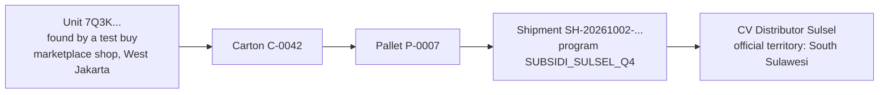
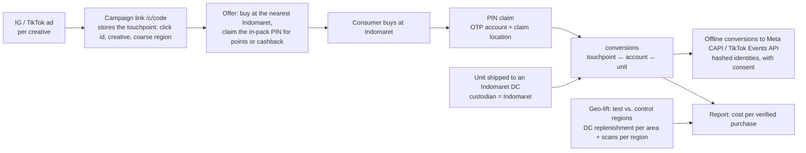

# Product Defense

This document defends the product decisions behind mGanik's four operational cases and Pillar D
(the Supply Chain Command Center). Every case follows the same order: **core problem → layered
solution → edge cases and false positives → trade-offs → business metrics → staged rollout →
what the prototype already does**.

How to read the status labels:

- **Built**: in the code and tested against a real PostgreSQL (test names are given).
- **Design**: not built yet; the reasoning and the plan are written here.

Technical details (schema, concurrency, security, limitations) are in
[`ARCHITECTURE.md`](ARCHITECTURE.md).

## Contents

1. [Summary](#1-summary)
2. [Assumptions](#2-assumptions)
3. [Shared foundation: one data asset for four cases](#3-shared-foundation-one-data-asset-for-four-cases)
4. [Case 1: Distributor gray market](#4-case-1-distributor-gray-market)
5. [Case 2: Loyalty point fraud](#5-case-2-loyalty-point-fraud)
6. [Case 3: Attributing ads to Indomaret sales](#6-case-3-attributing-ads-to-indomaret-sales)
7. [Case 4: Offline POS vs. online stock split-brain](#7-case-4-offline-pos-vs-online-stock-split-brain)
8. [Pillar D: Supply Chain Command Center](#8-pillar-d-supply-chain-command-center)
9. [Key metrics](#9-key-metrics)
10. [Roadmap](#10-roadmap)
11. [Questions that will almost certainly come up](#11-questions-that-will-almost-certainly-come-up)

---

## 1. Summary

| Case | Core of the solution | Prototype status | Headline metric |
|---|---|---|---|
| 1. Distributor gray market | Every unit traces back to a shipment and the distributor that received it. A scan outside the official territory becomes internal evidence; a per-distributor leakage index, not a single scan, triggers action | Built: aggregation, shipment + custodian propagation, trace, the `OUT_OF_TERRITORY` rule, the leakage index. Design: test-buy endpoint, IP geolocation | Subsidy saved (IDR) |
| 2. Loyalty point fraud | The outer QR only checks authenticity; points need the PIN inside the pack. Lifecycle gate, holding period, risk score, review + clawback | Almost fully built. Missing: the scheduled job that releases held points | Reversed-claim rate, point cost per incremental repeat purchase |
| 3. Ads → Indomaret | Move the measuring instrument into the consumer's hands: a post-purchase PIN claim links the click to the purchase; serial data proves the unit went through an Indomaret DC; geo-lift covers people who never scan | Design. The reused pieces (PIN claim, region-tagged scans, custodian per shipment) are built | Cost per verified purchase, iROAS from a geo test |
| 4. POS stock split-brain | Facts beat promises. Shrink the conflict window (buffer, heartbeat); when a conflict still happens, the cashier sale always stands and the online order is reallocated or settled fairly | Built in the backend (sync, preemption, reallocation, conflicts). Design: the in-browser offline POS app | Conflicts per 1,000 online orders fulfilled from store stock, % reallocated automatically |
| D. Command Center | Three questions every morning: which stock will run out, which distributor is leaking, which conflicts are still open | Built as an API read model. Missing: the console screens | Stockout days avoided, anomaly false-positive rate |

**Common threads**

1. **One data asset, many uses.** Serialization + aggregation + an in-pack PIN answer the gray
   market, point fraud, ad attribution, and anti-counterfeit questions at once.
2. **Integrity in the database, decisions in services.** Critical invariants are locked by
   constraints; business rules can change without corrupting data.
3. **Never punish on a single signal.** The radar collects evidence, people decide. Consumers are
   never blamed for a distributor's misconduct.
4. **Cost-aware staged rollout.** Start with what does not change the packaging or the factory
   process, measure, then step up.
5. **Honest about limits.** What is not built is written down as a limitation, including the
   weakest point of each design.

---

## 2. Assumptions

I do not have mGanik's operational data. The assumptions below are defaults; every numeric
threshold can be changed without a deploy (`anomaly_rules.params`, environment config) and must be
calibrated against the first weeks of real data.

| Area | Assumption |
|---|---|
| Organization | One business group, possibly multi-brand. Currency IDR. Times stored in UTC and shown in the location's time zone (WIB/WITA/WIT) |
| Labels | Hologram labels are printed by a vendor using codes we generate: a public QR outside the pack and a PIN inside the pack or on the back of the label. Labels are applied on the production line, then scanned to commission them to a batch |
| Modern retail | Indomaret and other third-party retailers do not scan our serials; their POS is a black box. The only data we might get is DC replenishment, with a weekly lag |
| Distributors | Distributors do not use our system yet (no outbound scan at the distributor's warehouse). A distributor portal is a later phase |
| Online channels | Marketplaces and the payment gateway integrate through webhooks (in the prototype: HMAC-signed mocks) |
| Own stores | Tablets/PCs running Chrome or Edge with HID barcode scanners. Store internet can drop for hours |
| Consumers | Use the phone camera to scan the QR; no app install. Indonesian phone numbers for OTP |
| Starting numbers | 5% baseline cross-region consumer mobility, a minimum sample of 20 scans per distributor, a 7-day point holding period, a claim review threshold of risk score 50, an online stock buffer of 2 units per store, a 2-minute heartbeat timeout |

---

## 3. Shared foundation: one data asset for four cases

Every unit carries two secrets with different jobs:

| Code | Where | Purpose | Cannot be used for |
|---|---|---|---|
| Public QR (80 random bits, 16 characters) | Outside the pack, visible on the shelf | Anyone can verify authenticity, no login | Claiming points |
| Claim PIN (50 random bits) | Inside the pack or under a seal, reachable only after purchase and opening | Point claims by a verified account | Anything before the product is bought |

Random (not sequential) codes make enumeration impossible. The PIN is only stored as
`HMAC-SHA256(pepper, id ‖ PIN)`.

Units are aggregated into cartons and pallets on the production line. A shipment moves custody of
the whole packaging tree at once. As a result, for every unit we know its batch and production date,
the label print job, its carton and pallet, every shipment that carried it, who holds it now, and
where it has been scanned. All four cases below read this same data asset.

---

## 4. Case 1: Distributor gray market

### 4.1 Core problem

A regional distributor (say, South Sulawesi) gets subsidized pricing to grow the market in its
territory, then resells the goods on marketplaces in big cities. The result:

- the brand pays a subsidy for sales that do not grow any new market;
- big-city market prices erode, because subsidized goods sell below the normal price;
- the official big-city distributors lose sales and trust in the brand.

**Why it is hard:** we have no access to the distributor's warehouse and cannot inspect it. The
leaked goods are **genuine**, so an ordinary authenticity check never catches them.

### 4.2 Layered solution

**Layer 1: serial data that ties a unit to a delivery note.**

1. The production line aggregates unit → carton → pallet (`POST /serials/aggregate`). Capacity,
   product, packaging level, and the mixed-batch rule are validated; parallel packing into the
   same carton cannot exceed its capacity.
2. The shipment to the South Sulawesi distributor carries a `program_code` (for example
   `SUBSIDI_SULSEL_Q4`). A single statement moves the status and custodian of every descendant of
   the pallet to that distributor and writes one event per unit.
3. `GET /serials/:code/trace` returns the full genealogy: packaging ancestors, shipments (including
   those of the parent carton/pallet, even after the unit was unpacked), custodian, and the latest
   scans.

**Layer 2: location signals.** Distributors do not scan, so the signals come from outside:

| Source | Trust | Status |
|---|---|---|
| Consumer verification scans (GPS with permission) | Medium: the consumer may be traveling | Built |
| Point claims (claim location) | Medium | Built |
| **Test-buy program**: the ops team buys from suspicious marketplace listings (priced below normal), then scans with the `TEST_BUY` context | Highest: a controlled purchase with a transaction receipt | The leakage index already counts it; the endpoint that records test-buy scans is design |
| Returns | Medium | Design |

**Layer 3: rules and an index, not accusations per scan.**

- The `OUT_OF_TERRITORY` rule compares the scan region with the custodian's official territory
  (`partner_territories`, with `NATIONAL`/`SELECTED` stored explicitly). The result is an
  **internal anomaly**; the consumer still sees "genuine", because the product is genuine. The
  problem is the distributor, not the consumer.
- **A leakage index per distributor** (`GET /cc/distribution-leakage`) = out-of-territory scans ÷
  scans that can be judged, within a time window (max 90 days). It alerts when:
  - the sample is at least 20 scans **and** the ratio exceeds the 5% mobility baseline, **or**
  - there is **a single** out-of-territory test-buy hit (the strongest evidence, alert at once).
- The custodian and the official territory are evaluated **at scan time**, not at report time.
  A distributor whose territory changed or whose contract ended mid-window is not wrongly accused.

**Layer 4: evidence without a physical inspection.** An example chain of evidence read straight
from the data:

**Layer 5: business action after the evidence.** Following the distribution contract: claw back
the subsidy for units proven to have leaked, cut the allocation in the next program, or end the
subsidy program for that distributor. The system supplies evidence; the sanction stays a human
decision.

### 4.3 Edge cases and false positives

| Situation | Why it can be wrong | Handling |
|---|---|---|
| Consumer traveling (holiday homecoming, business trip) | One out-of-territory scan looks like a leak | No action on a single scan. A per-distributor index with a minimum sample and a mobility baseline |
| Spoofed GPS | Location is sent by the client | No single signal triggers a sanction; test buys are evidence the team controls |
| Scan region too coarse (province only) while the official territory is city-level | Cannot decide inside vs. outside | The scan is not judged (counted in neither numerator nor denominator) |
| Legitimate transfer between distributors | The unit changes territory officially | Must be recorded as a shipment, so the custodian changes |
| Distributor with national coverage | Every region is legitimate | `coverage_mode = NATIONAL` never produces `OUT_OF_TERRITORY` |
| Party with no official territory data | Unknown | Skipped, never assumed national or empty |
| Scan without location permission | No region | Not judged; only located scans enter the index |

**Distributor counter-tactics**

| Tactic | Answer |
|---|---|
| Tearing off the hologram label | Tamper-evident labels (VOID pattern); consumer education ("no hologram, don't buy"); takedown of listings without holograms through the marketplace brand protection program |
| Breaking up cartons and spreading them to sub-distributors | Precision drops to the distributor level, which is still enough for a sanction. Later phase: a distributor portal with outbound scans |
| Selling through personal or reseller accounts | A test buy still traces the unit to its shipment, whoever the seller is |

### 4.4 Trade-offs

- Aggregation scans add a step on the production line: scanners, operator discipline, and per-shift
  targets. The system rejects cartons over capacity, so mistakes show up quickly.
- Propagating custody when a shipment is written (rather than when data is read) makes shipments
  more expensive to write, because consumer scans are far more frequent and more latency-sensitive
  than shipments.
- Region resolution uses the nearest city centroid: cheap, but imprecise near borders. Production
  needs region polygons.
- The leakage index depends on the consumer scan rate. Regions with a low scan rate need test buys
  to close the gap.

### 4.5 Business metrics

| Metric | Definition | Why it matters |
|---|---|---|
| **Subsidy saved (IDR)** | (normal price − subsidized price) × estimated leaked units prevented or clawed back | The number that makes management act |
| Leakage index per distributor | Out-of-territory scans ÷ judged scans, per month | The trend per distributor, not single incidents |
| Scan-to-alert time | From the first triggering scan to the alert | How fast we respond before leaked stock spreads |
| Test buys traced to a shipment | % of test buys with a unit → shipment chain | Quality of the aggregation data |
| False-positive rate | `FALSE_POSITIVE` anomalies ÷ closed anomalies | Rule quality; raise the thresholds if it is too high |

Illustration (not mGanik data): a price gap of IDR 5,000 per unit × 10,000 leaked units per month =
IDR 50 million per month for one distributor.

### 4.6 Staged rollout

1. **Phase 1, one subsidy program:** aggregation on the line for that program's SKUs, shipments
   always carry a `program_code`, consumer scans run, and ops reads the leakage index weekly.
2. **Phase 2, routine test buys:** 10–20 purchases a month from listings below the normal price.
   Start enforcing a clawback clause in the next program's contract.
3. **Phase 3:** a distributor portal with outbound scans for large distributors; region polygons;
   automatic alerts to the distributor's account manager.

### 4.7 In the prototype

| Component | Status | Evidence |
|---|---|---|
| Unit → carton → pallet aggregation with capacity and level validation | Built | `TestAggregate_CapacityAndIdempotent`, `TestAggregate_ConcurrentCapacity`, `TestAggregate_MixedBatchRule`, `TestAggregate_Rejections` |
| Shipment + custody propagation across the whole pallet | Built | `TestShipment_PropagatesToWholePallet`, `TestShipmentToPartyAndUnlocatedScope` |
| Genealogy trace | Built | `TestTrace_Genealogy`, `TestTrace_ShipmentSurvivesUnpack` |
| `OUT_OF_TERRITORY` stays internal | Built | `TestVerify_OutOfTerritoryIsInternalOnly`, `TestVerify_NationalCoverageNeverOutOfTerritory` |
| Leakage index per distributor | Built | `TestLeakage_IndexPerDistributor`, `TestLeakage_CustodianAtScanTime`, `TestLeakage_TerritoryValidAtScanTime`, `TestLeakage_RoleEndedMidWindow`, `TestLeakage_CoarseRegionAndRounding` |
| Endpoint that records test-buy scans | Design | — |
| Location from IP for scans without GPS | Design | The default resolver answers "unknown" |
| Stock balance moves with the shipment | Not yet (ARCHITECTURE §9, I4) | — |

---

## 5. Case 2: Loyalty point fraud

### 5.1 Core problem

The QR on the pack is visible on the shelf, so anyone (cashiers, promoters, middlemen) can scan it
before the product is sold and harvest the points. Points must go to **the real buyer, exactly
once**.

**Why it is hard:** at third-party retailers we do not know when a unit was sold. Too strict, and
real buyers are disappointed; too loose, and the loyalty program funds point thieves.

### 5.2 Layered solution

The principle: change the **economics of the attack**, not just add detection. To get the PIN, an
attacker has to break the seal, and a product with a broken seal cannot be sold.

| # | Layer | How it works | Status |
|---|---|---|---|
| 1 | **Two codes per unit** | The outer QR only verifies; points need the in-pack PIN | Built |
| 2 | **Lifecycle gate** | `SOLD` units (sold in our own stores/D2C) → points right away. `AT_PARTNER` units (at third-party retail, sale time unknown) → the claim is accepted and the points stay `PENDING` for a 7-day holding period, leaving room for review and clawback. Units not yet in circulation (`IN_STOCK`, `GENERATED`, `QUARANTINED`, ...) → rejected + anomaly | Built |
| 3 | **One active claim per unit** | A partial unique index over `PENDING`/`APPROVED` claims only. The claim, the serial's move to `CONSUMER_ACTIVATED`, and the point ledger entry are written in one transaction | Built |
| 4 | **Verified accounts** | Phone OTP login (the number is stored encrypted); a claim rate limit of 10 per hour per account | Built (mock OTP) |
| 5 | **PIN brute-force protection** | A unit locks after 5 wrong PINs, plus an anomaly. Parallel attempts are serialized by a row lock, so they cannot get past the limit | Built |
| 6 | **Risk score** | Weights from `anomaly_rules.params`, summed and clamped to 0–100; a score ≥ 50 → manual review | Built |
| 7 | **Review and clawback** | Staff with `loyalty.review` approve, reject, or reverse (clawback, reason required). Points are reversed through the ledger, the serial status is restored, and everything is audited | Built |
| 8 | **Aligned incentives** | Cashiers in our own stores earn an official incentive per transaction scanned at the POS, which removes the motive to harvest consumer points | Process, outside the code |

Risk score rules (defaults):

| Rule | Condition | Weight |
|---|---|---|
| `CLAIM_NEAR_STORE` | Claim within 100 m of a store during opening hours (consumers usually claim at home) | 30 |
| `CLAIM_ACCOUNT_VELOCITY` | More than 5 claims per account in 24 hours | 40 |
| `CLAIM_CARTON_SPREAD` | Units from the same carton claimed by more than 3 accounts in 24 hours | 30 |
| `CLAIM_SHARED_DEVICE` | One device used by more than 3 accounts | 40 |

With a threshold of 50, **no single rule triggers a review on its own**. It takes at least two
signals (for example rapid claims + near a store = 70). That is deliberate: one signal is too easy
to get wrong.

### 5.3 Edge cases and false positives

| Situation | Handling |
|---|---|
| The real buyer arrives after a fraudulent claim | The fraudulent claim is rejected or reversed in review. Because the unique index only covers active claims, the real buyer can still claim. The rejected account cannot claim that unit again, and any later claim on a unit with a rejected history must go through manual review |
| A claim is rejected after the unit was activated | The serial returns to its pre-activation status (`SOLD`/`AT_PARTNER`), so the unit is covered again by recalls and returns |
| The consumer claims inside the store where they bought | Weight 30 only, not enough for a review on its own |
| A gift (buyer ≠ claimer) | Legitimate. Points go to the PIN holder, the person who opened the pack |
| Damaged pack, unreadable PIN | Customer service with a photo of the pack + the receipt; points granted through an `ADJUST` ledger entry. The CS endpoint is not built |
| A buyer at a third-party retailer waits 7 days | The claim response says when the points become available; the balance is split into "available" and "on hold" |
| Two simultaneous claims for the same unit | One wins, the other is rejected with `already_claimed` |
| Batch recall after a claim | The unit with the consumer stays `CONSUMER_ACTIVATED`; verification shows the recall instructions |

### 5.4 Trade-offs

- **Packaging cost.** An in-pack PIN needs variable-data printing on the back of the label or the
  cap; a scratch-off layer or seal adds cost per unit. That is why the expensive physical layer is
  reserved for SKUs or regions with measurably high fraud (see the rollout).
- **Delayed gratification.** Buyers at third-party retailers wait 7 days. That is the price of
  being able to reverse harvested points before they are redeemed.
- **Manual review cost.** The threshold of 50 can be raised if the review queue grows too long
  and the false-positive rate is high.
- **SMS OTP cost** per consumer login.

### 5.5 Business metrics

| Metric | Definition |
|---|---|
| **Reversed-claim rate** | `REJECTED` + `REVERSED` claims ÷ all claims. Should fall once the PIN layer is live |
| Scan rate | Claims ÷ units sold. Too low = the program is not attractive; a sudden spike = harvesting |
| % of claims reviewed + review SLA | Team workload and consumer experience |
| Review false-positive rate | Reviewed claims that end up approved ÷ reviewed claims |
| **Point cost per incremental repeat purchase** | Total point cost ÷ additional repeat purchases compared with a no-points control group |
| Repeat purchase rate of point holders | Compared with non-holders |
| Units locked by PIN brute force | A sign of organized attacks |

### 5.6 Staged rollout

1. **Phase 1, one-SKU pilot:** the PIN is printed on the back of the label (variable data; the pack
   shape does not change). The lifecycle gate, holding period, and risk score are on; every claim
   with a score ≥ 50 is reviewed. Measure the scan rate, the reversal rate, and the false-positive
   rate.
2. **Phase 2, all SKUs:** the review threshold is calibrated from phase 1 data; the worker releases
   points automatically after the holding period; the incentive for our own cashiers starts.
3. **Phase 3, physical layer:** a tamper-evident scratch-off layer or seal, only for high-value SKUs
   or high-fraud regions, and only if measured fraud losses exceed the label cost.

### 5.7 In the prototype

| Component | Status | Evidence |
|---|---|---|
| Code + PIN minting, PIN stored only as an HMAC | Built | `TestMint_UnitCodesAndPINs`, `TestMint_ContainerHasNoPINAndValidation` |
| Lifecycle gate | Built | `TestClaim_SoldUnitApprovedImmediately`, `TestClaim_AtPartnerWaitingPeriod`, `TestClaim_UnsoldUnitRejectedWithAnomaly` |
| One active claim, simultaneous claims | Built | `TestClaim_ConcurrentDoubleClaim`, `TestInvariant_OneActiveClaimPerUnit` |
| PIN lockout, including parallel attempts | Built | `TestClaim_WrongPINLockout`, `TestClaim_ParallelBruteForceStopsAtFive` |
| Risk score + review | Built | `TestClaim_RiskScoreClampedAndReview`, `TestHTTP_ClaimAndReviewFlow` |
| Rejection, real buyer, clawback | Built | `TestClaim_RejectedThenGenuineBuyerClaims`, `TestClaim_QARepro_ReclaimAfterRejectBlocked`, `TestClaim_ReverseApprovedClaim`, `TestClaim_RejectRestoresStatusSoRecallCatchesIt`, `TestClaim_ConcurrentReviewDecisions` |
| Automatic point release after the holding period | The function is built and tested (`TestReleaseDueClaims_ConcurrentInstances`) but not scheduled by the worker (ARCHITECTURE §9, I3) | — |
| Units sold through D2C orders can be claimed | Not yet: fulfillment does not move the serial to `SOLD` (ARCHITECTURE §9, I2). Units sold through the POS already can | — |
| SMS OTP sender, CS endpoint | Design | — |

---

## 6. Case 3: Attributing ads to Indomaret sales

This whole case is **design**. The reused pieces (PIN claim, region-tagged scans, custodian per
shipment) are already built for Cases 1 and 2.

### 6.1 Core problem

Marketing spends on Instagram/TikTok ads and needs proof that those ads drive physical sales at
Indomaret. Indomaret's POS is a black box: no real-time transaction data, only DC replenishment
with a weekly lag. Without proof, the ad budget is split by clicks and views, not purchases.

### 6.2 Hybrid solution: deterministic for some buyers, experiments for the rest

1. **Coded campaign links.** Every creative gets a `campaign_links` entry (`/c/<code>` + UTM). The
   landing page stores the touchpoint (click id `fbclid`/`ttclid`, creative, coarse region) with
   an anonymous first-party cookie.
2. **The post-purchase PIN claim as the measuring instrument.** The consumer buys at Indomaret,
   opens the pack, and claims the PIN (the Case 2 mechanism). The anonymous cookie is linked to the
   account through `identity_links` and recorded in `conversions`.
3. **Serialization proves the channel.** The unit's custodian is the Indomaret DC for region X
   (from the shipment), so the purchase really went through Indomaret, with no integration with
   their POS.
4. **Geofenced promos.** The promo only applies when the claim location is inside the campaign's
   target region; ads target a radius around the stores.
5. **Feedback to the ad platforms.** Offline conversions go to the Meta Conversions API and the
   TikTok Events API (hashed identities, only for consumers who gave marketing consent), so the ad
   algorithms learn from real purchases instead of clicks.
6. **Geo-lift for people who never scan.** Test regions (ads on) are compared with control regions
   using difference-in-differences on replenishment to Indomaret DCs per area
   (`region_sellin_daily`) and on scans per region. The regional scan rate is the calibration
   factor.
7. **Optional for large rewards:** a receipt upload (OCR) for the store code and the date.

**Planned tables:** `campaigns`, `campaign_links`, `touchpoints`, `identity_links`,
`conversions`, `attributions`, `region_sellin_daily`. The consent columns already exist on
`consumers` (`consent_marketing_at`, `consent_location_at`).

### 6.3 Edge cases

| Situation | Handling |
|---|---|
| The consumer sees the ad on one phone, buys, then claims from another phone | The deterministic chain breaks; geo-lift captures it, deterministic attribution does not |
| Cookies cleared, or Safari ITP | Same: part of the chain is lost and is not claimed as attribution |
| The consumer claims without ever seeing an ad | An organic conversion; not attributed to the campaign |
| A unit bought at an Indomaret store in a different region from its DC | The custodian is the DC; the claim location gives a more precise store region |
| The consumer gave no consent | Not sent to ad platforms; only counted in anonymous aggregates |

### 6.4 Trade-offs

- **Selection bias.** Only engaged consumers claim a PIN, so claim counts are not total sales. Do
  not read them as absolute numbers; calibrate with geo-lift.
- **Data lag.** DC replenishment arrives weekly, so geo-lift takes several weeks to read.
- **Incentive cost** per claim (points or cashback) is the cost of measurement.
- **Privacy.** Location and identity data for marketing need explicit consent (Indonesian Personal
  Data Protection Law No. 27/2022); only hashed identities leave for the ad platforms.

I do not claim 100% attribution. What I offer is a deterministic signal for some buyers and a geo
experiment to estimate the rest; each corrects the other.

### 6.5 Business metrics

| Metric | Definition |
|---|---|
| **Cost per verified purchase** | Ad spend ÷ purchases proven through a PIN claim |
| **Incremental lift and iROAS** | From the geo test: the sales increase in test regions over control, and incremental revenue ÷ ad spend |
| Deterministic attribution coverage | % of purchases (geo-lift estimate) that have a click → claim chain |
| Scan rate per region | The calibration factor |
| Click-to-purchase time | Sets the attribution window |

### 6.6 Staged rollout

1. **Phase 1:** one campaign, two test regions and two comparable control regions. Campaign links +
   PIN claims with cashback. Measure the scan rate and the cost per verified purchase.
2. **Phase 2:** send offline conversions to Meta CAPI/TikTok Events API; compare campaigns optimized
   for real purchases against campaigns optimized for clicks.
3. **Phase 3:** a quarterly geo-lift as the basis for splitting the budget across channels.

---

## 7. Case 4: Offline POS vs. online stock split-brain

### 7.1 Core problem

The store's internet goes down. The cashier sells the last unit and the transaction is stored on
the device. In the same second an online order comes in, because the server still sees 1 unit in
the store. When the device is back online, two claims point at one physical item.

### 7.2 Principle: facts beat promises

The buyer at the counter already holds the item; that sale cannot be undone. The online order is a
promise that can still be fulfilled from somewhere else. Therefore:

- a correctly signed offline sale is **never rejected** because of stock;
- the online reservation that loses is reallocated to another location automatically;
- if no other location has stock, the online buyer is **never charged** for an item that cannot be
  shipped, and gets a clear choice.

### 7.3 Prevention layers: shrinking the conflict window

| Layer | How it works | Status |
|---|---|---|
| Warehouse first | Online orders are allocated to the central warehouse, then the hub, and only then to stores that enabled online fulfillment | Built |
| Store buffer | Store online ATP = available − `online_buffer_qty` (for example, the last 2 units are kept for walk-in buyers), re-checked inside the reservation statement | Built |
| POS heartbeat | The device sends a heartbeat every 30 seconds. After more than 2 minutes without one, the location is marked `OFFLINE` and its online ATP drops to 0 immediately. The conflict window shrinks from "as long as it is offline" to "at most 2 minutes" | Built |
| Offline lease (a stricter option) | A stock quota owned by the POS that online orders never touch. Safer, but lowers online availability | Design |

### 7.4 Resolution when a conflict still happens

The flow is drawn in [ARCHITECTURE §3.3](ARCHITECTURE.md#33-offline-pos-sync-and-conflicts-with-online-orders-case-4).
Within a single sync transaction:

1. Lock the active reservations and the `(store, product)` balance row.
2. Enough available stock → a normal `DIRECT_SALE`.
3. Not enough → **preempt** online reservations at that store in a deterministic order:
   - the newest `PENDING_PAYMENT` orders first: they have not paid and are hurt the least;
   - then the newest `PAID` orders;
   - within a group, the smallest reservation that covers the shortfall, so as few customers as
     possible are affected.
   Every preemption records an `OFFLINE_SALE_PREEMPT` conflict and an event for the worker.
4. Physical stock is short too (an unrecorded receipt, a stock-count discrepancy) → the sale is still
   recorded, and the gap is recorded as `ADJUST_DISCREPANCY` + a conflict + an anomaly for a stock
   count. The system does not lie to keep the numbers tidy.
5. The reallocation worker looks for another location:
   - stock found → a new reservation, conflict `AUTO_RESOLVED`; the online customer notices nothing
     beyond perhaps a shifted delivery estimate;
   - none, and the order is already paid → `NEEDS_ACTION` with two options: wait for restock + a
     voucher, or a full refund + an apology voucher;
   - none, and the order is not yet paid → `EXPIRED`; if the payment still arrives, it is handled as
     a late payment (reserve stock again, or refund).
6. Ops closes the remaining conflicts at `POST /cc/conflicts/:id/resolve` with a resolution
   (`CUSTOMER_COMPENSATED`, `ORDER_CANCELLED`, `STOCK_RECOUNTED`, ...) and a required note.

**Fair to both sides:** the in-store buyer gets the item they are holding; the online buyer is never
charged for an item that cannot be shipped, and receives clear compensation.

### 7.5 Other offline POS rules

| Rule | Behavior | Status |
|---|---|---|
| Idempotency | `client_txn_id` (UUIDv7 from the device) + `device_seq`; a resend → the exact same result, stock reduced once | Built |
| Integrity | Every transaction is HMAC-signed with the device signing key; same ID with different content → rejected + critical anomaly | Built |
| Offline duration | More than 24 hours → accepted with the `OFFLINE_TOO_LONG` flag | Built |
| Prices | From the latest price list version the device carries; an expired version → `PRICE_STALE` flag; a price that differs from the server → `PRICE_MISMATCH` | Built |
| Transaction value | Above IDR 10 million per transaction → accepted + anomaly for review | Built |
| Unknown serial | The sale is still accepted (the customer is not held up), then a critical anomaly: **the store sold an item that is not registered**, possibly counterfeit goods slipped in by an insider | Built |
| EDC/QRIS approval reused | The sale is recorded, the payment waits for verification + anomaly (a sign that a cashier pocketed money) | Built |
| Cashier deactivated before sync | The sale is still a fact; accepted with a flag + anomaly | Built |
| Lost device | The device token is revoked; local data is minimal (no consumer PII). Unsynced offline sales from that device are recovered by hand | Built (revocation) |
| Promos that need server validation | Disabled while offline | Design |
| Several tabs | The Web Locks API guarantees a single sync runner; `device_seq` is taken inside a Dexie transaction | Design |
| Browser clears local data | `navigator.storage.persist()` during provisioning | Design |

### 7.6 Edge cases

| Situation | Handling |
|---|---|
| The device resends a batch after a timeout | `DUPLICATE` with an identical result; stock unchanged |
| The same batch sent by two tabs/processes at once | The unique index holds the second until the first commits; one is processed, one is `DUPLICATE` |
| Wrong device clock | The server's receive time drives decisions; the skew is recorded and flagged |
| A missing sequence number | The server answers with `ack_up_to_seq` and `missing_seqs`; the device resends what has not arrived |
| A thief with the device token but no signing key tries to fill the next sequence number | Rejected without being stored; the sequence number is not taken, and genuine sales still get in |
| The preempted online order is being cancelled at the same moment | The sync waits; a phantom stock discrepancy is never recorded |
| One transaction with many products | Every product's reservations are locked up front in a fixed order (no deadlock) |

### 7.7 Trade-offs

- **The buffer** reduces online availability at stores. It can be tuned per `(store, product)` by
  sales velocity.
- **The heartbeat** still leaves a window of up to 2 minutes; an offline lease closes it at the cost
  of lower online availability.
- **Preemption occasionally hurts an online customer.** The cost is measurable (compensation) and
  smaller than rejecting a sale at the counter.
- **Accepting stock discrepancies** means POS facts can "add" to recorded stock. The safeguards: a
  signature per transaction, a cashier who must be permitted at that location, an anomaly for every
  discrepancy, and stock counts.

### 7.8 Business metrics

| Metric | Definition |
|---|---|
| **Conflicts per 1,000 online orders fulfilled from store stock** | The main measure of whether prevention works |
| **% reallocated automatically** | `AUTO_RESOLVED` conflicts ÷ all preemption conflicts |
| Conflict resolution time | From conflict creation to `RESOLVED` |
| Compensation cost | Vouchers + refunds caused by preemption, per month |
| Offline duration distribution per store | Stores with poor connectivity need a larger buffer or a lease |
| p95 sync lag | `received_at − occurred_at` |
| Discrepancy units per store per month | An indicator of goods-receipt and stock-count quality |

### 7.9 Staged rollout

1. **Phase 1:** online orders only from warehouses; stores run the offline-first POS. Conflicts are
   close to zero, and offline data per store accumulates.
2. **Phase 2:** enable online fulfillment at 1–2 pilot stores with a 2-unit buffer + heartbeat.
   Measure conflicts per 1,000 orders and the compensation cost.
3. **Phase 3:** per-SKU buffers based on sales velocity; an offline lease for the stores with the
   worst connectivity.

### 7.10 In the prototype

| Component | Status | Evidence |
|---|---|---|
| Idempotent sync (duplicate, concurrent duplicate, same ID with different content) | Built | `TestPosSync_DuplicateBatch`, `TestPosSync_ConcurrentDuplicate`, `TestPosSync_SameIdDifferentPayload` |
| This exact scenario | Built | `TestKasus4_OfflineSaleBeatsOnlineReservation`, `TestKasus4_NoStockAnywhere_NeedsAction` |
| Preemption order and stock discrepancy | Built | `TestRecordFactSale_PreemptOrder`, `TestRecordFactSale_PreemptsSmallestSufficient`, `TestRecordFactSale_Discrepancy`, `TestRecordFactSale_QARepro_NoPhantomStock` |
| Sync concurrent with online orders | Built | `TestPosSync_ConcurrentWithOnlineOrders` |
| Reallocation by the worker | Built | `TestReallocationHandler` |
| Online buffer + heartbeat → OFFLINE | Built | `TestOrder_OnlineATPForStores`, `TestPosHeartbeat_MarkOfflineThreshold`, `TestPosHeartbeat_TwoJobInstances` |
| Signatures, sequence squatting, flags, limits | Built | `TestPosSync_InvalidSignature`, `TestQA_SeqSquatting`, `TestPosSync_FlagsAndValidation`, `TestPosSync_BatchLimits`, `TestPosSync_SeqGapAndOrdering` |
| Conflict resolution by ops | Built | `TestConflictResolve` |
| In-browser offline POS app (IndexedDB outbox, cashier screen) | Built (`/pos` PWA) | `apps/web/src/features/pos/**/*.test.ts(x)` (canonical JSON vectors shared with Go, two-tab `device_seq`, sync engine statuses) |
| Issuing vouchers and executing refunds at the gateway | Design: the system records the resolution options and the refund request (metadata + event) but does not execute them | — |

---

## 8. Pillar D: Supply Chain Command Center

The Command Center answers three questions every morning: **which stock will run out, which
distributor is leaking, and which conflicts are still open.**

| Question | Endpoint | Contents |
|---|---|---|
| Summary | `GET /cc/summary` | Counts of critical/warning items and their locations, the earliest runout date, stockouts, open anomalies and conflicts, store sync status. The frontend will render it as a sentence first, then tables |
| Where is the stock | `GET /cc/stock` | Balance per location. Stock at locations we do not own (partner warehouses, marketplaces) is flagged `is_estimate` and never presented as fact |
| When will it run out | `GET /cc/runout` | DOI and runout date per `(location, product)` |
| Which distributor is leaking | `GET /cc/distribution-leakage` | Leakage index per distributor (Case 1) |
| Anomalies | `GET /cc/anomalies`, `PATCH /cc/anomalies/:id` | Work queue `OPEN → ACK → RESOLVED / FALSE_POSITIVE`, audited |
| Conflicts | `GET /cc/conflicts`, `POST /cc/conflicts/:id/resolve` | Allocation conflicts from the POS (Case 4) |

**Runout and DOI**

- `avg_daily_sales` = units sold (`DIRECT_SALE` + `COMMIT_SALE`) in the 28-day window ÷
  `history_days`. `history_days` is the age of the `(location, product)` history, capped at 28: a
  SKU that is two days old is not divided by 28 days, which would make its DOI 14 times too
  optimistic.
- `DOI = available ÷ avg_daily_sales`; `runout_date = today + DOI`.
- `CRITICAL` when DOI < lead time, or when stock is out while the item is still selling. `WARNING`
  when DOI < lead time + safety days, or when stock is below `min_qty`.
- A SKU with no sales history → `INSUFFICIENT_DATA`, not a made-up number. Less than 7 days of
  history is flagged `SHORT_HISTORY`.
- Seasonality (Ramadan/Lebaran, 11.11, 12.12): a later phase uses EWMA + seasonal factors from the
  previous year.

**Metrics for Pillar D:** stockout days avoided, DOI accuracy (predicted DOI vs. the actual day stock
ran out), false-positive rate per anomaly rule, time from anomaly creation to `ACK`.

**Status:** every endpoint above is built and tested (`TestRunout_LevelsDOIAndOrder`,
`TestRunout_ShortHistoryAndRounding`, `TestStock_VisibilityFiltersAndKeyset`, `TestSummary_Facts`,
`TestAnomaly_Transitions`, `TestScope_SelectedSeesOnlyOwnLocations`). The console screens (`/console`)
show the summary as sentences first, then runout, stock, anomalies, conflicts and distribution
leakage. Because shipments do not move stock balances yet (ARCHITECTURE §9, I4), partner
warehouse stock is not filled from shipments.

---

## 9. Key metrics

One headline metric per area, so the system's success is not measured by its feature count:

| Area | Headline metric | Guardrail metric |
|---|---|---|
| Case 1 / Pillar A | Subsidy saved (IDR/month) | Leakage anomaly false-positive rate |
| Case 2 | Point cost per incremental repeat purchase | Reversed-claim rate, review SLA |
| Case 3 | Cost per verified purchase | Deterministic attribution coverage |
| Case 4 / Pillar C | Conflicts per 1,000 online orders fulfilled from store stock | Compensation cost, p95 sync lag |
| Pillar B | Oversell incidents per 1,000 orders (target 0) | `NEEDS_ACTION` orders per 1,000 orders |
| Pillar D | Stockout days avoided | DOI accuracy |

---

## 10. Roadmap

Work after the prototype, ordered by the size of the risk it closes:

1. **Integration between modules** (ARCHITECTURE §9): per-permission scope checks in every module
   (I1), fulfillment moves serials to `SOLD` (I2), shipments and recalls move stock balances (I4),
   the point release and session cleanup jobs (I3), `LEDGER_DRIFT` reconciliation (I5).
2. **The offline POS app** (Dexie outbox + sync engine + cashier screen) and **the consumer
   verification page** at 360 px width.
3. **The Command Center console**: summary sentence, runout, anomaly and conflict queues, serial
   trace.
4. **A test-buy endpoint** and IP geolocation for scans without GPS.
5. **Case 3**: campaign links, touchpoints, offline conversions to ad platforms, geo-lift.
6. **A distributor portal** with outbound scans.

---

## 11. Questions that will almost certainly come up

**Why not keep stock in Redis?** Redis is fast, but stock in Redis means a dual write to the
database, which drifts. The conditional update in Postgres has already shown that 100 concurrent
requests for 10 units produce exactly 10 reservations, with the ledger in the same transaction. The
path for flash sales is splitting the hot row, not moving the source of truth.

**Why not SERIALIZABLE?** SERIALIZABLE aborts conflicting transactions and forces retries on every
path, exactly during a spike. At READ COMMITTED, Postgres re-evaluates `WHERE` after waiting for the
lock, so the conditional update is already safe without aborts.

**What if PINs leak from the print vendor?** That is the weakest point, and we say so. The plaintext
PIN only exists in the mint response, the input for the print file. Process mitigations: the vendor
contract and audits, a print file that is encrypted and deleted after printing, and reconciliation
per print job (labels printed vs. commissioned vs. voided; the columns exist in `code_batches`, the
workflow is not built). Mitigations already running in the code: a code scanned by a consumer while
still `GENERATED`, or before it ever left the central warehouse, immediately raises a high-severity
anomaly that points to its print job, and point claims on unsold units are rejected.

**What about radar false positives?** Consumers are never penalized: `OUT_OF_TERRITORY` is invisible
to them, impossible travel from the same device is only an internal anomaly, and velocity needs many
devices and many networks at once. Every anomaly can be closed as `FALSE_POSITIVE`, and that ratio
per rule is a quality metric; thresholds live in `anomaly_rules.params` and change without a deploy.

**Scratch-off labels are expensive?** Agreed, which is why phase 1 does not use them. The PIN is
printed on the back of the label without changing the pack shape; the physical layer only goes to
SKUs or regions where measured fraud exceeds the label cost.

**If you could do only one, which would it be?** The serialization + aggregation foundation, because
without it Cases 1, 2, and 3 have no data. In direct money, Case 1 (leaking subsidies) is usually the
largest; in reputation, anti-counterfeit.

**What if line operators are not disciplined about aggregation scans?** The system rejects cartons
over capacity and units that already have another parent. On the process side: per-shift
reconciliation of units per batch vs. units commissioned (this report is not built yet), per-shift
targets, and scanners with audible feedback.

**How do you get distributors on board?** The same data protects official distributors from gray
market goods in their own territory. That is an incentive, not just surveillance.
